# 普通高中数学课程标准日常修订版（2017年版2025年修订）

## 目 录

一、课程性质 1

二、课程理念 3

三、课程目标 5

(一)学科核心素养内涵 5

(二) 目标要求 8

四、课程结构 9

(一) 设计依据 9

(二) 结构 9

(三)学分与选课 11

五、课程内容 13

(一) 必修课程 13

(二) 选择性必修课程 35

(三) 选修课程 50

六、学业质量 72

(一) 学业质量内涵 72

(二)学业质量描述 72

(三)学业质量标准的应用 75

七、实施建议 76

(一) 教学与评价建议 76

(二)学业水平考试与高考建议 82

(三)教材编写建议 85

(四) 地方与学校实施课程标准的建议 90

附录 94

附录 1 数学学科核心素养的水平划分 94

附录 2 教学与评价案例 101

## 一、课程性质

数学是研究数量关系和空间形式的一门科学。数学源于对现实世界的抽象, 基于抽象结构, 通过符号运算、形式推理、模型构建等, 理解和表达现实世界中事物的本质、关系和规律。数学与人类生活和社会发展紧密关联。数学不仅是运算和推理的工具，还是表达和交流的语言。 数学承载着思想和文化，是人类文明的重要组成部分。数学是自然科学的重要基础, 也是重大科技创新发展的基础, 并且在社会科学中发挥越来越大的作用, 数学的应用已渗透到现代社会及人们日常生活的各个方面。随着现代科学技术特别是人工智能技术的迅猛发展, 人们获取数据和处理数据的能力都得到极大提升。伴随着数字化时代的到来, 人们常常需要对网络、文本、声音、图像等反映的信息进行数字化处理, 数学的研究领域与应用领域得到极大拓展。数学直接为社会创造价值，推动社会生产力的发展。

数学在形成人的理性思维、科学精神和促进个人智力发展的过程中发挥着不可替代的作用。数学素养是现代社会每一个人应该具备的基本素养。

数学教育承载着全面贯彻党的教育方针，落实立德树人根本任务， 发展素质教育的功能。高中数学课程具有基础性、选择性和发展性。高中数学课程能帮助学生掌握现代生活和进一步学习所必需的数学基础知

识、基本技能、基本思想和基本活动经验(简称 “四基”)；引导学生会用数学的眼光观察世界, 会用数学的思维思考世界, 会用数学的语言表达世界，形成和发展数学学科核心素养; 促进学生思维能力、实践能力和创新意识的发展，增强社会责任感；在学生形成正确世界观、人生观、价值观等方面发挥独特作用，为学生的终身学习和全面发展奠定基础。

## 二、课程理念

## 1. 学生发展为本

高中数学课程以学生发展为本，落实立德树人根本任务，致力于实现高中教育阶段的培养目标。使得人人都能获得良好的数学教育，不同的人在数学上得到不同的发展; 促进学生不断提升适应未来社会需要和个人终身发展需要的数学学科核心素养。

## 2. 优化课程结构

高中数学课程体现社会发展的需求、数学学科的特征和学生的认知规律, 发展学生数学学科核心素养。优化课程结构, 为学生发展提供共同基础和多样化选择; 突出数学主线, 凸显数学的内在逻辑和思想方法；精选课程内容，注重知识体系的构建；强调数学与生活以及其他学科的联系, 提升学生应用数学解决实际问题的能力; 注重数学文化的渗透。

## 3. 把握数学本质

高中数学教学以发展学生数学学科核心素养为导向, 创设合适的教学情境, 启发学生思考, 引导学生把握数学内容的本质。提倡独立思考、自主学习、合作交流等多种学习方式，激发学习数学的兴趣，养成

良好的学习习惯，促进学生实践能力和创新意识的发展；充分利用数字化赋能数学教学，助力提高教学质量和教学效率；不断引导学生感悟数学的科学价值、应用价值、文化价值和审美价值。

## 4. 重视过程评价

高中数学学习评价要关注学生学习的结果, 重视学生学习的过程, 促进数学学科核心素养的形成和发展。要制定科学合理的学业质量标准, 开发有效的评价工具, 建立素养导向、重视过程、方式多样的评价体系; 要重视教、学、评的有效融合, 通过评价, 提高学生的学习兴趣，帮助学生认识自我，增强自信，帮助教师改进教学，提高质量。

## 三、课程目标

## (一)学科核心素养内涵

学科核心素养是育人价值的集中体现, 是学生通过学科学习而逐步形成的正确价值观、必备品格和关键能力。数学学科核心素养是数学课程目标的集中体现, 是在数学学习和应用过程中逐步形成和发展的, 包括:数学抽象、逻辑推理、数学建模、直观想象、数学运算和数据分析。这些数学学科核心素养既相对独立、又相互交融，是一个有机的整体。

## 1. 数学抽象

数学抽象是指通过对数量关系与空间形式的抽象, 得到数学研究对象的素养。

数学抽象是数学的基本思想, 是形成理性思维的重要基础, 反映了数学的本质特征, 贯穿在数学产生、发展、应用的过程中。数学抽象使得数学成为高度概括、表达准确、结论一般、有序多级的系统。

数学抽象主要表现为:通过对问题情境中数量关系和空间形式的抽象, 获得数学概念和规则, 提出数学命题和模型, 形成数学方法与思想, 认识数学结构与体系。

通过高中数学课程的学习, 学生能在情境中抽象出数学概念、命题、方法和体系，积累从具体到抽象的活动经验；养成在日常生活和实践中一般性思考问题的习惯，把握事物的本质，以简驭繁；运用数学抽象的思维方式思考并解决问题。

## 2. 逻辑推理

逻辑推理是指从一些事实和命题出发, 依据规则推出其他命题的素养。主要包括两类:一类是从特殊到一般的推理，推理形式主要有归纳、类比; 另一类是从一般到特殊的推理, 推理形式主要有演绎。

逻辑推理是得到数学结论、构建数学体系的重要方式, 是数学严谨性的基本保证, 是人们在数学活动中进行交流的基本形式。

逻辑推理主要表现为: 掌握推理的基本形式和规则, 发现问题和提出命题，探索和表述论证过程，理解命题体系，有逻辑地表达与交流。

通过高中数学课程的学习, 学生能掌握逻辑推理的基本形式, 学会有逻辑地思考问题; 能够在比较复杂的情境中把握事物之间的关联, 把握事物发展的脉络；形成重论据、有条理、合乎逻辑的思维品质和理性精神，增强交流能力。

## 3. 数学建模

数学建模是指在现实情境中发现和提出问题, 用数学语言表达问题, 构建和求解数学模型的素养。

数学模型搭建了数学与外部世界联系的桥梁, 是数学应用的重要形式。数学建模既是应用数学解决实际问题的基本手段, 也是推动数学发展的动力。

数学建模主要表现为: 在现实情境中, 从数学的视角发现问题、提出问题, 分析问题、建立模型, 确定参数、计算求解, 检验结果、改进模型, 最终解决实际问题。

通过高中数学课程的学习, 学生能有意识地用数学语言表达现实世

界, 发现和提出问题, 感悟数学与现实之间的关联; 学会用数学模型解决实际问题，积累数学实践的经验；认识数学模型在科学、社会、工程技术诸多领域的作用，提升实践能力，增强创新意识和科学精神。

## 4. 直观想象

直观想象是指借助几何直观和空间想象感知事物的形态与变化, 利用空间形式与数形结合理解和解决数学问题的素养。

直观想象是发现和提出问题、分析和解决问题的重要手段, 是探索和形成论证思路、进行数学推理、构建抽象结构的思维基础。

直观想象主要表现为:借助空间形式认识事物的位置关系与变化规律; 利用图形描述与分析数学问题; 建立形与数的联系, 构建数学问题的直观模型; 运用空间想象, 探索解决问题的思路。

通过高中数学课程的学习, 学生能提升数形结合的能力, 发展几何直观和空间想象能力; 增强运用几何直观和空间想象思考问题的意识; 形成数学直观, 在具体的情境中感悟事物的本质。

## 5. 数学运算

数学运算是指在明晰运算对象的基础上, 依据运算法则进行合理运算, 通过运算解决问题的素养。

数学运算是解决数学问题的基本手段。数学运算是演绎推理, 是计算机解决问题的基础。

数学运算主要表现为:能结合具体问题，明确运算对象；依据运算规则, 形成运算思路和步骤; 求得运算结果, 解决问题。

通过高中数学课程的学习, 学生能进一步发展数学运算能力; 有效借助运算方法解决实际问题; 通过运算促进数学思维发展, 形成规范化思考问题的品质，养成一丝不苟、严谨求实的科学精神。

## 6. 数据分析

数据分析是指针对研究对象获取数据, 运用数学方法对数据进行整理、分析和推断, 形成关于研究对象知识的素养。

数据分析源于研究随机现象, 是数字化时代数学应用的一种主要方法。数据分析已经深入科学、技术、工程和现代社会生活的各个方面。

数据分析主要表现为:结合具体问题，选择合适的方法收集和整理数据, 运用统计工具和其他数学工具描述和分析数据, 提取信息, 获得并解释结论。

通过高中数学课程的学习，学生能提升获取有价值信息并进行定量分析的意识和能力; 适应数字化学习的需要, 增强基于数据表达现实问题的意识，形成通过数据认识事物的思维品质；积累依托数据探索事物本质、关联和规律的活动经验。

## (二)目标要求

通过高中数学课程的学习, 学生能获得发展数学学科核心素养所必需的数学基础知识、基本技能、基本思想、基本活动经验, 发展从数学角度发现和提出问题的能力、分析和解决问题的能力 (简称 “四能”)。

在数学问题解决和知识体系构建的过程中, 学生能发展数学抽象、 逻辑推理、数学建模、直观想象、数学运算、数据分析等数学学科核心素养。

通过高中数学课程的学习, 学生能提高学习数学的兴趣, 增强学好数学的自信心, 养成良好的数学学习习惯, 发展自主学习的能力; 树立敢于质疑、善于思考、严谨求实的科学精神；不断提高实践能力，提升创新意识；认识数学的科学价值、应用价值、文化价值和审美价值。

## 四、课程结构

## (一)设计依据

1. 依据高中数学课程理念, 实现 “人人都能获得良好的数学教育, 不同的人在数学上得到不同的发展”, 符合学生认知规律, 促进学生数学学科核心素养的形成和发展。

2. 依据高中课程方案, 借鉴国际经验, 体现课程改革成果, 调整课程结构, 改进学业质量评价。

3. 依据高中数学课程性质, 体现课程的基础性、选择性和发展性, 为全体学生提供共同基础, 为满足学生的不同志趣和发展提供丰富多样的课程。

4. 依据数学学科特点, 关注数学逻辑体系、内容主线、知识之间的关联, 重视数学实践和数学文化。

## (二) 结构

高中数学课程分为必修课程、选择性必修课程和选修课程, 包括函数、几何与代数、概率与统计、数学建模活动与数学探究活动四条主线。主线在必修课程和选择性必修课程中分为若干主题, 数学文化融入课程内容。高中数学课程结构如下:

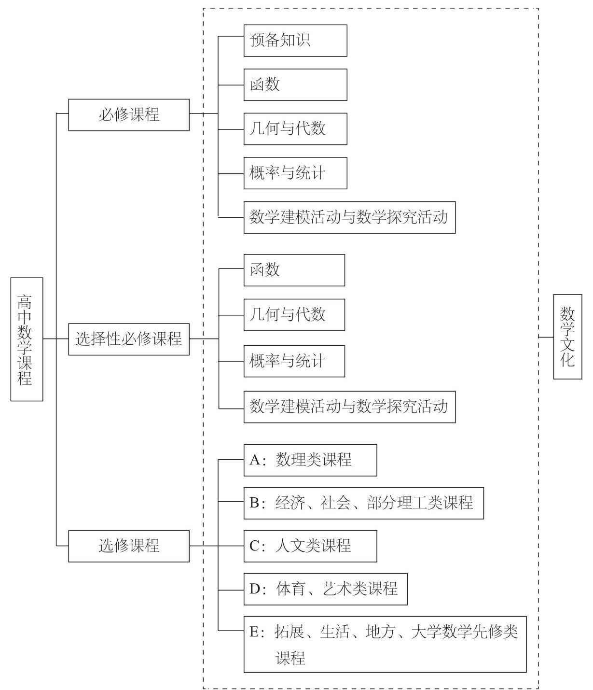

说明:数学文化是指数学的思想、精神、语言、方法、观点，以及它们的形成和发展; 还包括数学在人类生活、科学技术、社会发展中的贡献和意义, 以及与数学相关的人文活动。

## (三) 学分与选课

## 1. 学分设置

必修课程 8 学分，选择性必修课程 6 学分，选修课程 6 学分。

选修课程的分类、内容及学分如下。

A 类课程包括微积分、空间向量与代数、概率与统计三个专题, 其中微积分 2.5 学分，空间向量与代数 2 学分，概率与统计 1.5 学分。供有志于学习数理类(如数学、物理、计算机、精密仪器等)专业的学生选择。

B 类课程包括微积分、空间向量与代数、应用统计、模型四个专题, 其中微积分 2 学分, 空间向量与代数 1 学分, 应用统计 2 学分, 模型 1 学分。供有志于学习经济、社会类(如数理经济、社会学等)和部分理工类 (如化学、生物、机械等) 专业的学生选择。

C 类课程包括逻辑推理初步、数学模型、社会调查与数据分析三个专题，每个专题 2 学分。供有志于学习人文类(如语言、历史等)专业的学生选择。

D 类课程包括美与数学、音乐中的数学、美术中的数学、体育运动中的数学四个专题, 每个专题 1 学分。供有志于学习体育、艺术(包括音乐、美术)类等专业的学生选择。

E 类课程包括拓展视野、日常生活、地方特色的数学课程, 还包括大学数学的先修课程等。大学数学先修课程包括三个专题:微积分、解析几何与线性代数、概率论与数理统计, 每个专题 6 学分。

## 2. 课程定位

必修课程为学生发展提供共同基础, 是普通高中学业水平考试 (简称 “学业水平考试”) 和普通高等学校招生全国统一考试(简称 “高考”) 的内容要求。

选择性必修课程是供学生选择的课程, 是高考的内容要求。

选修课程为学生确定发展方向提供引导，为学生展示数学才能提供平台, 为学生发展数学兴趣提供选择, 为普通高等学校(简称 “高等学校”)招生提供参考。

## 3. 选课说明

如果学生以高中毕业为目标，需要完成必修课程的学习，参加数学学业水平考试。

如果学生以进入高等学校为目标，需要完成必修课程和选择性必修课程的学习，参加数学高考。

如果学生在上述选择的基础上，还希望多学习一些数学课程，可以在选择性必修课程或选修课程中, 根据自身未来发展的需求进行选择。

在选修课程中可以选择某一类课程, 例如, A 类课程; 也可以选择某类课程中的某个专题,例如, E 类课程的大学数学先修课程中的微积分; 还可以选择某些专题的组合, 例如, D 类课程中的美与数学、C 类课程中的社会调查与数据分析等。

## 五、课程内容

## (一) 必修课程

必修课程包括五个主题, 分别是预备知识、函数、几何与代数、概率与统计、数学建模活动与数学探究活动。数学文化融入课程内容。

必修课程共 8 学分 144 课时, 表 1 给出了课时分配建议, 教材编写、教学实施时可以根据实际作适当调整。

表 1 必修课程课时分配建议表

<table><tr><td>主题</td><td>单元</td><td>建议课时</td></tr><tr><td rowspan="4">主题一预备知识</td><td>集合</td><td rowspan="4">18</td></tr><tr><td>常用逻辑用语</td></tr><tr><td>相等关系与不等关系</td></tr><tr><td>从函数观点看一元二次方程和一元二次不等式</td></tr><tr><td rowspan="4">主题二函数</td><td>函数概念与性质</td><td rowspan="4">52</td></tr><tr><td>幂函数、指数函数、对数函数</td></tr><tr><td>三角函数</td></tr><tr><td>函数应用</td></tr></table>

续表

<table><tr><td>主题</td><td>单元</td><td>建议课时</td></tr><tr><td rowspan="3">主题三几何与代数</td><td>平面向量及其应用</td><td rowspan="3">42</td></tr><tr><td>复数</td></tr><tr><td>立体几何初步</td></tr><tr><td rowspan="2">主题四概率与统计</td><td>概率</td><td rowspan="2">20</td></tr><tr><td>统计</td></tr><tr><td>主题五数学建模活动与数学探究活动</td><td>数学建模活动与数学探究活动</td><td>6</td></tr><tr><td colspan="2">机动</td><td>6</td></tr></table>

## 主题一 预备知识

预备知识以义务教育阶段数学课程内容为载体, 结合集合、常用逻辑用语、相等关系与不等关系、从函数观点看一元二次方程和一元二次不等式等内容的学习, 为高中数学课程做好学习心理、学习方式和知识技能等方面的准备, 帮助学生完成初高中数学学习的过渡。

## 【内容要求】

内容包括:集合、常用逻辑用语、相等关系与不等关系、从函数观点看一元二次方程和一元二次不等式。

## 1. 集合

集合是刻画一类事物的语言和工具。本单元的学习, 可以帮助学生使用集合的语言简洁、准确地表述数学的研究对象, 学会用数学的语言表达和交流, 积累数学抽象的经验。

内容包括: 集合的概念与表示、集合的基本关系、集合的基本运算。

(1)集合的概念与表示

①通过实例，了解集合的含义，理解元素与集合的属于关系。

②针对具体问题，能在自然语言和图形语言的基础上，用符号语言刻画集合。

③在具体情境中，了解全集与空集的含义。

(2)集合的基本关系

理解集合之间包含与相等的含义，能识别给定集合的子集。

(3)集合的基本运算

①理解两个集合的并集与交集的含义，能求两个集合的并集与交集。

②理解在给定集合中一个子集的补集的含义，能求给定子集的补集。

③能使用 Venn 图表达集合的基本关系与基本运算，体会图形对理解抽象概念的作用。

## 2. 常用逻辑用语

常用逻辑用语是数学语言的重要组成部分, 是数学表达和交流的工具, 是逻辑思维的基本语言。本单元的学习, 可以帮助学生使用常用逻辑用语表达数学对象、进行数学推理, 体会常用逻辑用语在表述数学内容和论证数学结论中的作用，提高交流的严谨性与准确性。

内容包括:必要条件、充分条件、充要条件，全称量词与存在量词, 全称量词命题与存在量词命题的否定。

(1)必要条件、充分条件、充要条件

①通过对典型数学命题的梳理，理解必要条件的意义，理解性质定理与必要条件的关系。

②通过对典型数学命题的梳理，理解充分条件的意义，理解判定定理与充分条件的关系。

③通过对典型数学命题的梳理，理解充要条件的意义，理解数学定义与充要条件的关系。

(2)全称量词与存在量词

通过已知的数学实例, 理解全称量词与存在量词的意义。

(3)全称量词命题与存在量词命题的否定

①能正确使用存在量词对全称量词命题进行否定。

②能正确使用全称量词对存在量词命题进行否定。

## 3. 相等关系与不等关系

相等关系、不等关系是数学中最基本的数量关系, 是构建方程、不等式的基础。本单元的学习, 可以帮助学生通过类比, 理解等式和不等式的共性与差异, 掌握基本不等式。

内容包括:等式与不等式的性质、基本不等式。

(1)等式与不等式的性质

梳理等式的性质, 理解不等式的概念, 掌握不等式的性质。

(2)基本不等式

掌握基本不等式 $\sqrt{ab} \leq  \frac{a + b}{2}\left( {a, b \geq  0}\right)$ 。结合具体实例,能用基本不等式解决简单的最大值或最小值问题。

## 4. 从函数观点看一元二次方程和一元二次不等式

用函数理解方程和不等式是数学的基本思想方法。本单元的学习, 可以帮助学生用一元二次函数认识一元二次方程和一元二次不等式。通过梳理初中数学的相关内容, 理解函数、方程和不等式之间的联系, 体会数学的整体性。

内容包括:从函数观点看一元二次方程、从函数观点看一元二次不等式。

(1)从函数观点看一元二次方程

会结合一元二次函数的图象, 判断一元二次方程实根的存在性及实根的个数, 了解函数的零点与方程根的关系。

(2)从函数观点看一元二次不等式

①经历从实际情境中抽象出一元二次不等式的过程，了解一元二次不等式的现实意义。能借助一元二次函数求解一元二次不等式, 并能用集合表示一元二次不等式的解集。

②借助一元二次函数的图象，了解一元二次不等式与相应函数、方程的联系 (参见案例 1)。

## 【教学提示】

初中阶段数学知识相对具体, 高中阶段数学知识相对抽象。教师应针对这一特征帮助学生完成从初中到高中数学学习的过渡, 包括学习心理、学习方式等方面。

在集合、常用逻辑用语的教学中, 教师应创设合适的教学情境, 以义务教育阶段学过的数学内容为载体, 引导学生用集合语言和常用逻辑用语梳理、表达学过的相应数学内容。应引导学生理解属于关系可以定义集合的基本关系,了解元素 $a$ 与由元素 $a$ 组成的集合 $\{ a\}$ 的差异, 即 $a \in  \{ a\} , a$ 与 $\{ a\}$ 不相同。在梳理过程中,可以针对学生的实际布置不同的任务, 采用自主学习与合作学习相结合的方式组织教学活动。

在相等关系与不等关系的教学中, 应引导学生通过类比学过的等式与不等式的性质, 进一步探索等式与不等式的共性与差异。

在从函数观点看一元二次方程和一元二次不等式的教学中, 可以先以讨论具体的一元二次函数变化情况为情境, 引导学生发现一元二次函数与一元二次方程的关系, 引出一元二次不等式概念; 然后进一步引导学生探索一般的一元二次函数与一元二次方程、一元二次不等式的关系, 归纳总结出用一元二次函数解一元二次不等式的程序。

教学中, 要根据内容的定位和教育价值, 关注数学学科核心素养的培养。要让学生逐渐养成借助直观理解概念、进行逻辑推理的思维习惯, 以及独立思考、合作交流的学习习惯, 引导学生感悟高中阶段数学课程的特征, 适应高中阶段的数学学习。

## 【学业要求】

能够在现实情境或数学情境中, 概括出数学对象的一般特征, 并用集合语言予以表达。初步学会用三种语言 (自然语言、图形语言、符号语言)表达数学研究对象，并能进行转换。理解集合的基本关系与基本运算。

能够借助常用逻辑用语进行数学表达、论证和交流，体会常用逻辑用语在数学中的作用。

能够从函数观点认识一元二次方程和一元二次不等式, 感悟数学知识之间的关联，认识函数的重要性。掌握等式与不等式的性质。

重点提升数学抽象、逻辑推理和数学运算素养。

## 主题二 函数

函数是现代数学最基本的概念, 是描述客观世界中变量关系和规律的最为基本的数学语言和工具, 在解决实际问题中发挥重要作用。函数是贯穿高中数学课程的主线。

## 【内容要求】

内容包括:函数概念与性质，幂函数、指数函数、对数函数，三角函数, 函数应用。

## 1. 函数概念与性质

本单元的学习, 可以帮助学生建立完整的函数概念, 不仅把函数理解为刻画变量之间依赖关系的数学语言和工具, 也把函数理解为实数集合之间的对应关系; 能用代数运算和函数图象揭示函数的主要性质; 在现实问题中, 能利用函数构建模型, 解决问题。

内容包括:函数概念、函数性质、*函数的形成与发展(标有*的内容均为选学内容, 不作为考试要求)。

(1)函数概念

①在初中用变量之间的依赖关系描述函数的基础上，用集合语言和对应关系刻画函数，建立完整的函数概念(参见案例 2)，体会集合语言和对应关系在刻画函数概念中的作用。了解构成函数的要素, 能求简单函数的定义域。

②在实际情境中，会根据不同的需要选择恰当的方法 (如图象法、 列表法、解析法等)表示函数，理解函数图象的作用。

③通过具体实例，了解简单的分段函数，并能简单应用。

(2)函数性质

①借助函数图象，会用符号语言表达函数的单调性、最大(小)值， 理解它们的作用和实际意义。

②结合具体函数，了解奇偶性的概念和几何意义。

③结合三角函数，了解周期性的概念和几何意义。

(3)* 函数的形成与发展

收集、阅读函数的形成与发展的历史资料，撰写小论文，论述函数发展的过程、重要结果、主要人物、关键事件及其对人类文明的贡献。

## 2. 幂函数、指数函数、对数函数

幂函数、指数函数与对数函数是最基本的、应用最广泛的函数, 是进一步学习数学的基础。本单元的学习, 可以帮助学生学会用函数图象和代数运算的方法研究这些函数的性质; 理解这些函数中所蕴含的运算规律; 运用这些函数建立模型, 解决简单的实际问题, 体会这些函数在解决实际问题中的作用。

内容包括:幂函数、指数函数、对数函数。

(1)幂函数

通过具体实例,结合 $y = x, y = \frac{1}{x}, y = {x}^{2}, y = \sqrt{x}, y = {x}^{3}$ 的图象, 理解它们的变化规律, 了解幂函数。

(2)指数函数

①通过对有理数指数幂 ${a}^{\frac{m}{n}}\left( {a > 0\text{,且}a \neq  1;m, n \in  \mathbf{Z}\text{,且}n \neq  0}\right)$ 、 实数指数幂 ${a}^{x}\left( {a > 0\text{,且}a \neq  1;x \in  \mathbf{R}}\right)$ 含义的认识,了解指数幂的拓展过程, 掌握指数幂的运算性质。

②通过具体实例，了解指数函数的实际意义，理解指数函数的概念。

③能用描点法或借助计算工具画出具体指数函数的图象，探索并理解指数函数的单调性与特殊点。

(3)对数函数

①理解对数的概念和运算性质，知道用换底公式能将一般对数转化成自然对数或常用对数。

②通过具体实例，了解对数函数的概念。能用描点法或借助计算工具画出具体对数函数的图象，探索并了解对数函数的单调性与特殊点。

③知道对数函数 $y = {\log }_{a}x$ 与指数函数 $y = {a}^{x}$ 互为反函数( $a > 0$ ，且 $a \neq  1)$ 。

④ * 收集、阅读对数概念的形成与发展的历史资料，撰写小论文， 论述对数发明的过程以及对数对简化运算的作用。

## 3. 三角函数

三角函数是一类最典型的周期函数。本单元的学习, 可以帮助学生在用锐角三角函数刻画直角三角形中边角关系的基础上, 借助单位圆建立一般三角函数的概念, 体会引入弧度制的必要性; 用几何直观和代数运算的方法研究三角函数的周期性、奇偶性 (对称性)、单调性和最大 (小) 值等性质; 探索和研究三角函数之间的一些恒等关系; 利用三角函数构建数学模型, 解决实际问题。

内容包括:角与弧度、三角函数概念和性质、同角三角函数的基本关系式、三角恒等变换、三角函数应用。

(1)角与弧度

了解任意角的概念和弧度制, 能进行弧度与角度的互化, 体会引入弧度制的必要性 (参见案例 3)。

(2)三角函数概念和性质

①借助单位圆理解三角函数(正弦函数、余弦函数、正切函数)的定义, 能画出这些三角函数的图象, 了解三角函数的周期性、单调性、 奇偶性、最大 (小) 值。借助单位圆的对称性, 利用定义推导出诱导公式 $\left( {\alpha  \pm  \frac{\pi }{2},\alpha  \pm  \pi }\right.$ 的正弦、余弦、正切)。

②借助图象理解正弦函数、余弦函数在 $\left\lbrack  {0,{2\pi }}\right\rbrack$ 上，正切函数在 $\left( {-\frac{\pi }{2},\frac{\pi }{2}}\right)$ 上的性质。

③ 结合具体实例，了解 $y = A\sin \left( {{\omega x} + \varphi }\right) \;\left( {A \neq  0,\omega  \neq  0}\right)$ 的实际意义; 能借助图象理解参数 $\omega ,\varphi , A$ 的意义,了解参数的变化对函数图象的影响。

(3)同角三角函数的基本关系式: ${\sin }^{2}x + {\cos }^{2}x = 1,\frac{\sin x}{\cos x} =$

理解同角三角函数的基本关系式: ${\sin }^{2}x + {\cos }^{2}x = 1$ , $\frac{\sin x}{\cos x} = \; \tan x$ 。

(4)三角恒等变换

①经历推导两角差余弦公式的过程，知道两角差余弦公式的意义。

②能从两角差的余弦公式推导出两角和与差的正弦、余弦、正切公式, 二倍角的正弦、余弦、正切公式, 了解它们的内在联系。

③能运用上述公式进行简单的恒等变换(包括推导出积化和差、和差化积、半角公式, 这三组公式不要求记忆)。

(5)三角函数应用

会用三角函数解决简单的实际问题, 体会可以利用三角函数构建刻画事物周期变化的数学模型 (参见案例 4)。

## 4. 函数应用

函数应用不仅体现在用函数解决数学问题, 更重要的是用函数解决实际问题。本单元的学习, 可以帮助学生掌握运用函数性质求方程近似解的基本方法 (二分法); 理解用函数构建数学模型的基本过程; 运用模型思想发现和提出问题、分析和解决问题。

内容包括:二分法与求方程近似解、函数与数学模型。

(1)二分法与求方程近似解

①结合学过的函数图象，了解函数零点与方程解的关系。

②结合具体连续函数及其图象的特点，了解函数零点存在定理，探索用二分法求方程近似解的思路并会画程序框图, 能借助计算工具用二分法求方程近似解, 了解用二分法求方程近似解具有一般性。

(2)函数与数学模型

①理解函数模型是描述客观世界中变量关系和规律的重要数学语言和工具。在实际情境中, 会选择合适的函数类型刻画现实问题的变化规律。

②结合现实情境中的具体问题，利用计算工具，比较对数函数、一元一次函数、指数函数增长速度的差异，理解“对数增长”“直线上升” “指数爆炸”等术语的现实含义。

③收集、阅读一些现实生活、生产实际或者经济领域中的数学模型， 体会人们是如何借助函数刻画实际问题的, 感悟数学模型中参数的现实意义。

## 【教学提示】

教师应把本主题的内容视为一个整体, 引导学生从变量之间的依赖关系、实数集合之间的对应关系、函数图象的几何直观等角度整体认识函数概念; 通过梳理函数的单调性、周期性、奇偶性 (对称性)、最大 (小) 值等，认识函数的整体性质；经历运用函数解决实际问题的全过程。

函数概念的引入，可以用学生熟悉的例子为背景进行抽象。例如， 可以从学生已知的、基于变量关系的函数定义入手，引导学生通过生活或数学中的问题, 构建函数的一般概念, 体会用对应关系定义函数的必要性，感悟数学抽象的层次。

函数单调性的教学，要引导学生正确使用符号语言清晰地刻画函数的性质 (参见案例 5)。在函数定义域、值域以及函数性质的教学过程中, 应避免编制偏题、怪题, 避免烦琐的技巧训练。

指数函数的教学, 应关注指数函数的运算法则和变化规律, 引导学生经历从整数指数幂到有理数指数幂, 再到实数指数幂的拓展过程, 掌握指数函数的运算法则和变化规律。

对数函数的教学，应通过比较同底数的指数函数和对数函数(例如, $y = {2}^{x}$ 和 $y = {\log }_{2}x$ ),认识它们互为反函数。

三角函数的教学, 应发挥单位圆的作用, 引导学生结合实际情境, 借助单位圆的直观，探索三角函数的有关性质 (参见案例 6)。在三角恒等变换的教学中, 可以采用不同的方式得到三角恒等变换基本公式; 也可以在向量的学习中, 引导学生利用向量的数量积推导出两角差的余弦公式。

函数应用的教学, 要引导学生理解如何用函数描述客观世界事物的变化规律，体会幂函数、指数函数、对数函数、三角函数等函数与现实世界的密切联系(参见案例 7)。

鼓励学生运用信息技术学习、探索和解决问题。例如, 利用计算器、计算机画出幂函数、指数函数、对数函数、三角函数等的图象, 探索、比较它们的变化规律, 研究函数的性质, 求方程的近似解等 (参见案例 8)。

可以组织学生收集、阅读函数的形成与发展的历史资料，结合内容撰写报告，论述函数发展的过程、重要结果、主要人物、关键事件及其对人类文明的贡献。

## 【学业要求】

能够从两个变量之间的依赖关系、实数集合之间的对应关系、函数图象的几何直观等多个角度, 理解函数的意义与数学表达; 理解函数符号表达与抽象定义之间的关联, 知道函数抽象概念的意义。

能够理解函数的单调性、最大 (小) 值, 了解函数的奇偶性、周期性；理解一些基本函数类(如一元一次函数、反比例函数、一元二次函数、幂函数、指数函数、对数函数、三角函数等)的背景、概念和性质; 能从整体的角度探索具体函数模型和一般函数的性质和应用。

能够对简单的实际问题, 选择适当的函数构建数学模型, 解决问题; 能够从函数观点认识方程, 并运用函数的性质求方程的近似解; 能够从函数观点认识不等式, 并运用函数的性质解不等式。具有用函数分析事物的意识。

重点提升数学抽象、数学建模、数学运算、直观想象和逻辑推理素养。

## 主题三 几何与代数

几何与代数是高中数学课程的主线之一。在必修课程与选择性必修课程中, 突出几何直观与代数运算之间的融合, 即通过形与数的结合, 感悟数学知识之间的关联, 加强对数学整体性的理解。

## 【内容要求】

内容包括:平面向量及其应用、复数、立体几何初步。

## 1. 平面向量及其应用

向量理论具有深刻的数学内涵和丰富的物理背景。向量既是代数研究对象, 也是几何研究对象, 是沟通几何与代数的桥梁。向量是描述直线、曲线、平面、曲面以及高维空间数学问题的基本工具, 是进一步学习和研究其他数学领域问题的基础, 在解决实际问题中发挥重要作用。

本单元的学习，可以帮助学生理解平面向量的几何意义和代数意义；掌握平面向量的概念、运算、向量基本定理以及向量的应用; 用向量语言、方法表述和解决现实生活、数学和物理中的问题。

内容包括:向量概念、向量运算、向量基本定理及坐标表示、向量应用与解三角形。

(1)向量概念

①通过对力、速度、位移等的分析，了解平面向量的实际背景，理解平面向量的意义和两个向量相等的含义。

②理解平面向量的几何表示和基本要素。

(2)向量运算

①借助实例和平面向量的几何表示，掌握平面向量加、减运算及运算规则, 理解其几何意义。

②通过实例分析，掌握平面向量数乘运算及运算规则，理解其几何意义。理解两个平面向量共线的含义。

③了解平面向量的线性运算性质及其几何意义。

④通过物理中功等实例，理解平面向量数量积的概念及其物理意义, 会计算平面向量的数量积。

⑤通过几何直观，了解平面向量投影的概念以及投影向量的意义 (参见案例 9)。

⑥会用数量积判断两个平面向量的垂直关系。

(3)向量基本定理及坐标表示

①掌握平面向量基本定理。

②借助平面直角坐标系，掌握平面向量的正交分解及坐标表示。

③会用坐标表示平面向量的加、减运算与数乘运算。

④能用坐标表示平面向量的数量积，会表示两个平面向量的夹角。

⑤能用坐标表示平面向量共线、垂直。

(4)向量应用与解三角形

①会用向量方法解决简单的平面几何问题、力学问题以及其他实际问题, 体会向量在解决数学和实际问题中的作用。

②借助向量的运算，探索三角形边长与角度的关系，掌握余弦定理、正弦定理。

③能用余弦定理、正弦定理解决简单的实际问题。

## 2. 复数

复数是一类重要的运算对象, 有广泛的应用。本单元的学习, 可以帮助学生通过方程求解等, 理解引入复数的必要性, 了解数系的扩充, 掌握复数的表示、运算及其几何意义。

内容包括:复数的概念、复数的运算、* 复数的三角表示。

(1)复数的概念

①通过方程的解，认识复数。

②理解复数的代数表示及其几何意义，理解两个复数相等的含义。

(2)复数的运算

掌握复数代数表示式的四则运算，了解复数加、减运算的几何意义。

(3)* 复数的三角表示

通过复数的几何意义, 了解复数的三角表示, 了解复数的代数表示与三角表示之间的关系, 了解复数乘、除运算的三角表示及其几何意义。

## 3. 立体几何初步

立体几何研究现实世界中物体的形状、大小与位置关系。本单元的学习，可以帮助学生以长方体为载体，认识和理解空间点、直线、平面的位置关系; 用数学语言表述有关平行、垂直的性质与判定, 并对某些结论进行论证; 了解一些简单几何体的表面积与体积的计算方法; 运用直观感知、操作确认、推理论证、度量计算等认识和探索空间图形的性质, 建立空间观念。

内容包括:基本立体图形、基本图形位置关系、* 几何学的发展。

(1)基本立体图形

①利用实物、计算机软件等观察空间图形，掌握柱、锥、台、球及简单组合体的结构特征, 能运用这些特征描述现实生活中简单物体的结构。

②知道棱柱、棱锥、棱台、球的表面积和体积的计算公式, 能用公式解决简单的实际问题。

③能用斜二测法画出简单空间图形(长方体、球、圆柱、圆锥、棱柱及其简单组合体) 的直观图。

(2)基本图形位置关系

①借助长方体，在直观认识空间点、直线、平面的位置关系的基础上，抽象出空间点、直线、平面的位置关系的定义，了解以下基本事实和定理, 基本事实 1~4 也称为公理。

基本事实 1: 过不在一条直线上的三个点, 有且只有一个平面。

基本事实 2:如果一条直线上的两个点在一个平面内，那么这条直线在这个平面内。

基本事实 3:如果两个不重合的平面有一个公共点，那么它们有且只有一条过该点的公共直线。

基本事实 4:平行于同一条直线的两条直线平行。

定理: 如果空间中两个角的两条边分别对应平行, 那么这两个角相等或互补。

②从上述定义和基本事实出发，借助长方体，通过直观感知，了解空间中直线与直线、直线与平面、平面与平面的平行和垂直的关系, 归纳出以下性质定理, 并加以证明。

一条直线与一个平面平行, 如果过该直线的平面与此平面相交, 那么该直线与交线平行。

两个平面平行, 如果另一个平面与这两个平面相交, 那么两条交线平行。

垂直于同一个平面的两条直线平行。

两个平面垂直, 如果一个平面内有一条直线垂直于这两个平面的交线, 那么这条直线与另一个平面垂直。

③从上述定义和基本事实出发，借助长方体，通过直观感知，了解空间中直线与直线、直线与平面、平面与平面的平行和垂直的关系, 归纳出以下判定定理。

如果平面外一条直线与此平面内的一条直线平行, 那么该直线与此平面平行。

如果一个平面内的两条相交直线与另一个平面平行, 那么这两个平面平行。

如果一条直线与一个平面内的两条相交直线垂直, 那么该直线与此平面垂直。

如果一个平面过另一个平面的垂线, 那么这两个平面垂直。

④能用已获得的结论证明空间基本图形位置关系的简单命题。

(3)* 几何学的发展

收集、阅读几何学发展的历史资料，撰写小论文，论述几何学发展的过程、重要结果、主要人物、关键事件及其对人类文明的贡献。

## 【教学提示】

在平面向量及其应用的教学中, 应从力、速度、位移等实际情境入手，从物理、几何、代数三个角度理解向量的概念与运算法则，引导学生运用类比的方法探索实数运算与向量运算的共性与差异。可以通过力的分解引出向量基本定理, 建立基的概念和向量的坐标表示。可以引导学生运用向量解决一些物理和几何问题。例如, 利用向量计算力使物体沿某方向运动所做的功, 利用向量解决与平面内两条直线平行或垂直有关的问题等。对于向量的非正交分解只要求学生一般了解, 不必展开。

在复数的教学中, 应注重对复数的表示及几何意义的理解, 避免烦琐的计算与技巧训练。对于学有余力的学生, 可以安排一些引申内容,

如复数的三角表示等。可以适当融入数学文化，让学生体会数系扩充过程中理性思维的作用(参见案例 10)。

立体几何初步的教学重点是帮助学生逐步形成空间观念, 应遵循从整体到局部、从具体到抽象的原则, 提供丰富的实物模型或利用计算机软件呈现空间几何体, 帮助学生认识空间几何体的结构特征, 进一步掌握在平面上表示空间图形的方法和技能。通过对图形的观察和操作, 引导学生发现和提出描述基本图形平行、垂直关系的命题, 逐步学会用准确的数学语言表达这些命题，直观解释命题的含义和表述证明的思路， 并证明其中一些命题; 对相应的判定定理只要求直观感知、操作确认, 在选择性必修课程中将用向量方法对这些定理加以论证。

可以使用信息技术展示空间图形, 为理解和掌握图形几何性质 (包括证明) 提供直观。教师可以指导和帮助学生选择一些立体几何问题作为数学探究活动的课题 (参见案例 11)。

可以组织学生收集、阅读几何学发展的历史资料，结合内容撰写报告，论述几何学发展过程中的重要结果、主要人物、关键事件及其对人类文明的贡献。

## 【学业要求】

能够从多种角度掌握向量概念和运算法则, 掌握向量基本定理; 能够运用向量运算解决简单的几何和物理问题, 知道数学运算与逻辑推理的关系。

能够理解复数的概念, 掌握复数代数表示式的四则运算。

能够通过直观图理解空间图形, 掌握基本空间图形及其简单组合体的概念和基本特征, 解决简单的实际问题。能够运用图形的概念描述图形的基本关系和基本结果。能够证明简单的几何命题 (平行、垂直的性质定理), 并会进行简单应用。

能够运用向量运算、推理论证等思想方法探索图形的位置关系和度量关系, 能够通过数形结合建立几何与代数的联系。 重点提升直观想象、逻辑推理、数学运算和数学抽象素养。

## 主题四 概率与统计

概率的研究对象是随机现象, 为人们从不确定性的角度认识客观世界提供重要的思维模式和解决问题的方法。统计的研究对象是数据, 核心是数据分析。概率为统计的发展提供理论基础。

## 【内容要求】

内容包括:概率、统计。

## 1. 概率

本单元的学习，可以帮助学生结合具体实例，理解样本点、有限样本空间、随机事件，会计算古典概型中简单随机事件的概率，加深对随机现象的认识和理解。

内容包括:随机事件与概率、随机事件的独立性。

(1)随机事件与概率

①结合具体实例，理解样本点和有限样本空间的含义，理解随机事件与样本点的关系(参见案例 12)。了解随机事件的并、交与互斥的含义, 能结合实例进行随机事件的并、交运算。

②结合具体实例，理解古典概型，能计算古典概型中简单随机事件的概率。

③通过实例，理解概率的性质，掌握随机事件概率的运算法则。

④结合实例，会用频率估计概率。

(2)随机事件的独立性

结合有限样本空间, 了解两个随机事件独立性的含义。结合古典概型, 能利用独立性计算概率。

## 2. 统计

本单元的学习, 可以帮助学生进一步学习数据收集和整理的方法、 数据直观图表的表示方法、数据统计特征的刻画方法; 通过具体实例, 感悟在实际生活中进行科学决策的必要性和可能性; 体会统计思维与确定性思维的差异、归纳推断与演绎证明的差异; 通过实际操作、计算机模拟等活动, 积累数据分析的经验。

内容包括:获取数据的基本途径及相关概念、抽样、统计图表、用样本估计总体。

(1)获取数据的基本途径及相关概念

①知道获取数据的基本途径，包括:统计报表和年鉴、社会调查、 试验设计、普查和抽样、互联网等。

②了解总体、样本、样本量的概念，了解数据的随机性。

(2)抽样

①简单随机抽样

通过实例, 了解简单随机抽样的含义及其解决问题的过程, 掌握两种简单随机抽样方法: 抽签法和随机数法。会计算样本均值和样本方差, 了解样本与总体的关系。

②分层随机抽样

通过实例, 了解分层随机抽样的特点和适用范围, 了解分层随机抽样的必要性, 掌握各层样本量比例分配的方法。结合具体实例, 掌握分层随机抽样的样本均值和样本方差 (参见案例 13)。

③抽样方法的选择

在简单的实际情境中, 能根据实际问题的特点, 设计恰当的抽样方法解决问题。

(3)统计图表

能根据实际问题的特点, 选择恰当的统计图表 (如频数分布直方图、频率分布直方图、散点图等) 对数据进行可视化描述, 体会合理使用统计图表的重要性。

(4)用样本估计总体

①结合实例，能用样本估计总体的集中趋势参数(平均数、中位数、众数), 理解集中趋势参数的统计含义。

②结合实例，能用样本估计总体的离散程度参数(标准差、方差、 极差), 理解离散程度参数的统计含义。

③结合实例，能用样本估计总体的取值规律。

④结合实例，能用样本估计百分位数，理解百分位数的统计含义 (参见案例 14)。

## 【教学提示】

在概率的教学中, 应引导学生通过日常生活中的实例了解随机事件与概率的意义。在随机事件和样本空间的教学中, 应引导学生通过古典概型, 认识样本空间, 理解随机事件发生的含义; 理解古典概型的特征:试验结果的有限性和每一个试验结果出现的等可能性, 知道只有在这种特征下, 才能定义出古典概型中随机事件发生的概率。教学中要适当介绍基本计数方法 (如树状图、列表等), 计算古典概型中随机事件发生的概率。

在统计的教学中, 应引导学生根据实际问题的需求, 选择不同的抽样方法获取数据, 理解数据蕴含的信息; 根据数据分析的需求, 选择适当的统计图表描述和表达数据, 并从样本数据中提取需要的数字特征, 估计总体的统计规律, 解决相应的实际问题。对统计中的基本概念 (如总体、样本、样本量等), 应结合具体问题进行描述性说明, 在此基础上适当引入严格的定义, 并利用数字特征 (如平均值、方差等) 和数据直观图表 (如频数分布直方图、频率分布直方图、散点图等) 进行数据分析。

统计的教学活动应通过典型案例进行。教学中应通过对一些典型案例的处理, 使学生经历较为系统的数据处理全过程, 在此过程中学习数据分析的方法, 理解数据分析的思路, 运用所学知识和方法解决实际问题。

可以鼓励学生尽可能利用计算器、计算机进行模拟活动, 处理数据, 更好地体会概率的意义和统计思想。例如, 利用计算器产生随机数来模拟掷硬币试验等, 利用计算机来计算样本量较大的数据的样本均值、样本方差等。

## 【学业要求】

能够掌握古典概型的基本特征, 根据实际问题构建概率模型, 解决简单的实际问题。能够借助古典概型初步认识有限样本空间、随机事件, 以及随机事件的概率。

能够根据实际问题的需求, 选择恰当的抽样方法获取样本数据, 并从中提取需要的数字特征推断总体。能够正确运用数据分析的方法解决简单的实际问题。

具有运用随机思想进行数据分析的意识。能够区别统计思维与确定性思维的差异、归纳推断与演绎证明的差异。能够结合具体问题, 理解统计推断结果的或然性, 正确运用统计结果解释实际问题。

重点提升数据分析、数学建模、逻辑推理和数学运算素养。

## 主题五 数学建模活动与数学探究活动

## 【内容要求】

数学建模活动是对现实问题进行数学抽象, 用数学语言表达问题、 用数学方法构建模型解决问题的过程。主要包括: 在实际情境中从数学的视角发现问题、提出问题, 分析问题、建立模型, 确定参数、计算求解, 检验结果、改进模型, 最终解决实际问题。数学建模活动是基于数学思维运用模型解决实际问题的一类综合实践活动, 是高中阶段数学课程的重要内容。 数学建模活动的基本过程如下:

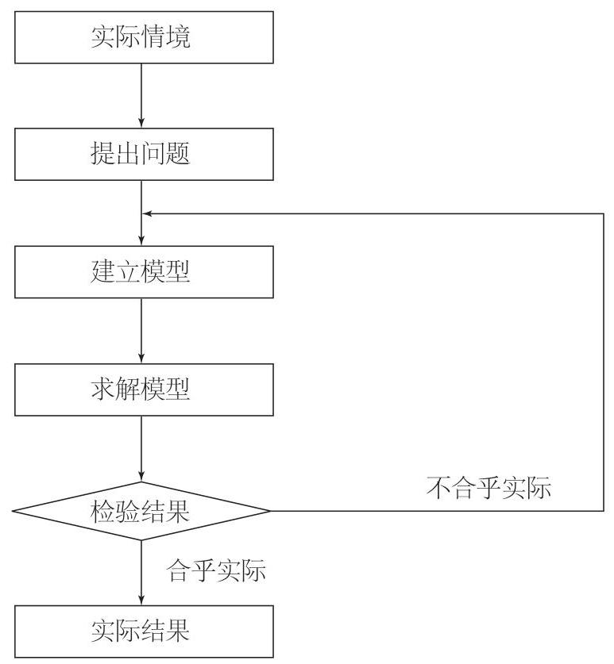

数学探究活动是围绕某个具体的数学问题, 开展自主探究、合作研究并最终解决问题的过程。具体表现为: 发现和提出有意义的数学问题, 猜测合理的数学结论, 提出解决问题的思路和方案, 通过自主探索、合作研究论证数学结论。数学探究活动是运用数学知识解决数学问题的一类综合实践活动, 是高中阶段数学课程的重要内容。

数学建模活动与数学探究活动以课题研究的形式开展。在必修课程中, 要求学生完成其中的一个课题研究。

## 【教学提示】

教师要指导学生经历数学建模活动与数学探究活动的全过程(参见案例 15)。包括: 指导学生确定研究课题, 组织学生建立课题研究小组 (2~3 人为宜)；指导学生撰写开题报告，组织学生开展开题交流活动， 进一步完善解决问题的思路; 指导学生开展课题研究, 帮助学生克服解决问题过程中碰到的困难, 解决问题, 得到初步的结果; 指导学生撰写

研究报告(参见案例 15)，组织结题活动。在数学建模活动与数学探究活动过程中, 教师要引导学生遵守学术规范, 坚守诚信底线。

## 【学业要求】

学生应在教师指导下确定研究课题, 参与课题研究的全过程: 选题、开题、做题和结题。学生要学会撰写开题报告, 开题报告应包括选题意义、文献综述、解决问题思路、研究计划、预期结果等。经历解决问题的过程, 包括描述问题、数学表达、建立模型、求解模型、得到结论、反思完善等。学生要撰写研究报告, 积极参与教师组织的结题答辩。根据选题的内容, 报告可以采用专题作业、测量报告、算法程序、 制作的实物、研究报告或小论文等多种形式。(参见案例 16)

重点提升数学建模、数学抽象、数据分析、数学运算、逻辑推理和直观想象素养。

## (二) 选择性必修课程

选择性必修课程包括四个主题，分别是函数、几何与代数、概率与统计、数学建模活动与数学探究活动。数学文化融入课程内容。

选择性必修课程共 6 学分 108 课时，表 2 给出了课时分配建议，教材编写、教学实施时可以根据实际作适当调整。

表 2 选择性必修课程课时分配建议表

<table><tr><td>主题</td><td>单元</td><td>建议课时</td></tr><tr><td rowspan="2">主题一   函数</td><td>数列</td><td rowspan="2">30</td></tr><tr><td>一元函数导数及其应用</td></tr><tr><td rowspan="2">主题二   几何与代数</td><td>空间向量与立体几何</td><td rowspan="2">44</td></tr><tr><td>平面解析几何</td></tr></table>

续表

<table><tr><td>主题</td><td>单元</td><td>建议课时</td></tr><tr><td rowspan="3">主题三概率与统计</td><td>计数原理</td><td rowspan="3">26</td></tr><tr><td>概率</td></tr><tr><td>统计</td></tr><tr><td>主题四数学建模活动与数学探究活动</td><td>数学建模活动与数学探究活动</td><td>4</td></tr><tr><td colspan="2">机动</td><td>4</td></tr></table>

主题一 函数

在必修课程中，学生学习了函数的概念和性质，总结了研究函数的基本方法, 掌握了一些具体的基本函数类, 探索了函数的应用。在本主题中, 学生将学习数列和一元函数导数及其应用。数列是一类特殊的函数, 是数学重要的研究对象, 是研究其他类型函数的基本工具, 在日常生活中也有着广泛的应用。导数是微积分的核心内容之一, 是现代数学的基本概念, 蕴含微积分的基本思想; 导数定量地刻画了函数的局部变化, 是研究函数性质的基本工具。

## 【内容要求】

内容包括:数列、一元函数导数及其应用。

## 1. 数列

本单元的学习, 可以帮助学生通过对日常生活中实际问题的分析, 了解数列的概念; 探索并掌握等差数列和等比数列的变化规律, 建立通项公式与前 n 项和公式; 能运用等差数列、等比数列解决简单的实际问题和数学问题, 感受数学模型的现实意义与应用; 了解等差数列与一

元一次函数、等比数列与指数函数的联系, 感受数列与函数的共性与差异，体会数学的整体性。

内容包括:数列概念、等差数列、等比数列、* 数学归纳法。

(1)数列概念

通过日常生活和数学中的实例, 了解数列的概念和表示方法 (列表、图象、通项公式), 了解数列是一种特殊函数。

(2)等差数列

①通过生活中的实例，理解等差数列的概念和通项公式的意义。

②探索并掌握等差数列的前 $n$ 项和公式,理解等差数列的通项公式与前 $n$ 项和公式的关系。

③能在具体的问题情境中，发现数列的等差关系，并解决相应的问题。

④体会等差数列与一元一次函数的关系。

(3)等比数列

①通过生活中的实例，理解等比数列的概念和通项公式的意义。

②探索并掌握等比数列的前 $n$ 项和公式,理解等比数列的通项公式与前 $n$ 项和公式的关系。

③能在具体的问题情境中，发现数列的等比关系，并解决相应的问题。

④体会等比数列与指数函数的关系。

(4)* 数学归纳法

了解数学归纳法的原理, 能用数学归纳法证明数列中的一些简单命题。

## 2. 一元函数导数及其应用

本单元的学习, 可以帮助学生通过丰富的实际背景理解导数的概念, 掌握导数的基本运算, 运用导数研究函数的性质, 并解决一些实际问题。

内容包括:导数概念及其意义、导数运算、导数在研究函数中的应用、* 微积分的创立与发展。

(1)导数概念及其意义

①通过实例分析，经历由平均变化率过渡到瞬时变化率的过程，了解导数概念的实际背景, 知道导数是关于瞬时变化率的数学表达, 体会导数的内涵与思想。

②体会极限思想。

③通过函数图象直观理解导数的几何意义。

(2)导数运算

①能根据导数定义求函数 $y = c, y = x, y = {x}^{2}, y = {x}^{3}, y = \frac{1}{x}$ , $y = \sqrt{x}$ 的导数。

②能利用给出的基本初等函数的导数公式和导数的四则运算法则， 求简单函数的导数; 能求简单的复合函数 (限于形如 $f\left( {{ax} + b}\right)$ ) 的导数。

③会使用导数公式表。

(3)导数在研究函数中的应用

①结合实例，借助几何直观了解函数的单调性与导数的关系；能利用导数研究函数的单调性; 对于多项式函数, 能求不超过三次的多项式函数的单调区间。

②借助函数的图象，了解函数在某点取得极值的必要条件和充分条件；能利用导数求某些函数的极大 (小) 值、最大 (小) 值；对于多项式函数, 能求给定闭区间上不超过三次的多项式函数的最大 (小) 值; 体会导数在研究单调性、极大 (小) 值、最大 (小) 值中的作用。

(4)* 微积分的创立与发展

收集、阅读对微积分的创立和发展起重大作用的有关资料, 包括一些重要历史人物(如牛顿、莱布尼茨、柯西、魏尔斯特拉斯等)和事件, 采取独立完成或者小组合作的方式, 完成一篇有关微积分创立与发展的研究报告。

## 【教学提示】

在数列的教学中, 应引导学生通过具体实例 (如购房贷款、放射性物质的衰变、人口增长等), 理解等差数列、等比数列的概念、性质和应用；引导学生掌握数列中各个量之间的基本关系。

应特别强调数列作为一类特殊的函数在解决实际问题中的作用, 突出等差数列、等比数列的本质, 引导学生通过类比的方法探索等差数列与一元一次函数、等比数列与指数函数的联系, 加深对数列及函数概念的理解。

在教学中可以组织学生收集、阅读数列方面的研究成果, 特别是我国古代的优秀研究成果，如 “杨辉三角”、《四元玉鉴》等，撰写小论文, 论述数列发展的过程、重要结果、主要人物、关键事件及其对人类文明的贡献, 感悟我国古代数学的辉煌成就。

在一元函数导数及其应用的教学中, 应通过丰富的实际背景和具体实例引入导数的概念, 例如, 斜率、增长率、膨胀率、效率、密度、速度、加速度等；应引导学生经历由平均变化率过渡到瞬时变化率的过程, 了解导数是如何刻画瞬时变化率的, 感悟极限的思想; 应引导学生通过具体实例感受导数在研究函数和解决实际问题中的作用, 体会导数的意义。学生对导数概念的理解不可能一步到位, 导数概念的学习应该贯穿在一元函数导数及其应用学习的始终。一般地, 在高中阶段研究与导数有关的问题中, 涉及的函数都是可导函数。

在教学中可以组织学生收集、阅读微积分创立与发展的历史资料, 撰写小论文，论述微积分创立与发展的过程、重要结果、主要人物、关键事件及其对人类文明的贡献。

## 【学业要求】

能够结合具体实例, 理解通项公式对于数列的重要性, 知道通项公

式是这类函数的解析表达式; 通过等差数列和等比数列的研究, 感悟数列是可以用来刻画现实世界中一类具有递推规律事物的数学模型, 掌握通项公式与前 $n$ 项和公式的关系; 能够运用数列解决简单的实际问题。

能够通过具体情境, 直观理解导数概念, 感悟极限思想, 知道极限思想是人类深刻认识和表达现实世界必备的思维品质。理解导数是一种借助极限的运算, 掌握导数的基本运算规则, 能求简单函数和简单复合函数的导数。能够运用导数研究简单函数的性质和变化规律, 能够利用导数解决简单的实际问题。知道微积分创立过程, 以及微积分对数学发展的作用。

能够凝练、归纳出研究高中函数主线的基本思路。能够借助函数的导数, 从定性和定量、整体和局部等多种角度研究函数的性质和应用。 能够用函数思想分析事物的变化规律, 用函数的语言表达规律、构建模型。

重点提升数学抽象、数学运算、直观想象、数学建模和逻辑推理素养。

## 主题二 几何与代数

在必修课程学习平面向量的基础上, 本主题将学习空间向量, 并运用空间向量研究立体几何中图形的位置关系和度量关系。解析几何是数学发展过程中的标志性成果, 是微积分创立的基础。本主题将学习平面解析几何, 通过建立平面直角坐标系, 借助直线、圆与圆锥曲线的几何特征, 导出相应方程; 用代数方法研究它们的几何性质, 体现形与数的结合。

## 【内容要求】

内容包括:空间向量与立体几何、平面解析几何。

## 1. 空间向量与立体几何

本单元的学习, 可以帮助学生在学习平面向量的基础上, 利用类比的方法理解空间向量的概念、运算、基本定理和应用, 体会平面向量和空间向量的共性和差异; 运用向量的方法研究空间基本图形的位置关系和度量关系, 体会向量方法和综合几何方法的共性和差异; 运用向量方法解决简单的数学问题和实际问题, 感悟向量是研究几何问题的有效工具。

内容包括:空间直角坐标系、空间向量及其运算、向量基本定理及坐标表示、空间向量的应用。

(1)空间直角坐标系

①在平面直角坐标系的基础上，了解空间直角坐标系，感受建立空间直角坐标系的必要性, 会用空间直角坐标系刻画点的位置。

②借助特殊长方体(所有棱分别与坐标轴平行)顶点的坐标，探索并得出空间两点间的距离公式。

(2)空间向量及其运算

①经历由平面向量推广到空间向量的过程，理解空间向量的概念。

②经历由平面向量的运算及其法则推广到空间向量的过程。

(3)向量基本定理及坐标表示

①掌握空间向量基本定理及其意义，掌握空间向量的正交分解及其坐标表示。

②掌握空间向量的线性运算及其坐标表示。

③掌握空间向量的数量积及其坐标表示。

④ 了解空间向量投影的概念以及投影向量的意义 (参见案例 9)。

(4)空间向量的应用

①能用向量语言描述直线和平面，理解直线的方向向量与平面的法向量。

②能用向量语言表述直线与直线、直线与平面、平面与平面的夹角以及垂直与平行关系。

③能用向量方法证明必修内容中有关直线、平面位置关系的判定定理。

④能用向量方法解决点到直线、点到平面、相互平行的直线、相互平行的平面的距离问题 (参见案例 17) 和简单夹角问题, 并能描述解决这一类问题的程序，体会向量方法在研究几何问题中的作用。

## 2. 平面解析几何

本单元的学习, 可以帮助学生在平面直角坐标系中, 认识直线、 圆、椭圆、抛物线、双曲线的几何特征, 建立它们的标准方程; 运用代数方法进一步认识圆锥曲线的性质以及它们的位置关系; 运用平面解析几何方法解决简单的数学问题和实际问题, 感悟平面解析几何中蕴含的数学思想。

内容包括:直线与方程、圆与方程、圆锥曲线与方程、* 平面解析几何的形成与发展。

(1)直线与方程

①在平面直角坐标系中，结合具体图形，探索确定直线位置的几何要素。

②理解直线的倾斜角和斜率的概念，经历用代数方法刻画直线斜率的过程, 掌握过两点的直线斜率的计算公式。

③能根据斜率判定两条直线平行或垂直。

④根据确定直线位置的几何要素，探索并掌握直线方程的几种形式 (点斜式、两点式及一般式)。

⑤能用解方程组的方法求两条直线的交点坐标。

⑥探索并掌握平面上两点间的距离公式、点到直线的距离公式, 会求两条平行直线间的距离。

(2)圆与方程

①回顾确定圆的几何要素，在平面直角坐标系中，探索并掌握圆的标准方程与一般方程。

②能根据给定直线、圆的方程，判断直线与圆、圆与圆的位置关系。

③能用直线和圆的方程解决一些简单的数学问题与实际问题。

(3)圆锥曲线与方程

①了解圆锥曲线的实际背景，感受圆锥曲线在刻画现实世界和解决实际问题中的作用。

②经历从具体情境中抽象出椭圆的过程，掌握椭圆的定义、标准方程及简单几何性质。

③了解抛物线与双曲线的定义、几何图形和标准方程，以及它们的简单几何性质。

④通过圆锥曲线与方程的学习，进一步体会数形结合的思想。

⑤了解椭圆、抛物线的简单应用。

(4)* 平面解析几何的形成与发展

收集、阅读平面解析几何的形成与发展的历史资料，撰写小论文， 论述平面解析几何发展的过程、重要结果、主要人物、关键事件及其对人类文明的贡献。

## 【教学提示】

本主题的研究对象是几何图形, 所用的研究方法主要是代数方法。

在空间向量与立体几何的教学中, 应重视以下两方面: 第一, 引导学生运用类比的方法, 经历向量及其运算由平面向空间的推广过程, 探索空间向量与平面向量的共性和差异, 引发学生思考维数增加所带来的影响; 第二, 鼓励学生灵活选择运用向量方法与综合几何方法, 从不同角度解决立体几何问题 (如距离问题), 通过对比体会向量方法的优势。 在上述过程中, 引导学生理解向量基本定理的本质, 感悟 “基” 的思想, 并运用它解决立体几何中的问题。

在平面解析几何的教学中, 应引导学生经历以下过程: 首先, 通过实例了解几何图形的背景, 例如, 通过行星运行轨道、抛物运动轨迹

等, 使学生了解圆锥曲线的背景与应用; 进而, 结合情境清晰地描述图形的几何特征与问题, 例如, 两点确定一条直线, 椭圆是到两个定点的距离之和为定长的动点的轨迹等; 再结合具体问题合理地建立平面直角坐标系, 用代数语言描述这些特征与问题; 最后, 借助几何图形的特点, 形成解决问题的思路, 通过直观想象和代数运算得到结果, 并给出几何解释, 解决问题。

应充分发挥信息技术的作用, 通过计算机软件向学生演示方程中参数的变化对方程所表示的曲线的影响, 使学生进一步理解曲线与方程的关系。

在教学中, 可以组织学生收集、阅读平面解析几何的形成与发展的历史资料，撰写小论文，论述平面解析几何发展的过程、重要结果、主要人物、关键事件及其对人类文明的贡献。

## 【学业要求】

能够理解空间向量的概念、运算、背景和作用; 能够依托空间向量建立空间图形及图形关系的想象力; 能够掌握空间向量基本定理, 体会其作用, 并能简单应用; 能够运用空间向量解决一些简单的实际问题, 体会用向量解决一类问题的思路。

能够掌握平面解析几何解决问题的基本过程: 根据具体问题情境的特点, 建立平面直角坐标系; 根据几何问题和图形的特点, 用代数语言把几何问题转化为代数问题; 根据对几何问题 (图形) 的分析, 探索解决问题的思路；运用代数方法得到结论；给出代数结论合理的几何解释，解决几何问题。

能够根据不同的情境，建立平面直线和圆的方程，建立椭圆、抛物线、双曲线的标准方程, 能够运用代数的方法研究上述曲线之间的基本关系, 能够运用平面解析几何的思想解决一些简单的实际问题。

能够借助基本图形及其关系建立空间观念, 能有选择地运用向量运算、坐标表达、推理论证等思想方法探索典型图形的性质、判定和应

用, 能运用数形结合的思想刻画事物的规律以及事物之间的关系, 建立几何直观。

重点提升直观想象、数学运算、数学建模、逻辑推理和数学抽象素养。

## 主题三 概率与统计

本主题是必修课程中概率与统计内容的延续, 将学习计数原理、概率、统计的相关知识。计数原理的内容包括两个基本计数原理、排列与组合、二项式定理。概率的内容包括随机事件的条件概率、离散型随机变量及其分布列、正态分布。统计的内容包括成对数据的统计相关性、 一元线性回归模型、2×2 列联表。

## 【内容要求】

内容包括:计数原理、概率、统计。

## 1. 计数原理

分类加法计数原理和分步乘法计数原理是解决计数问题的基础, 称为基本计数原理。本单元的学习, 可以帮助学生理解两个基本计数原理, 运用计数原理探索排列、组合、二项式定理等问题。

内容包括:两个基本计数原理、排列与组合、二项式定理。

(1)两个基本计数原理

通过实例, 理解分类加法计数原理、分步乘法计数原理及其意义。

(2)排列与组合

通过实例, 理解排列、组合的概念; 能利用计数原理推导排列数公式、组合数公式。

(3)二项式定理

能用多项式运算法则和计数原理证明二项式定理(参见案例 18， 19)，会用二项式定理解决与二项展开式有关的简单问题。

## 2. 概率

本单元的学习，可以帮助学生了解条件概率，理解条件概率与独立性的关系, 能进行简单计算; 感悟离散型随机变量及其分布列的含义, 知道可以通过随机变量更好地刻画随机现象; 理解伯努利试验, 掌握二项分布, 了解超几何分布; 感悟服从正态分布的随机变量, 知道连续型随机变量; 基于随机变量及其分布解决简单的实际问题。

内容包括:随机事件的条件概率、离散型随机变量及其分布列、正态分布。

(1)随机事件的条件概率

①结合古典概型，了解条件概率，能计算简单随机事件的条件概率。

②结合古典概型，理解条件概率与独立性的关系。

③结合古典概型，会利用乘法公式计算概率。

④结合古典概型，会利用全概率公式计算概率。* 了解贝叶斯公式。

(2)离散型随机变量及其分布列

①通过具体实例，了解离散型随机变量的概念，理解离散型随机变量分布列及其数字特征 (均值、方差)。

②通过具体实例，理解伯努利试验，掌握二项分布及其数字特征， 并能解决简单的实际问题。

③通过具体实例，了解超几何分布及其均值，并能解决简单的实际问题。

(3)正态分布

①通过误差模型，了解服从正态分布的随机变量。通过具体实例， 借助频率分布直方图的几何直观，了解正态分布的特征。

②了解正态分布的均值、方差及其含义。

## 3. 统计

本单元的学习，可以帮助学生了解样本相关系数的统计含义，了解一元线性回归模型和 $2 \times  2$ 列联表,运用这些方法解决简单的实际问题。 会利用统计软件进行数据分析。

内容包括:成对数据的统计相关性、一元线性回归模型、2×2 列联表。

(1)成对数据的统计相关性

①结合实例，了解样本相关系数的统计含义，了解样本相关系数与标准化数据向量夹角的关系。

②结合实例，会通过相关系数比较多组成对数据的相关性。

(2)一元线性回归模型

①结合具体实例，了解一元线性回归模型的含义，了解模型参数的统计意义, 了解最小二乘原理, 掌握一元线性回归模型参数的最小二乘估计方法, 会使用相关的统计软件。

②针对实际问题，会用一元线性回归模型进行预测。

(3)2×2 列联表

①通过实例，理解 2×2 列联表的统计意义。

②通过实例，了解 2×2 列联表独立性检验及其应用。

## 【教学提示】

教师应通过典型案例开展教学活动, 案例的情境应是丰富的、有趣的、学生熟悉的。在案例教学中要重视过程，层次清楚，从具体到抽象, 从实际到理论。

在计数原理的教学中, 应结合具体情境, 引导学生理解许多计数问题可以归结为分类和分步两类问题, 引导学生根据计数原理分析问题、 解决问题。

在概率的教学中, 应引导学生通过具体实例, 理解可以用随机变量更好地刻画随机现象, 感悟随机变量与随机事件的关系; 理解随机事件

独立性与条件概率之间的关系; 通过二项分布、超几何分布、正态分布的学习, 理解随机变量及其分布。在教学过程中, 应在引导学生利用所学知识解决一些实际问题的基础上, 适当进行严格、准确的描述。

在统计的教学中, 应通过具体案例, 引导学生理解两个随机变量的相关性可以通过成对样本数据进行分析; 理解利用一元线性回归模型可以研究变量之间的随机关系, 进行预测; 理解利用 2 \\\$2 列联表可以检验两个随机变量的独立性。在教学过程中, 应通过具体案例引导学生参与数据分析的全过程, 并鼓励学生使用相应的统计软件。

## 【学业要求】

能够结合具体实例, 识别和理解分类加法计数原理和分步乘法计数原理及其作用, 并能够运用这些原理解决简单的实际问题。

能够结合具体实例, 理解排列、组合、二项式定理与两个计数原理的关系, 能够运用两个计数原理推导排列、组合、二项式定理的相关公式, 并能够运用它们解决简单的实际问题, 特别是概率中的某些问题。

能够结合具体实例, 理解随机事件的独立性和条件概率的关系, 理解离散型随机变量在描述随机现象中的作用, 掌握两个基本概率模型及其应用，了解正态分布的作用，进一步深入理解随机思想在解决实际问题中的作用。

能够解决成对数据统计相关性的简单实际问题。能够结合具体实例,掌握运用一元线性回归分析的方法。了解运用 $2 \times  2$ 列联表的方法, 解决独立性检验的简单实际问题。

能够选择合适的方法计算概率, 能够选择合适的概率模型研究随机现象, 能够用随机变量及其分布解释随机现象的规律, 能够合理构建统计模型来描述成对数据的统计规律, 具有数据分析的能力。

重点提升数据分析、数学建模、逻辑推理、数学运算和数学抽象素养。

主题四 数学建模活动与数学探究活动

## 【内容要求】

数学建模活动与数学探究活动以课题研究的形式开展。在选择性必修课程中, 要求学生完成一个课题研究, 可以是数学建模的课题研究, 也可以是数学探究的课题研究。课题可以是学生在学习必修课程时已完成课题的延续, 或者是新的课题。

## 【教学提示】

教师在学生初步经历数学建模活动与数学探究活动的基础上, 可以鼓励学生完善必修课程中的研究课题, 将必修中得到的结果与实际需求进行对比, 进一步完善解决问题的过程, 得到有价值的结果, 改进研究报告；也可以鼓励学生自主选择新的研究课题，经历开题、做题、结题的过程, 撰写研究报告或小论文, 开展结题交流活动。教师应组织评价小组, 可以邀请校外专家、社会人士、家长等参与评价, 也可以组织学生互评。在数学建模活动与数学探究活动过程中, 教师要引导学生遵守学术规范，坚守诚信底线。

## 【学业要求】

学生应与教师协商改进必修阶段完成的课题研究, 进一步明确研究问题, 改进解决问题的思路, 得到更为符合实际的结果, 并撰写研究报告；学生也可以自主选择新的研究课题，经历开题、做题和结题的过程。采用多种方式展示研究成果, 积极参加各种级别的青少年科技展示活动。

重点提升数学建模、数学抽象、数据分析、数学运算、逻辑推理和直观想象素养。

## (三)选修课程

选修课程是由学校根据自身情况选择设置的课程, 供学生依据个人志趣自主选择,分为 A, B, C, D, E 五类, 具体选课建议参见 “四、 课程结构” 的 “ (三) 学分与选课” 中的 “1 . 学分设置”。

这些课程为学生确定发展方向提供引导, 为学生展示数学才能提供平台, 为学生发展数学兴趣提供选择, 为高等学校招生提供参考。学生可以根据自己的志向和高等学校专业的要求选择学习其中的某些课程。

选修课程的修习情况应列为综合素质评价的内容。不同高等学校、 不同专业的招生，根据需要可以对选修课程中某些内容提出要求。国家、地方政府、社会权威机构可以组织命题考试，考试成绩应存入学生个人学习档案，供高等学校招生参考。

## A 类课程

A 类课程包括微积分、空间向量与代数、概率与统计三个专题, 其中微积分 2.5 学分, 空间向量与代数 2 学分, 概率与统计 1.5 学分。

## 微积分

本专题在数列极限的基础上建立函数极限和连续的概念; 在具体的情境中用极限刻画导数，给出借助导数研究函数性质的一般方法；通过极限建立微分和积分的概念, 阐述微分和积分的关系 (微积分基本定理) 及其应用。本专题要考虑高中学生的接受能力, 重视课程内容的实际背景, 关注数学内容的直观理解, 培养学生的数学抽象、数学运算、 数学建模和逻辑推理素养, 为进一步学习大学数学课程奠定基础。

内容包括:数列极限、函数极限、连续函数、导数与微分、定积分。

## 1. 数列极限

(1)通过典型收敛数列的极限过程(当 $n \rightarrow  \infty$ 时， $\frac{1}{n} \rightarrow  0,\frac{n}{n + 1} \rightarrow$ 1, ${q}^{n} \rightarrow  0\left( {0 < \left| q\right|  < 1}\right) ,{a}^{\frac{1}{n}} \rightarrow  1\left( {a > 0}\right) )$ ,建立并理解数列极限的 $\varepsilon  - N$ 定义。

(2)探索并证明基本性质:收敛数列是有界数列。

(3)通过典型单调有界数列 $\left\{  \frac{1}{n}\right\}$ ， $\left\{  \frac{n}{n + 1}\right\}$ ， $\left\{  {q}^{n}\right\}  \left( {0 < q < 1}\right)$ ， $\left\{  {a}^{\frac{1}{n}}\right\}  \left( {a > 0}\right)$ 的收敛过程, 理解基本事实: 单调有界数列必有极限。

(4)掌握数列极限的四则运算法则。

(5)通过典型数列的收敛性，理解 $\mathrm{e}$ 的意义。

## 2. 函数极限

(1)通过典型函数的极限过程(当 $x \rightarrow  a$ 时， ${x}^{2} \rightarrow  {a}^{2}$ ；当 $x \rightarrow  a$ 时， $\sin x \rightarrow  \sin a$ ; 当 $x \rightarrow  0$ 时, ${a}^{x} \rightarrow  1\left( {a > 0\text{,且}a \neq  1}\right) )$ ,理解函数极限的 $\varepsilon  - \delta$ 定义。

(2)掌握基本初等函数极限的四则运算。

(3)掌握两个重要函数极限: $\mathop{\lim }\limits_{{x \rightarrow  0}}\frac{\sin x}{x} = 1,\mathop{\lim }\limits_{{x \rightarrow  0}}{\left( 1 + x\right) }^{\frac{1}{x}} = \mathrm{e}$ ,并会求其简单变形的极限。

## 3. 连续函数

(1)理解连续函数的定义。

(2)了解闭区间上连续函数的有界性、介值性及其简单应用(例如, 用二分法求方程近似解)。

## 4. 导数与微分

(1)借助物理背景与几何背景理解导数的意义，并能给出导数的严格数学定义。

(2)通过导函数的概念，掌握二阶导数的概念，了解二阶导数的物理意义与几何意义。

(3)了解复合函数的求导公式。

(4)理解并证明拉格朗日中值定理, 并能用其讨论函数的单调性。

(5)会利用拉格朗日中值定理,证明一些不等式,例如,当 $x > 0$ 时, $\sin x < x,\ln \left( {1 + x}\right)  < x$ 。

(6)会利用导数讨论函数的极值问题，利用几何图形说明一个点是极值点的必要条件与充分条件 (不要求数学证明)。

(7)了解微分的概念及其实际意义，并会用符号表示。

## 5. 定积分

(1)通过等分区间求特殊曲边梯形面积的极限过程, 理解定积分的概念及其几何意义与物理意义。

(2)在单调函数定积分的计算过程中，通过微分感悟积分与导数的关系,理解并掌握微积分基本定理 (牛顿-莱布尼茨公式 $f\left( b\right)  - f\left( a\right)  = \; \left. {{\int }_{a}^{b}{f}^{\prime }\left( t\right) \mathrm{d}t}\right)$ 。

(3)会利用基本初等函数的导数表和牛顿-莱布尼茨公式，求一些简单函数的定积分。

(4)会利用定积分计算某些封闭图形的面积，计算球、圆锥、圆台和三棱锥、三棱台的体积; 能利用定积分解决简单的做功问题和重心问题。

## 空间向量与代数

本专题在必修课程和选择性必修课程的基础上, 通过系统学习三维空间的向量代数, 表述各种运算的几何背景, 实现几何与代数的融合。 引入矩阵与行列式的概念, 利用矩阵理论解三元一次方程组; 利用向量代数, 讨论三维空间中点、直线、平面的位置关系与度量; 利用直观想

象建立平面和空间的等距变换理论。将空间几何与线性代数融合在一起, 把握问题的本质, 为代数理论提供几何背景, 用代数方法解决几何问题, 进而解决实际问题, 为大学线性代数课程的学习奠定直观基础。

内容包括:空间向量代数、三阶矩阵与行列式、三元一次方程组、 空间中的平面与直线、等距变换。

## 1. 空间向量代数

(1)通过几何直观，理解向量运算的几何意义。

(2)探索并解释空间向量的内积(即数量积)与外积及其几何意义。

(3)理解向量的投影与分解及其几何意义，并会应用。

(4)掌握向量组的线性相关性，并能加以判断。

(5)掌握向量的线性运算，理解向量空间与子空间的概念。

## 2. 三阶矩阵与行列式

(1)通过几何直观引入矩阵概念，掌握矩阵的三种基本运算及其性质。

(2)了解正交矩阵及其基本性质，能用代数方法解决几何问题。

(3)掌握行列式定义与性质，会计算行列式。

## 3. 三元一次方程组

(1)通过实例，探索三元一次方程组的求解过程，理解三元一次方程组的常用解法 (高斯消元法), 会用矩阵表示三元一次方程组。

(2)掌握三元齐次线性方程组的解法，会表示一般解。

(3)掌握非齐次线性方程组有解的判定，建立线性方程组的理论基础。

(4)探索三元一次方程组解的结构，会表示一般解。

(5)理解克拉默(Cramer)法则，会用克拉默法则求解三元一次方程组。

## 4. 空间中的平面与直线

(1)通过向量的坐标表示，建立空间平面的方程。

(2)理解空间直线方程的含义，会用方程表示空间直线。

(3)理解空间点、直线、平面的位置关系，会用代数方法判断空间点、直线、平面的位置关系, 会求点到直线 (平面) 的距离。

## 5. 等距变换

(1)了解平面变换的含义，理解平面的等距变换，特别是三种基本等距变换:直线反射、平移、旋转。

(2)了解平面对称图形及变换群概念。

(3)掌握常见平面等距变换及其矩阵表示。

(4)了解空间变换的含义，理解空间的等距变换，特别是三种常见等距变换:平面反射、平移、旋转。

(5)了解空间对称图形及变换群。

(6)掌握常见空间等距变换及其矩阵表示。

## 概率与统计

本专题在必修课程和选择性必修课程的基础上展开。在概率方面， 通过具体实例, 进一步学习连续型随机变量及其概率分布, 二维随机变量及其联合分布, 并运用这些数学模型, 解决一些简单的实际问题。在统计方面，结合一些具体任务，学习参数估计、假设检验，并运用这些方法解决一些简单的实际问题; 在一元线性回归分析的基础上, 结合具体实例, 进一步学习二元线性回归分析的方法, 解决一些简单的实际问题。在教学活动中, 要重视课程内容的实际背景, 关注学生对数学内容的直观理解; 要充分考虑高中学生接受能力, 更要注重学生数学学科核心素养的提升。

内容包括:连续型随机变量及其分布、二维随机变量及其联合分布、参数估计、假设检验、二元线性回归模型。

## 1. 连续型随机变量及其分布

(1)借助具体实例，了解连续型随机变量及其分布，体会连续型随机变量与离散型随机变量的共性与差异。

(2)结合生活中的实例，了解几个重要连续型随机变量的分布:均匀分布、正态分布、卡方分布、 $t$ -分布,理解这些分布中参数的意义, 能进行简单应用。

(3)了解连续型随机变量的均值和方差，知道均匀分布、正态分布、卡方分布、 $t$ -分布的均值和方差及其意义。

## 2. 二维随机变量及其联合分布

(1)在学习一维离散型随机变量的基础上，通过实例，了解二维离散型随机变量概念及其分布列、数字特征(均值、方差、协方差、相关系数), 并能解决简单的实际问题。了解两个随机变量的独立性。

(2)在学习一维正态随机变量的基础上，通过具体实例，了解二维正态随机变量及其联合分布, 以及联合分布中参数的意义。

## 3. 参数估计

借助对具体实际问题的分析，知道矩估计和极大似然估计这两种参数估计方法, 了解参数估计原理, 能解决一些简单的实际问题。

## 4. 假设检验

(1)了解假设检验的统计思想和基本概念。

(2)借助具体实例，了解正态总体均值和方差检验的方法，了解两个正态总体均值比较的方法。

(3)结合具体实例，了解总体分布的拟合优度检验。

## 5. 二元线性回归模型

(1)了解二维正态分布及其参数的统计含义。

(2)了解二元线性回归模型，会用最小二乘原理对模型中的参数进行估计。

(3)运用二元线性回归模型解决简单的实际问题。

## B 类课程

B 类课程包括微积分、空间向量与代数、应用统计、模型四个专题, 其中微积分 2 学分, 空间向量与代数 1 学分, 应用统计 2 学分, 模型 1 学分。

## 微积分

本专题在数列极限的基础上建立函数极限的概念; 在具体的情境中用极限刻画导数，给出借助导数研究函数性质的一般方法；通过极限建立微分和积分的概念, 阐述微分和积分的关系 (微积分基本定理) 及其应用。在学习一元函数的基础上, 了解二元函数及其偏导数的概念。本专题要考虑高中学生接受能力, 重视课程内容的实际背景, 关注数学内容的直观理解, 培养学生的运算能力, 为进一步学习大学相关课程奠定基础。

内容包括:极限、导数与微分、定积分、二元函数。

## 1. 极限

(1)通过典型数列 $\left\{  \frac{1}{n}\right\}$ ， $\left\{  \frac{n}{n + 1}\right\}$ ， $\left\{  {q}^{n}\right\}  \left( {0 < \left| q\right|  < 1}\right)$ ，了解数列的极限, 掌握极限的符号, 了解基本事实: 单调有界数列必有极限。

(2)通过具体函数 $f\left( x\right)  = {x}^{2}, f\left( x\right)  = \frac{1}{x}, f\left( x\right)  = \sqrt{x}, f\left( x\right)  = \; {a}^{x}\left( {a > 0\text{,且}a \neq  1}\right) , f\left( x\right)  = \cos x$ ,了解函数极限 $\mathop{\lim }\limits_{{x \rightarrow  {x}_{0}}}f\left( x\right)  = A$ 和连续的概念, 掌握极限的符号, 了解闭区间上连续函数的性质。

## 2. 导数与微分

(1)通过导数概念，理解二阶导数的概念，了解二阶导数的物理意义与几何意义; 掌握一些基本初等函数的一阶导数与二阶导数。

(2)理解拉格朗日中值定理, 了解它的几何解释。

(3) 能利用导数讨论函数的单调性, 并证明某些不等式 (例如, 当 $x > 0$ 时, $\sin x < x,\ln \left( {1 + x}\right)  < x$ )。

(4)会利用导数讨论函数的极值问题，利用几何图形说明一个点是极值点的必要条件与充分条件 (不要求数学证明)。

(5)借助导数，会求闭区间上一元一次函数、一元二次函数、一元三次函数的最大值与最小值。

(6)了解微分的概念及其实际意义，会用符号表示。

## 3. 定积分

(1)了解闭区间上连续函数定积分的概念，理解其几何意义与物理意义。

(2)能用等分区间方法计算特殊的黎曼和。

(3)利用 $f\left( x\right)$ 的单调性、等分区间的方法、拉格朗日中值定理， 推导牛顿-莱布尼茨公式 $f\left( b\right)  - f\left( a\right)  = {\int }_{a}^{b}{f}^{\prime }\left( t\right) \mathrm{d}t$ (微积分基本定理)。

(4)会利用定积分计算某些封闭平面图形的面积，计算球、圆锥、 圆台和三棱锥、三棱台的体积。了解祖暅原理。

## 4. 二元函数

(1)通过简单实例，理解二元函数的背景。

(2)了解偏导数的定义，能计算一些简单函数的偏导数。例如，已知 $f\left( x\right)$ 与 $g\left( y\right)$ 分别是基本初等函数,会求 $f\left( x\right)  + g\left( y\right) , f\left( x\right)  \cdot \; g\left( y\right)$ 的偏导数。

(3)会求一些简单二元函数的驻点，并能求相应实际问题中的极值。

(4)利用等高线法，会求一次函数 $f\left( {x, y}\right)  = {ax} + {by}$ 在闭凸多边形区域上的最大值和最小值。

(5)会求闭圆域、闭椭圆域上二元二次函数的最大值和最小值。

## 空间向量与代数

本专题在必修课程和选择性必修课程的基础上, 比较系统地学习三维空间的整体结构——向量代数，感悟几何与代数的融合。引入矩阵与行列式的概念, 并讨论三元一次方程组解的结构。本专题中强调几何直观, 把握问题的本质, 培养学生数学运算、数学抽象、逻辑推理和直观想象等素养，为大学线性代数课程的学习奠定直观基础。

内容包括:空间向量代数、三阶矩阵与行列式、三元一次方程组。

## 1. 空间向量代数

(1)通过几何直观，理解向量运算的几何意义。

(2)探索并解释空间向量的内积(即数量积)与外积及其几何意义。

(3)理解向量的投影与分解及其几何意义，并会应用。

(4)掌握向量组的线性相关性，并能加以判断。

(5)掌握向量的线性运算，理解(低维)向量空间与子空间的概念。

(6)会求点到直线、点到平面的距离，两条异面直线的距离，直线与平面的夹角。

## 2. 三阶矩阵与行列式

(1) 通过几何直观引入矩阵概念, 掌握矩阵的三种基本运算及其性质。

(2)掌握行列式定义与性质，会计算行列式。

## 3. 三元一次方程组

(1)通过实例，探索三元一次方程组的求解过程，掌握三元一次方程组的常用解法 (高斯消元法), 会用矩阵表示三元一次方程组。

(2)掌握三元齐次线性方程组的解法，会表示一般解。

(3)掌握非齐次线性方程组有解的判定，建立线性方程组的理论基础。

(4)探索三元一次方程组解的结构，会表示一般解。

(5)理解克拉默(Cramer)法则，会用克拉默法则求解三元一次方程组。

## 应用统计

本专题在必修课程和选择性必修课程的基础上展开。在概率方面， 通过具体实例, 进一步学习连续型随机变量及其概率分布, 二维随机变量及其联合分布, 并运用这些数学模型, 解决一些简单的实际问题。在统计方面，结合一些具体任务，学习参数估计、假设检验和不依赖于分布的统计检验, 并运用这些方法解决一些简单的实际问题; 学习数据分析的两种特殊方法一一聚类分析和正交设计。在教学活动中, 要关注学生对数学内容的直观理解, 充分考虑高中学生接受能力; 要重视课程内容的实际背景, 更要重视课程内容的实际应用; 要注重全面提升学生数学学科核心素养。

内容包括:连续型随机变量及其分布、二维随机变量及其联合分布、参数估计、假设检验、二元线性回归模型、聚类分析、正交设计。

## 1. 连续型随机变量及其分布

(1)借助具体实例，了解连续型随机变量及其分布，体会连续型随机变量与离散型随机变量的共性与差异。

(2)结合生活中的实例，了解几个重要连续型随机变量的分布:均匀分布、正态分布、卡方分布、 $t$ -分布,理解这些分布中参数的意义, 能进行简单应用。

(3)了解连续型随机变量的均值和方差，知道均匀分布、正态分布、卡方分布、 $t$ -分布的均值和方差及其意义。

## 2. 二维随机变量及其联合分布

(1)在学习一维离散型随机变量的基础上，通过实例，了解二维离散型随机变量概念及其分布列、数字特征(均值、方差、协方差、相关系数), 并能解决简单的实际问题。了解两个随机变量的独立性。

(2)在学习一维正态随机变量的基础上，通过具体实例，了解二维正态随机变量及其联合分布，以及联合分布中参数的意义。

## 3. 参数估计

借助对具体实际问题的分析，知道矩估计和极大似然估计这两种参数估计方法, 了解参数估计原理, 能解决一些简单的实际问题。

## 4. 假设检验

(1)了解假设检验的统计思想和基本概念。

(2)借助具体实例，了解正态总体均值和方差检验的方法，了解两个正态总体均值比较的方法。

(3)结合具体实例，了解总体分布的拟合优度检验。

## 5. 二元线性回归模型

(1)了解二维正态分布及其参数的统计含义。

(2)了解二元线性回归模型，会用最小二乘原理对模型中的参数进行估计。

(3) 运用二元线性回归模型解决简单的实际问题。

## 6. 聚类分析

(1)借助具体实例，了解聚类分析的意义。

(2)借助具体实例，了解几种聚类分析的方法，能解决一些简单的实际问题。

## 7. 正交设计

(1)借助具体实例，了解正交设计原理。

(2)借助具体实例，了解正交表，能用正交表进行实验设计。

## 模型

本专题在必修课程和选择性必修课程的基础上，通过大量的实际问题, 建立一些基本数学模型, 包括线性模型、二次曲线模型、指数函数模型、三角函数模型、参变数模型。在教学中, 要重视这些模型的背景、形成过程、应用范围，提升数学建模、数学抽象、数学运算和直观想象素养，提升实践能力和创新意识。

内容包括:线性模型、二次曲线模型、指数函数模型、三角函数模型、参变数模型。

## 1. 线性模型

(1)结合实际问题，了解一维线性模型，理解一次函数与均匀变化的关系, 并能发现生活中均匀变化的实际问题。

(2)结合实际问题，了解二维线性模型，探索平面上一些图形的变化, 并能理解一维线性模型与二维线性模型的异同(例如, 系数矩阵是对角阵)。

(3)结合实际问题，了解三维线性模型，如经济学上的投入产出模型。

## 2. 二次曲线模型

借助实例 (如光学模型、自由落体、边际效应等), 了解二次曲线模型的含义和特征, 体会二次曲线模型的实际意义。

## 3. 指数函数模型

借助有关增长率的实际问题 (如种群增长、放射物衰减), 理解指数函数模型, 感受增长率是常数的事物的单调变化。

## 4. 三角函数模型

借助具体实例，理解波动 (如光波、声波、电磁波) 等周期现象可以用三角函数刻画。

## 5. 参变数模型

(1)借助具体实例，理解平面上的参变数模型，如弹道模型。

(2)借助具体实例，理解空间中的参变数模型，如螺旋曲线。

(3)借助一些用参变数方程描述的物理问题与几何问题，理解参变数的意义, 掌握参变数变化的范围。

## C 类课程

C 类课程包括逻辑推理初步、数学模型、社会调查与数据分析三个专题, 每个专题 2 学分。

## 逻辑推理初步

本专题内容以数学推理为主线展开, 将相关逻辑知识与数学推理有机融合。通过本专题的学习, 能进一步认识逻辑推理的本质, 体会其在数学推理、论证中的作用; 能运用相关数学逻辑知识正确表述自己的思想、解释社会生活中的现象，提高逻辑思维能力，发展逻辑推理素养。

内容包括:数学定义、命题和推理，数学推理的前提，数学推理的类型, 数学证明的主要方法, 公理化思想。

## 1. 数学定义、命题和推理

通过实例, 了解数学定义和数学命题, 知道数学定义的基本方式, 了解数学命题的表达形式, 了解数学定义、数学命题和数学推理之间的关系。能理解数学命题中的条件和结论; 结合实例, 能对充分条件、必要条件、充要条件进行判断。

## 2. 数学推理的前提

理解同一律、矛盾律、排中律的含义, 通过实例认识它们在数学推理中的作用, 能在数学推理中认识推理前提的重要性。能通过实例, 区分排中律与矛盾律, 能在推理中正确运用排中律。

## 3. 数学推理的类型

结合学过的数学实例和生活中的实例, 理解演绎推理、归纳和类比推理, 在这些推理的过程中, 认识数学推理的传递性。知道利用推理能够得到和验证数学的结果。通过数学和生活中的实例, 认识或然性推理和必然性推理的区别。

## 4. 数学证明的主要方法

通过数学实例, 认识一些常用的数学证明方法, 理解这些证明方法在数学和生活中的意义。

## 5. 公理化思想

通过数学史和其他领域的典型事例, 了解数学公理化的含义, 了解公理体系的独立性、相容性、完备性, 了解公理化思想在数学、自然科学及社会科学中的运用, 体会公理化思想的意义和价值。

## 数学模型

本专题在必修课程和选择性必修课程的基础上, 通过具体实例, 建立一些基于数学表达的经济模型和社会模型, 包括存款贷款模型、投入产出模型、经济增长模型、凯恩斯模型、生产函数模型、等级评价模型、人口增长模型、信度评价模型等。在教学活动中, 要让学生知道这些模型形成的背景、数学表达的道理、模型参数的意义、模型适用的范围, 提升数学建模、数学抽象、数学运算和直观想象素养; 知道其中的有些模型 (以及模型的衍生) 获得诺贝尔经济学奖的理由, 理解数学的应用，提高学习数学的兴趣，提升实践能力和创新意识。

内容包括:经济数学模型、社会数学模型。

## 1. 经济数学模型

(1)存款贷款模型(指数函数模型)

通过对存款等实际问题的分析，抽象出复利模型；通过对住房贷款等实际问题的分析，抽象出等额本金付款模型。了解这些模型各自的特点, 能用这些模型解决简单的实际问题。

(2)投入产出模型(线性方程组模型)

了解投入产出模型的背景和意义, 理解如何通过线性方程组中的系数和解来约束自变量, 从而实现组合生产的计划。能用投入产出模型分析并解决简单的实际问题。

(3)经济增长模型 (线性回归模型)

利用我国改革开放以后经济发展数据，通过时间与国内生产总值 (GDP) 或人均国内生产总值之间的关系, 建立线性回归模型或分段的线性回归模型, 估计其中的参数, 理解参数的意义。能用同样的方法分析简单的经济现象。

(4)凯恩斯模型(经济理论模型)

了解如何通过收入、消费和投资之间的关系建立数学模型, 体会模型中系数的乘数效应, 体会扩大消费与经济发展、增加国民收入之间的关系, 能用模型解释简单的经济现象。

(5)生产函数模型 (对数线性模型)

了解生产理论中柯布-道格拉斯 (Cobb-Douglas) 生产函数, 知道如何用数学语言表达生产与劳动投入、资本投入之间的关系, 知道如何把这样的表达转化为对数线性模型、如何对其中的参数进行估计, 能解决简单的实际问题。

## 2. 社会数学模型

(1)等级评价模型 (平均数模型)

结合具体实例 (如产品质量评价、热点问题筛选、跳水等技能性或全能等综合性体育运动评分等)，了解加权平均、调和平均、稳健平均等评价模型的特点及适用范围，能用这样的模型解决简单实际问题。

(2)人口增长模型(指数函数模型)

结合实例 (如我国人口增长数据等), 了解为什么可以用指数增长模型刻画人口变化的规律，知道模型中参数的意义，知道如何用模型拟合实际数据，并能判断拟合的有效性。

(3)信度评价模型 (Logistic 回归模型)

对于银行贷款用户、信用卡用户等涉及信度的问题, 知道用 Logistic 回归模型进行信度评级的道理, 知道构造两级 (好、差) 或者三级 (好、中、差) 进行评价的方法, 并会简单应用。

## 社会调查与数据分析

社会调查是学生进入社会要掌握的基本能力, 本专题在必修课程和选择性必修课程的基础上，结合社会调查的实际问题和社会调查中的一些关键环节, 引导学生经历社会调查的全过程, 包括社会调查方案的设计、抽样设计、数据分析、报告的撰写，并结合具体社会调查案例，分析在社会调查实施过程中可能遇到的问题, 以及解决这些问题的对策。 本专题的基本特点是实用、具体、有效、有趣。在完成社会调查任务的

过程中, 要注意引导学生充分运用概率与统计知识, 避免采用不科学的社会调查方法与数据分析方法, 全面提升学生数学学科核心素养。

内容包括:社会调查概论、社会调查方案设计、抽样设计、社会调查数据分析、社会调查数据报告、社会调查案例选讲。

## 1. 社会调查概论

(1)结合实例，了解社会调查的使用范围、分类和意义。

(2)针对具体问题，了解社会调查的基本步骤:项目确定、方案设计、组织实施、数据分析、形成报告。

## 2. 社会调查方案设计

(1)结合实例，了解调查方案设计的基本框架:目的、内容、对象、项目、方式、方法等。

(2)结合实例，探索调查方案的可行性评估。

(3)结合实例，了解问卷设计的主要问题:问卷的结构与常用量表、问卷设计的程序与技巧。

(4)结合实例，掌握社会调查基本方法:文案调查法、观察法、访谈法、专家调查法 (Delphi Method)、电话法等。

## 3. 抽样设计

在必修课程学习的简单随机抽样、分层抽样等抽样方法的基础上, 了解二阶与多阶抽样, 能根据具体情境选择合适的抽样方法。

## 4. 社会调查数据分析

(1)结合具体实例，整理调查数据，了解常用统计图表:频数表、 交叉表、直方图、茎叶图、扇形图、雷达图、箱线图, 以及常用统计量:均值、众数、中位数、百分位数，能确定各种抽样方法的样本量。

(2)结合具体实例，了解相关分析、回归分析、多元统计分析。

## 5. 社会调查数据报告

掌握社会调查报告的基本要求及基本内容, 能做出简单的、完整的社会调查数据报告。

## 6. 社会调查案例选讲

通过典型案例的学习, 理解社会调查的意义。

## D 类课程

D 类课程包括美与数学、音乐中的数学、美术中的数学、体育运动中的数学四个专题, 每个专题 1 学分。

## 美与数学

学会审美不仅可以陶冶情操，而且能够改善思维品质。本专题尝试从数学的角度刻画审美的共性, 主要包括: 简洁、对称、周期、和谐等。通过本专题的学习, 学生对美的感受能够从感性走向理性, 提升有志于从事艺术、体育事业学生的审美情趣和审美能力, 在形象思维的基础上增强理性思维能力。

内容包括:美与数学的简洁、美与数学的对称、美与数学的周期、 美与数学的和谐。

## 1. 美与数学的简洁

数学可以刻画现实世界中的简洁美。例如, 太阳、满月、车轮、井盖形状等美的共性与圆相关, 抛物运动、行星运动轨迹等美的共性与二次曲线相关, 脱氧核糖核酸 (DNA) 结构、向日葵花盘、海螺等美的共性与特殊曲线相关, 家具、日用品、冷却塔、建筑物外形等美的共性与简单曲面相关, 雪花、云彩、群山、海岸线、某些现代设计等美的共性与分形相关。

## 2. 美与数学的对称

数学可以刻画现实世界中的对称美。例如, 某些动物形体、飞机造型、某些建筑物外形等美的共性与空间反射对称相关, 剪纸、脸谱、风筝等传统艺术美的共性与轴对称相关, 晶体等美的共性与中心对称相关，带饰、面饰等美的共性与平移、中心对称、轴对称相关。循环赛制、守恒定律也具有对称美。

## 3. 美与数学的周期

数学可以刻画现实世界中的周期美。例如, 昼夜交替、四季循环、 日月星辰运动规律、海洋波浪等美的共性与周期相关, 乐曲创作、图案设计中美的共性与周期相关。

## 4. 美与数学的和谐

数学可以刻画现实世界中的和谐美。例如, 人体结构、建筑物、国旗、绘画、优选法等美的共性与黄金分割相关，苗木生长、动物繁殖、 向日葵种子排列规律等美的共性与斐波那契数列相关。

## 音乐中的数学

音乐的要素——音高、音响、音色、节拍、乐音、乐曲、乐器等都与数学相关, 特别是音的律制与数学的关系十分密切。通过本专题的学习, 学生能够更加理性地理解音乐, 鉴赏音乐的美, 提升有志于从事音乐事业学生的数学修养, 增强理性思维能力。

内容包括:声波与正弦函数，律制、音阶与数列，乐曲的节拍与分数, 乐器中的数学, 乐曲中的数学。

## 1. 声波与正弦函数

纯音可以用正弦函数来表达, 音高与正弦函数的频率相关, 响度与正弦函数的振幅相关, 和声、音色与正弦函数的叠加相关。

## 2. 律制、音阶与数列

音的律制用以规定音阶，三分损益律、五度相生律、纯律的音阶均与频率比、弦长比相关, 十二平均律与等比数列相关。五线谱能够科学地记录乐曲。

## 3. 乐曲的节拍与分数

乐曲的小节、拍、拍号与分数相关, 套曲的钢琴演奏与最小公倍数相关。

## 4. 乐器中的数学

键盘乐器 (如钢琴等)、弦乐器 (如小提琴、二胡等)、管乐器gu 长笛等) 的发声、共鸣等，都与数学相关。

## 5. 乐曲中的数学

乐曲中的高潮点、乐曲调性的转换点, 常与黄金分割相关; 乐曲的创作既与平移、反射、伸缩等变换相关, 也与排列、组合相关。

## 美术中的数学

美术主要包括绘画、雕塑、工艺美术、建筑艺术，以及书法、篆刻艺术等。通过本专题的学习, 可以帮助学生了解美术中的平移、对称、 黄金分割、透视几何等数学方法, 了解计算机美术的基本概念和方法, 了解美术家在创作过程中所蕴含的数学思想, 体会数学在美术中的作用, 更加理性地鉴赏美术作品, 提升直观想象和数学抽象素养。在教学过程中, 应以具体实例为主线展开, 将美术作品与相关的数学知识有机联系起来。

内容包括:绘画与数学、其他美术作品中的数学、美术与计算机、 美术家的数学思想。

## 1. 绘画与数学

名画中的数学元素, 绘画中的平移与对称, 绘画中的黄金分割, 绘画中的透视几何。

## 2. 其他美术作品中的数学

雕塑中的黄金分割, 建筑中的对称, 工艺品中的对称, 邮票中的数学, 书法中的黄金分割。

## 3. 美术与计算机

计算机绘画的发展背景, 计算机绘画所需的硬件和软件, 计算机绘画实例。

## 4. 美术家的数学思想

著名美术家的数学思想。

## 体育运动中的数学

在体育运动中, 无论是运动本身还是与运动有关的事都蕴含着许多数学原理。例如, 田径运动中的速度、角度、运动曲线, 比赛场次安排、运动器械与运动场馆设计等。通过本专题的学习, 学生能运用数学知识探索提高运动效率的途径，能运用数学方法合理安排赛事，提升有志于从事体育事业学生的数学修养，增强理性思维能力。

内容包括:运动场上的数学原理、运动成绩的数据分析、运动赛事中的运筹帷幄、体育用具及设施中的数学知识。

## 1. 运动场上的数学原理

了解与田径运动、球类运动、体操运动、水上运动等相关的数学原理, 探索如何提高运动效率和运动成绩。例如, 根据向量分解的原理指导运动员进行跳高、跳远和投掷。

## 2. 运动成绩的数据分析

通过健康指标和运动成绩的数据, 运用概率与统计知识寻求规律、 探索合理方案。例如, 通过日常运动和健康状况的数据, 分析运动与健康的关系。

## 3. 运动赛事中的运筹帷幄

知道能借助图论、运筹等数学知识分析体育赛事的规律, 进行合理安排，提升教练员的指挥策略，改善运动员赛场上的应对策略。

## 4. 体育用具及设施中的数学知识

知道在大多数体育运动用具和场馆的设计中都运用了数学知识。例如, 足球、乒乓球的制作, 网球拍的构造, 标准跑道的规划; 通过数学曲面感悟 “鸟巢” “水立方” 等体育设施的设计原理。

## E 类课程

E 类课程是学校根据自身的需求开发或选用的课程, 包括拓展视野、日常生活、地方特色的数学课程，还包括大学数学的先修课程等。

拓展视野的数学课程 例如, 机器人与数学、对称与群、球面上的几何、欧拉公式与闭曲面分类、数列与差分、初等数论初步。

日常生活的数学课程 例如，生活中的数学、家庭理财与数学。

地方特色的数学课程 例如, 地方建筑与数学、家乡经济发展的社会调查与数据分析。

大学数学的先修课程 包括:微积分、解析几何与线性代数、概率论与数理统计。

## 六、学业质量

## (一)学业质量内涵

学业质量是学生在完成本学科课程学习后学业成就的综合表现, 体现课程目标的达成程度, 反映核心素养发展状况。学业质量标准依据学科核心素养水平划分, 结合结构化课程内容, 描述学习结果的典型表现, 整体标识和刻画学业质量的不同水平。

## (二)学业质量描述

数学学业质量标准从情境与问题解决、知识与体系构建、思维与交流表达、态度与价值判断四个方面刻画学生的学业成就表现。数学学业质量分三个水平呈现, 整体标识和描述数学课程目标与数学学科核心素养的达成程度，具体参见表 3 。

表 3 学业质量标准

<table><tr><td>水平</td><td>学业质量描述</td></tr><tr><td>水平一</td><td>在熟悉的情境即学生有直接生活经历或学习经验的情境中, 能发现和提出有意义的数学问题, 借鉴已有的解决问题思路, 运用数学概念、公式、定理、模型等，进行计算或论证，得到结果，能解释结果的意义; 具有探索通性通法的意识, 能解释解决问题的过程。   在熟悉的情境中，能从对应的角度建立函数的概念，理解基本函数类(见函数主题的学业要求)的背景、概念和性质，能用函数的单调性等性质解释事物的变化规律，具有用函数思想分析问题的意识； 能识别基本图形及其关系, 建立点、直线、平面与空间之间的联系, 能运用向量运算、推理论证等思想方法探索图形的位置关系和度量关系, 能通过数形结合建立几何与代数的联系; 能识别随机现象和确定性现象, 能借助有限样本空间进行简单随机事件的概率计算, 具有运用数据探索和描述统计规律的意识，感悟统计参数的意义。   在论证问题的过程中, 能明确问题的内涵, 具有用数学语言表达和交流的意识，有条理地表达观点。   具有参与知识体系构建和问题解决等数学活动的意愿, 并初步树立学好数学的自信心; 在活动中能有意识地提出问题、思考问题、积累经验, 养成良好的学习习惯; 具有认识数学价值的意识。   (参见案例 20 〜31)</td></tr><tr><td>水平二</td><td>在关联的情境即学生有间接 (看到、听到、联想到) 生活经历的情境中, 发现和提出有意义的数学问题, 用数学概念、公式、定理、 模型分析问题, 构建解决问题的思路; 能合理地构建数学模型, 正确地进行计算或论证, 得到结果; 能针对情境反思结果的合理性, 改进模型, 得到解决问题的一般方法。   在关联的情境中, 能借助函数的导数, 从定性和定量、整体和局部等多个角度研究函数的性质和应用, 能用函数思想分析事物的变化规律, 用函数的语言表达规律、构建模型; 能借助基本图形及其关系建立空间观念, 能有选择地运用向量运算、坐标表达、推理论证等思想方法探索典型图形的性质、判定和应用, 能运用数形结合的思想刻画事物的规律以及事物之间的关系，建立几何直观；能选择合适的方法</td></tr></table>

续表

<table><tr><td>水平</td><td>学业质量描述</td></tr><tr><td>水平二</td><td>计算概率, 能选择合适的概率模型研究随机现象, 能用随机变量及其分布解释随机现象的规律, 能合理构建统计模型描述成对数据的统计规律, 具有数据分析的能力。   在探索和论证问题的过程中, 能把握问题的要素, 理解问题的本质, 选择合理的数学语言逻辑清晰地表达和交流。   积极参与知识体系构建和问题解决等数学活动, 具有学好数学的自信心; 在学习活动中, 能运用数学思想方法发现和提出问题、分析和解决问题, 养成敢于质疑、有逻辑思考问题的习惯, 形成实践能力和创新意识；能够探索数学的科学价值、应用价值、文化价值和审美价值。   (参见案例 20~31)</td></tr><tr><td>水平三</td><td>在综合的情境即较复杂的、真实的或跨学科的情境中, 能用数学的眼光发现问题, 提出有价值的数学问题; 能用数学的思维分析问题, 创造性地运用概念、公式、定理和模型解决问题。   在综合的情境中, 能理解所学数学知识体系的抽象性和逻辑性, 主动学习选修课程，进一步拓展数学学习内容，总结出数学知识体系的特征和内在联系, 有意识地整体构建科学合理、有序多级、逻辑清晰的数学内容体系。   能用数学语言理解和表达数学与其他学科及现实生活之间的联系， 理解数学应用的广泛性; 能抓住问题的关键, 形成自己的观点, 主动与他人交流，在合作学习中发挥引领作用。   拥有强烈的好奇心和自信心；敢于质疑反思；能主动探索数学问题, 拓展数学及相关学科的知识领域; 主动提升实践能力、发展创新意识；能自觉地运用数学思维方式思考问题，树立严谨求实的科学精神；能在社会活动、科技活动中，主动探索数学的科学价值、应用价值、文化价值和审美价值，形成独立的见解。   (参见案例 24, 26, 28)</td></tr></table>

## (三)学业质量标准的应用

学业质量标准是学校课程设计、教学、评价和考试的依据。数学学业质量水平一是高中毕业应当达到的要求, 也是数学学业水平考试命题的依据。数学高考命题不超过学业质量水平二。数学学业质量水平三为高等学校选拔拔尖创新人才提供参考。

## 七、实施建议

## (一) 教学与评价建议

在教学活动中, 教师应准确把握课程目标、课程内容、学业质量的要求。在教学与评价中, 要以数学学科核心素养为导向, 落实 “四基”, 培养 “四能”, 促进情感、态度与价值观的形成; 关注学生数学学科核心素养水平的达成, 关注各个数学学科核心素养的不同特征及要求, 关注数学学科核心素养的综合性与整体性(参见案例 22)。

## 1. 教学建议

全面落实立德树人根本任务，深入挖掘数学学科的育人价值，树立以发展学生数学学科核心素养为导向的教学意识，将数学学科核心素养的培养贯穿于教学活动的全过程。

(1)教学目标制订要以数学学科核心素养为导向

教师在制订教学目标时要深入理解数学学科核心素养的内涵、价值、表现、水平及其相互联系; 要研究数学学科核心素养目标实现的具体方式及内容载体; 要充分关注数学学科核心素养水平的达成。

学生数学学科核心素养水平的达成具有阶段性、连续性、整体性等特点。教师要结合具体的教学内容, 从内容要求、教材、学情等方面进

行分析, 构建体现数学学科核心素养的主题、单元教学目标(参见案例 32), 围绕单元教学目标细化具体课时的教学目标, 明确课时教学目标对数学学科核心素养发展的贡献。

“四基” “四能” 是发展学生数学学科核心素养的有效载体。教学中要引导学生理解基础知识, 掌握基本技能, 感悟数学基本思想, 积累数学基本活动经验, 提升发现和提出问题的能力、分析和解决问题的能力, 促进学生数学学科核心素养的不断发展。

(2)重视数学知识的体系构建

数学学科核心素养的发展具有连续性和阶段性, 是在长期的教学过程中逐渐形成的。为实现核心素养导向的教学目标, 教师要改变过于注重以课时为单位的教学，探索单元整体教学，整体把握教学内容之间的关联。应参考教学提示、学业要求、学业质量，以及附录 1 中的数学学科核心素养的水平划分, 设计出符合学生发展需要的教学活动。

教学内容是落实教学目标、发展数学学科核心素养的载体。在教学过程中要重视对教学内容的整体分析, 帮助学生构建体现数学学科本质的数学知识体系。首先要引导学生经历四条主线的建构过程, 其次要帮助学生认识知识和思想方法的前后关联, 以及不同主线间的相互联系与综合应用，形成对高中数学课程内容体系的整体认识。

(3)注重情境创设和问题设计

数学学科核心素养的提升，需要创设合适的情境与问题。基于数学学科核心素养的教学活动应该把握数学的本质，创设符合学生已有经验和认知水平的情境，提出难度合适并指向数学本质的数学问题，引发学生思考与交流。

情境和数学问题是多样的、多层次的。在教学活动中, 应结合教学任务及其蕴含的数学学科核心素养设计合适的情境和问题, 引导学生用数学的眼光观察现象、发现问题, 使用恰当的数学语言描述问题, 用数学的思想、方法解决问题。在问题解决的过程中, 理解数学内容的本质, 促进学生数学学科核心素养的形成和发展。

(4)重视数学建模活动与数学探究活动，加强数学文化融入教学

数学建模活动与数学探究活动是综合提升数学学科核心素养的载体。教师应整体设计、分步实施数学建模活动与数学探究活动, 引导学生从类比、模仿到自主创新, 从局部实施到整体构想, 经历选题、开题、做题、结题的活动过程, 积累发现和提出问题、分析和解决问题的经验, 养成独立思考与合作交流的习惯, 发展学生的应用意识和创新意识。应引导学生遵守学术规范，坚守诚信底线。

数学教学活动应加强数学文化的融入。在教学活动中, 教师应有意识地结合相应的教学内容, 将数学文化渗透在日常教学中, 引导学生了解数学的发展历程, 认识数学在科学技术、社会发展中的作用, 感悟数学的价值，激发学生的数学学习兴趣，拓展学生的视野。

(5)既要重视教，更要重视学，促进学生学会学习

教师要把教学活动的重心放在促进学生学会学习上, 积极探索有利于促进学生学习的多样化教学方式, 不仅限于讲授与练习, 也包括引导学生阅读自学、独立思考、动手实践、自主探索、合作交流等。教师要善于根据不同的内容和学习任务采用不同的教学方式, 优化教学, 抓住关键的教学与学习环节, 增强实效。例如, 丰富作业的形式, 提高作业的质量, 提升学生完成作业的自主性、有效性。

教师要加强学习方法的指导，帮助学生养成良好的数学学习习惯， 促使他们敢于质疑、善于思考，理解概念、把握本质，数形结合、明晰算理, 厘清知识的来龙去脉, 建立知识之间的关联。教师还可以根据自身教学经验和学生学习的个性特点, 引导学生总结出一些具有针对性的学习方式, 因材施教。

(6)重视信息技术运用，实现信息技术与数学课程的融合

教师应科学、合理地使用人工智能技术赋能数学教学改革。在数学教学中, 教师应具有信息化意识, 重视信息化应用, 创设信息化学习环境, 优化课堂教学, 转变教学与学习方式。例如, 利用计算机展示函数图象以及几何图形的运动变化过程; 利用计算机探究算法、进行较大规

模的计算；从数据库中获得数据，绘制合适的统计图表；利用计算机的随机模拟结果, 帮助学生更好地理解随机事件以及随机事件发生的概率。充分发挥信息技术在以下方面的作用:为学生理解概念创设背景， 为学生探索规律启发思路，为学生解决问题提供直观，引导学生自主获取资源等。在这些过程中, 教师要有意识地积累信息技术与课程融合的经验，探索出生动、自主、有效的教学方式和学习方式(参见案例 33)。

## 2. 评价建议

教学评价是数学教学活动的重要组成部分。评价应以课程目标特别是数学学科核心素养、课程内容和学业质量标准为基本依据。数学教学评价既包括对学生学习的评价，也包括对教师教学的评价，两者相互促进, 教学相长。

(1)评价目的与原则

评价应发挥育人导向作用，评价的重点是促进学生的发展，以评促教、以评促学。诊断学生学习过程和教师教学过程中的优势与不足, 改进学生的学习行为和教师的教学行为。

应坚持学生发展为本，关注学业质量的整体要求，依据学业质量标准, 跟踪课程目标的达成程度与核心素养的发展水平。评价应遵循以下原则。

①关注数学学科核心素养的达成

在设计评价工具时, 要关注情境设计是否有价值, 数学问题的产生是否自然, 解决问题的方法是否为通性通法; 要关注知识技能的范围和难度, 聚焦数学的核心概念和通性通法, 有利于考查学生的思维过程、 思维深度和思维广度 (如设置开放题)。设计评价工具的核心是促进学生数学学科核心素养的提升。

②重视评价的整体性与阶段性

关注核心素养发展的整体性与阶段性。既要关注数学学科核心素养目标的整体达成, 又要关注六个数学学科核心素养及其三个水平目标的达成。

关注课程内容的整体性与阶段性。既要关注数学课程总目标的达成, 也要关注必修课程、选择性必修课程和选修课程以及各内容主线、 主题、单元目标的达成。

关注学业质量的整体性与阶段性。既要关注学业质量标准的整体达成, 又要关注学业质量三个水平的达成。

既要关注数学知识技能的达成, 更要关注相关的数学学科核心素养的提升; 还应依据必修课程、选择性必修课程和选修课程内容的主线和主题, 整体把握学业质量与数学学科核心素养水平。

③重视过程评价

学生的知识掌握、数学理解、学习自信、独立思考等是随着学习过程而发展变化的, 教学时需要观察学生的学习过程, 发现学生思维活动的特征及教学中的问题, 改进学生的学习方法和思维习惯。

④ 关注学生的学习态度

良好的学习态度是学生形成和发展数学学科核心素养的必要条件, 也是形成科学精神的必要条件, 在日常评价中应把学生的学习态度作为教学评价的重要目标。应关注学生在主动学习、认真思考、善于交流、 集中精力、坚毅执着、严谨求实等方面的表现。在日常教学活动中，教师要关注每一个学生的学习态度，对于特殊的学生给予重点关注。可以记录学生学习态度的变化历程, 从中分析问题, 寻求解决问题的办法。

(2)评价主体与方式

教学评价的主体应多元化, 评价方式应多样化。评价主体可以包括教师、学生、家长等，综合运用教师评价、学生自我评价、学生相互评价、家长评价等方式, 对学生的学习情况进行全方位的考查。在多元评价的过程中, 要重视教师与学生之间、教师与家长之间、学生与学生之间的沟通交流，努力营造良好的学习氛围。

评价方式应包括书面测试、口头测验、活动报告、课堂观察、课后访谈、课内外作业等。每种评价方式各有特点，教师应基于不同目的选

择适当的评价方式。例如, 课堂观察可以了解学生的学习过程、学习态度和学习策略; 课内外作业可以了解学生的基础知识和基本技能的掌握情况。

在日常评价中, 可以采用形成性评价的方式, 如日常的课内外作业。在教学过程中, 教师要关注学生的整体学习情况和个别学生的学习进展, 在评价反思的同时调整教学活动, 提高教学质量。在形成性评价的过程中, 要关注学生对知识技能的掌握程度, 关注学生的思维过程, 判断学生是否会用数学的眼光观察世界, 是否会用数学的思维思考世界，是否会用数学的语言表达世界。

在单元测验中, 应重点关注基本概念的理解, 基本技能的达成, 主要考查单元教学后 “四基” “四能” 的达成情况, 诊断教学中存在的问题, 为改进教学提供参考; 在期中、期末考试中, 要参照学业质量水平的要求, 关注数学学科核心素养的达成, 避免赶超教学进度。在命题与考试时, 不拘一格，设计和开发可以充分表现思维过程和创新精神的试题, 避免繁、难、偏、怪的问题; 在制订评分方案时, 可以遵循满意原则和加分原则(即达到测试的基本要求视为满意，有所拓展或创新可以根据实际情况加分), 鼓励学生大胆发挥, 使每个学生都有机会充分展示数学学科核心素养发展的不同特点与水平。

在数学建模活动与数学探究活动的教学评价中, 应引导每个学生都积极参与教学活动, 可以是个体活动, 也可以是小组活动。教学活动包括根据问题情境, 经历发现数学关联、提出数学问题、构建数学模型、 求解数学模型、检验数学结果、完善数学模型、得到数学结论、说明结论意义的全过程; 也包括根据现实情境, 反复修改模型或者结论, 最终提交研究报告或者小论文。无论是研究报告还是小论文, 都要阐明提出问题的依据、解决问题的思路、所得结论的意义, 遵守学术规范, 坚守诚信底线。可以召开小型报告会，除了教师和学生，还可以邀请家长、 有关方面的专家，对研究报告或者小论文作出评价。

(3)评价结果的呈现与利用

评价结果的呈现应更多地关注学生的进步, 关注学生已有的学业水平和提升空间, 为后续教学提供参考。评价结果的利用应有利于增强学生学习数学的自信心, 提高学生学习数学的兴趣, 使学生养成良好的学习习惯，促进学生的全面发展。

教师要注意分析全班学生评价结果的变化, 了解自己教学的成果与问题, 分析、反思教学过程中影响学生数学学科核心素养发展的因素, 寻求改进教学的对策; 也需要根据学生个体的发展水平和特征进行个性化的反馈, 特别是将学生一些积极的变化及时反馈给学生。个性化的评价反馈不仅要系统、全面、客观地反映学生在数学学科核心素养发展上的成长过程和水平特征, 更要为每个学生提供长期、具体、可行的指导和改进建议。

教师还应充分利用信息技术、合理使用人工智能技术, 收集、整理、分析有关反映学生学习过程和结果的数据。评价的结果应该反映学生在学习过程中的优势与不足, 为改进教学的行为和方式、改进学习的行为和方法提供参考。

## (二)学业水平考试与高考建议

对数学学业水平考试和数学高考提出以下建议。

## 1. 考试理念

坚持育人导向，推动教学改革。确保命题的政治性、科学性、公平性和规范性; 充分发挥考试对教学的正向引导作用; 应引导学生德智体美劳全面发展，适应人才培养的不同需要。数学学业水平考试是为了保障实现高中数学教育教学质量的基本要求, 数学高考是为高等学校选拔人才提供依据。

依据学业质量，促进素养发展。考试命题应按照学业要求和学业质

量的不同水平, 整体考查学生数学学科核心素养的达成程度, 促进数学学科核心素养的发展，体现数学的科学价值、应用价值、文化价值和审美价值。

依托课程主线，突出数学本质。考试命题的内容应围绕数学内容主线, 突出数学本质。注重考查基础知识、基本技能、基本思想和基本活动经验, 注重考查发现和提出问题、分析和解决问题的能力, 注重考查对数学与生活和其他学科之间联系的理解, 特别关注考查解决实际问题的数学建模能力。

注重思维考查, 创新试题形式。考试命题应注重思维能力的考查, 强调通性通法，淡化解题技巧，融入数学文化。在注重基础性、应用性和综合性的基础上, 创新试题形式。考试命题应关注情境和问题的设计，问题情境的设计应自然、合理，增强试题的探究性、开放性。处理好考试时间和题量的关系, 合理设置题量, 给学生充足的思考时间; 逐步减少选择题、填空题的题量; 适度增加试题的思维量; 关注内容与难度的分布、数学学科核心素养的比重与水平的分布。

## 2. 考试设计

(1)设计要素

考试范围。学业水平考试的内容范围是必修课程内容, 高考的内容范围是必修课程内容和选择性必修课程内容。

考试形式。学业水平考试一般采用闭卷笔试形式，在条件具备的情况下，也可采用计算机化考试，适当加入完成课题或论文等形式。高考采用闭卷笔试形式。根据考试形式和考试目的合理安排考试时间。

(2)试卷结构

内容结构。以高中数学课程内容体系为依托，全面考查数学学科核心素养。考查内容的比例与其在课程标准中各部分课程内容主题所占课时比例大体一致，重点考查函数、几何与代数、概率与统计、数学建模活动与数学探究活动等主线内容及其相互联系。融入数学文化。

题型结构。题型一般包括选择题 (单项选择题与多项选择题)、填空题和解答题。根据考试性质、目的和要求, 确定合理的题型比例、题量和分值。应有一定数量的实际应用问题, 探索结构不良问题、开放性问题等试题形式。学业水平考试的解答题分值占比不少于 40%。

难度结构。考试要涵盖各个难度层次的试题。根据考试性质、目的和要求, 合理确定试题难度、整卷易中难试题的比例和难度系数。

(3)命题蓝图

制定命题蓝图时，应依据考试性质、目的和要求，分别按照学业水平考试和高考的要求, 整体规划相应试题的命制。

在确定试卷结构的基础上，明确每道试题的测试功能和试题属性。 试题属性包括试题考查的数学学科核心素养、学业质量水平、课程内容, 也包括试题的情境类别、题型、分值、预设难度系数、预设完成时间等。

(4)分析报告

为了提升命题的质量, 命题组应在试题命制结束后, 根据考试理念、考试设计和试题命制完成命题分析报告。该报告应包括命题指导思想、依据、原则、试卷结构、试卷特点及典型试题分析等。

为了发挥对教学的正向引导作用, 命题主管部门在阅卷工作完成后, 应完成学业质量分析报告。该报告应包括整体考试情况、每道试题的得分情况、不同级别学生的表现情况、“四基”“四能”和学科核心素养方面的表现、典型试题的作答分析和教学建议等。

## 3. 试题命制

(1)命题指向

根据命题蓝图, 把试题的考查目标和试题属性具体化, 重点围绕情境与问题解决、知识与体系构建、思维与交流表达、态度与价值判断四个方面体现学业质量水平的要求。

(2)情境设置

试题情境包括生活情境、数学情境、科技情境、文化情境等。

情境要真实、合理，情境中的问题可以直接或通过假设转化为数学问题; 要适当控制阅读信息量和运算复杂性; 要避免情境单一化。

(3) 问题设计

问题与情境要有机结合, 问题设计要充分体现数学学科特点, 突出数学本质, 注重通性通法, 淡化解题技巧。问题设计要有利于展现思维过程。同一情境下的问题之间要有层次性和内在逻辑。问题要明确, 表述要准确、严密、简洁和规范。

(4)评分规则

选择题和填空题根据结果给分。

解答题应根据解答步骤分步赋分, 结合思维的层次、解答步骤的难易等合理赋分。不同解法应同等评价, 赋予相同的分数, 体现各种解法的对等性。

对于开放性试题, 要充分考虑多种可能的解答结果, 针对不同解法、不同结果给出典型的赋分案例, 遵循满意原则和加分原则。

## (三)教材编写建议

数学教材的编写要全面落实立德树人根本任务，充分体现数学学科特有的育人价值与功能。要贯彻高中数学课程的基本理念与要求，贯穿发展学生数学学科核心素养的主线; 要体现数学内容的逻辑体系, 揭示数学内容的发生、发展过程; 要遵循学生认知规律, 合理安排学习内容, 形成教材的编排体系以及相应的特色和风格, 积极探索教材的多样化。教材应有利于教师创造性教学, 有利于学生自主性学习。

## 1. 教材编写要以发展学生数学学科核心素养为宗旨

(1)全面体现并落实课程标准提出的基本理念和目标要求

教材编写应全面体现并落实课程标准提出的基本理念和目标要求, 以学生发展为本，培养和提高学生的数学学科核心素养。为 “人人都能

获得良好的数学教育, 不同的人在数学上得到不同的发展” 提供优质的、可供学生多样选择的数学学习资源。

教材编写要注重将课程标准提出的课程目标转化为实际的教学要求。应突出发展学生数学学科核心素养的目标要求, 帮助学生在获得必要的基础知识和基本技能、感悟数学基本思想、不断积累数学基本活动经验的过程中, 逐步提高发现和提出问题的能力、分析和解决问题的能力, 发展数学实践能力和创新意识, 树立科学精神, 促进学生学会学习。

(2)促进学生数学学科核心素养的发展

发展学生数学学科核心素养是数学课程的核心目标, 是教材编写的宗旨。教材编写者应深入理解数学学科核心素养，用以指导内容的选择和编排; 应遵循学生认知规律, 创设合适的问题情境, 设计有效的数学学习活动, 展示数学概念、结论、应用的形成发展过程。教材编写者需要以创新的精神，积极探索新的途径和方式，促进学生数学学科核心素养的发展。

(3)准确把握内容要求和学业质量标准

教材编写者不仅要认真研究内容要求，还要深入研究学业质量标准, 准确把握学生经过学习应当达到的要求; 要很好地把握学业质量标准的整体性和阶段性, 统筹考虑学生的整个学习过程, 设计出有利于学生达成学业目标的教材。

在编写相关内容时, 要把握好内容所涉及的范围, 关注内容蕴含的学业质量要求; 也要把握好用 “了解” “理解” “掌握” “运用” 等行为动词所表达的内容程度要求的不同，确定教材内容的难度。

## 2. 教材编写应体现整体性

(1)凸显依托内容进阶逐步促进学生数学学科核心素养的发展

数学学科核心素养的发展不能一蹴而就, 教材编写时要凸显依托内容逐步深入，依托学生认知规律，循序渐进地促进学生数学学科核心素

养的提升，不仅要关注每一个核心素养的表现与进阶，还应关注不同核心素养之间的关联和相互交融。这就需要教材在编写时有整体思考和设计，这样才能编写出有效促进学生数学学科核心素养发展的好教材。

(2)注重教材的整体结构

教材编写必须遵从课程标准设定的课程内容结构，预备知识是促进学生适应高中学习的内容载体, 必修课程是学生高中毕业的内容要求, 必修课程和选择性必修课程是学生高考的内容要求, 选修课程是供学校自主设定、学生自主选修的课程。要整体设计必修课程和选择性必修课程的体系，处理好数学内容的层次性与数学学科核心素养水平发展的连续性与阶段性的关系, 使教材形成一个整体的结构体系。

(3)体现内容之间的有机衔接

高中数学内容主要分为四条主线，它们既相对独立，又相互联系。 教材各个章节的设计要体现三个关注:关注同一主线内容的逻辑关系， 关注不同主线内容之间的逻辑关系, 关注不同数学知识所蕴含的通性通法、数学思想。数学内容的展开应循序渐进、螺旋上升, 使教材成为一个有机的整体。

数学建模活动与数学探究活动是数学内容的主线之一。这条主线不仅能够帮助学生更好地掌握知识技能，更能帮助学生学会数学地思考和实践, 是学生形成和发展数学学科核心素养的有效载体。教材的编写要重视这条主线的设计，按照课程内容的要求通盘考虑、分步实施。基于这条主线的多样性和灵活性, 应当在教师教学用书中提出比较详细的教学建议, 使这条主线的活动能够收到实效。

教材应当把数学文化融入学习内容中, 可以适当地介绍数学和科学研究的成果, 拓展学生的数学视野, 激发学生的学习兴趣与好奇心, 培养学生的科学精神。“课程内容”中在相应的地方给出了数学文化的提示，供编写者参考。教材应汲取中华优秀传统文化中的数学内容，使学生感悟中华民族的智慧与创新精神，增强民族自豪感，坚定文化自信。

(4)整体设计习题等课程资源

习题是教材的重要组成部分, 要提高习题的有效性, 科学、准确地把握习题的容量、难度，防止“题海战术”。应开发一些具有应用性、 开放性、探究性的问题, 解决这样的问题有助于学生数学学科核心素养的提升。

习题有助于课堂教学内容的巩固和深化, 也应当为学生发展数学学科核心素养提供平台。要重视习题编写的针对性, 也要重视习题编排的整体性。例如, 练习题要关注习题的层次性、由浅入深, 帮助学生在掌握知识技能的同时, 进一步感悟数学的基本思想, 积累数学思维的经验; 思考题要关注情境和问题的创设, 有利于学生理解数学知识的本质, 提升数学学科核心素养; 复习题要关注单元知识的系统性, 帮助学生理解数学的结构, 增进复习的有效性, 达到相应单元的 “学业要求”; 复习题也要关注数学内容主线之间的关联以及六个数学学科核心素养之间的协调，有利于学生整体理解、系统掌握学过的数学内容，实现学业质量的相应要求。

为了体现教材的整体特色和风格，教材的支撑性资源也应当一体设计，形成多样的课程资源。

## 3. 教材编写应遵循“教”与“学”的规律

(1)教材编写要有利于教师的教

编写者要认真研究教学建议，教材的编写要有利于教师实现教学建议中对教师教学提出的要求; 要便于教师把握知识本质, 驾驭课程内容; 要便于教师把握知识结构, 统筹教学安排; 要便于教师教学设计, 创设教学情境、提出合适问题、有效组织教学；要为教师自主选择、增补和调整教学内容预留必要空间。

教材编写应处理好数学的科学形态与教育形态之间的关系。教材的编写既要充分反映数学的本质, 体现数学应有的逻辑性和严谨性, 也要符合高中学生的认知规律, 有利于学生自主学习、直观理解。

教材编写应处理好过程与结果的关系。教材不能只是数学结论的简单表述, 应该体现结论产生的背景和形成发展过程, 引导学生在背景和过程中主动探究、认知建构、理解结论。

(2)教材编写要有利于学生的学

编写者要认真研究学业质量标准，教材的编写要有利于学生达成学业质量标准提出的要求。教材应具备可读性，深入浅出，易于学生理解， 激发学习兴趣；应具有探索性，启发学生思考，提供思维空间；要为学生提供学习方法的指导, 促进学生形成良好的学习习惯和思维习惯。

教材编写时, 不仅要引导学生 “学会”, 更重要的是要引导学生 “会学”, 养成好的学习习惯。例如, 教材编写时要提供好的例题、习题、复习题, 加强课程内容与现实社会生活实践和科技发展的联系, 提高学生的学习兴趣, 帮助学生积累获取知识的经验。

## 4. 教材内容呈现方式应丰富多样

内容呈现方式丰富多样可以增强教材的可读性与亲和力, 更好地引导学生自主学习。多样化的设计可以体现在教材编写的各个方面, 如素材选取、栏目设计、活动方式、情境类型、思路引领、习题选择、图文表达形式等。呈现方式的丰富多样，还可以通过信息技术与课程的深度融合以及课程资源开发的多样化实现。

教材应具有一定的弹性, 适应学生学习的个性化需求, 为学校、教师拓展和开发课程内容资源提供可能。例如, 提供具有不同层次要求的习题供学生选用; 通过特定设计的问题 (如非常规问题、开放性问题等), 引导学生展示数学理解力, 满足学生自主探究的欲望, 拓展学生的数学视野; 也可以设定一些活动环节, 让学生自己收集整理资料, 形成研究成果等。

## 5. 注重教材特色建设

为提高数学教材的编写质量, 应当突出所编写数学教材的特色。要

认真总结课改以来数学实验教材编写的实践经验，借鉴国外优秀数学教材编写案例，广泛听取教材使用者的意见和建议，精心设计、反复修订, 凝练并形成所编写教材的风格与特色。教材编写者应锐意创新、勇于实践，编写出能够经得起检验的、把数学内容与数学学科核心素养有机融合的数学教材。

## (四) 地方与学校实施课程标准的建议

## 1. 地方实施课程标准应注意的几个问题

地方应重点关注本地区高中数学课程实施的整体推进, 突出重点。 通过评价, 推动本地区教育的全面发展。

(1)重视顶层设计，建立有效的数学教研体系

逐步完善国家、省(自治区、直辖市)、地(市、州、盟)、县 (区、旗)、学校五级教研体系，重视教研顶层设计，加强与高等学校、 研究机构等的合作，以研促教，建立合理有效的数学教研体系；由专职教研员、兼职教研员、骨干教师组成合作共同体。

(2)集中力量研究解决课程标准实施中的关键问题

抓住本地区具有普遍性、全局性的关键问题, 集中力量深入研究, 总结经验，推广经验。这些关键问题包括 “初高中过渡问题” “单元教学”“数学建模活动”“提升高考复习效率” 等。

区域教育领导可以邀请高等学校、研究机构专家，与本地区教研员和一线教师组成课题组, 集体攻关, 解决问题, 推广经验, 促进区域数学教育发展。

(3)重视过程性评价

要加强对数学教学、教研、学习过程的评价, 即评价数学教学经验形成的过程、数学教学研究深入的过程、数学学习规律把握的过程。

日常评价与考试要遵循学生的学习规律, 对于重要的概念、结论和应用的评价, 要循序渐进, 不要一步到位。

## 2. 学校实施课程标准应注意的几个问题

(1)加强学校课程建设、课程管理机制建设

学校应根据自身的情况, 推动国家课程的全面落实, 建设有特色的校本课程，适应学生多样化发展的需求，促进学生全面发展。

学校实施课程标准时, 要形成有效的机制, 处理好备课组和教研组的关系, 使得备课组与教研组协同、高效工作, 为数学课程的实施提供保障。学校要为学生选择课程提供必要的教学条件, 形成相应的管理制度, 充分利用社会资源以满足学生的学习需求。

(2)加强数学教师的专业发展和团队建设

教师专业发展是实施课程标准的关键, 学校要加强对数学教师的培训, 提升教师的专业水平。学校要加强培养数学骨干教师, 充分发挥骨干教师的作用，关注青年教师的成长，注重发展教师的数学教育理论素养、实践能力等，形成高效、专业的教师团队。

学校应特别重视两个团队建设，一是年级数学教师团队建设，二是数学教研组团队建设。每个年级每年都能有所改进和突破, 数学教研组能及时把每个年级好的经验总结、提升、传承，学校教研水平、学校教育一定会稳步发展。

(3)开展有针对性的数学教研活动

教研组应定期开展教研活动, 除了解决日常教学中的问题, 每年还要确定需要集中研究、突破的教学难题。

## 3. 教师实施课程标准应注意的几个问题

(1)数学教师要努力提升通识素养

教师应主动提升自身的通识素养，包括科学素养、人文素养和信息技术素养等。应养成良好的自主学习习惯，能学习、会学习、善学习， 努力成为学生主动学习、不断进取的榜样。在教学活动中, 应勇于创新, 包括教学方式的创新, 也包括从教学实践中总结经验; 包括指导学生学习方式的创新, 也包括对学生认知规律的探索; 包括对数学知识更

为深刻的理解, 也包括对数学结构的梳理。实现对自身数学教学经验的不断反思和超越。

(2)数学教师要努力提升数学专业素养

“四基” 是培养学生数学学科核心素养的沃土, 是发展学生数学学科核心素养的有效载体。为了培养学生的数学学科核心素养, 数学教师必须提升自身的 “四基” 水平、提升数学专业能力, 自觉养成用数学的眼光发现和提出问题、用数学的思维分析和解决问题、用数学的语言表达和交流问题的习惯。

教师要加强学习和理解与高中数学内容关系密切的高等数学内容, 能够从更高的观点理解高中数学知识的本质。例如, 通过导数理解函数的性质, 通过运算法则理解初等函数, 通过矩阵变换和不变量理解几何与代数, 通过样本空间和随机变量理解概率与统计。

(3)数学教师要努力提升数学教育理论素养

数学教师要有良好的数学教育理论素养, 能把握数学教育的价值取向, 有效落实数学教育的育人目标。可以关注以下几个方面。

结合教育教学实践，阅读和理解教育与数学教育经典著作，并关注它们的前沿进展。

认真研读课程标准, 理解和把握高中数学课程的目标, 深入思考教与学的关系。

基于课程标准, 认真研读教材, 把握 “四基” 与数学学科核心素养的关联。

基于理论与实践, 不断探索数学教学的规律, 特别是学生学习高中数学的规律，探索如何把科学形态的数学转化为教育形态的数学。

理解和把握评价的作用, 思考如何通过评价鼓励学生学习的自觉性、如何通过评价调整自己的教学。

(4)数学教师要努力提升教学实践能力

数学教师应用理论指导实践, 不断总结与反思自己的教学实践, 不断提高教学能力，最终落实到课堂、落实到学生。可以关注以下几个方面。

一是提升教学设计和实施能力。首先要把握数学知识的本质, 理解其中的教育价值; 把握教学中的难点, 理解学生认知的特征; 在此基础上，探索通过什么样的途径能够引发学生思考，让学生在掌握知识技能的同时，感悟知识的本质，实现教育价值；最后能够创设合适的情境、 提出合适的问题, 设计教学流程、写好教案。在实施过程中, 能够有效处理预设和生成的关系, 积极启发学生思考, 关注每个学生的成长。

二是提升教学案例的分析能力。教学活动是不断实践的过程, 实践能力的提升本质上是一种经验的积累, 除了自我反思, 与同事或者教研组共同分析教学案例也是一种有效手段, 同时还能促进数学教师团队的共同成长。要注意不断积累教学资源，掌握基本的教学策略。

三是提升人工智能与信息技术的使用能力。基于人工智能与信息技术的教育资源和教学手段日新月异，正在改变着数学教与学的方式。教师要适应时代的发展，按照课程标准的要求，发挥人工智能与信息技术直观便捷、资源丰富的优势，帮助学生发展数学学科核心素养。

四是提升数学教育研究的能力。数学教育研究要落实到课堂，落实到学生。一方面, 要善于发现自己教学过程中、学生学习过程中的问题; 另一方面, 要善于借鉴其他教师的教学经验, 把这些问题或经验作为自己的研究课题, 实现教学活动的理性思考, 不断提升理论水平和教学能力。

高中数学课程标准修订的重点是落实数学学科核心素养, 这对数学教师提出了新的要求。通过校本研修、学习讨论、教学实验、展示交流等途径，数学教师要深刻认识数学学科核心素养的育人价值，把握数学学科核心素养与知识技能之间的关联，理解数学学科核心素养的内涵和水平划分, 将数学学科核心素养的落实变成自己的自觉行动。要通过创设合适的学习任务、学习情境、学习活动等，把学生数学学科核心素养的养成渗透到日常教学中; 要创新评价的形式和方法, 把知识技能的评价与数学学科核心素养达成状况的评价有机融合, 完成课程标准中提出的学业质量的要求，落实立德树人根本任务。

## 附录

## 附录 1 数学学科核心素养的水平划分

表 1 数学抽象素养的水平划分

<table><tr><td rowspan="2">水平</td><td>素养</td></tr><tr><td>数学抽象</td></tr><tr><td>水平一</td><td>能够在熟悉的情境中直接抽象出数学概念和规则, 能够在特例的基础上归纳并形成简单的数学命题, 能够模仿学过的数学方法解决简单问题。   能够解释数学概念和规则的含义, 了解数学命题的条件与结论, 能够在熟悉的情境中抽象出数学问题。   能够了解用数学语言表达的推理和论证; 能够在解决相似的问题中感悟数学的通性通法, 体会其中的数学思想。   在交流的过程中, 能够结合实际情境解释相关的抽象概念。</td></tr><tr><td>水平二</td><td>能够在关联的情境中抽象出一般的数学概念和规则, 能够将已知数学命题推广到更一般的情形, 能够在新的情境中选择和运用数学方法解决问题。   能够用恰当的例子解释抽象的数学概念和规则; 理解数学命题的条件与结论; 能够理解和构建相关数学知识之间的联系。   能够理解用数学语言表达的概念、规则、推理和论证; 能够提炼出解决一类问题的数学方法, 理解其中的数学思想。   在交流的过程中, 能够用一般的概念解释具体现象。</td></tr></table>

续表

<table><tr><td rowspan="2">水平</td><td>素养</td></tr><tr><td>数学抽象</td></tr><tr><td>水平三</td><td>能够在综合的情境中抽象出数学问题, 并用恰当的数学语言予以表达；能够在得到的数学结论基础上形成新命题；能够针对具体问题运用或创造数学方法解决问题。   能够通过数学对象、运算或关系理解数学的抽象结构, 能够理解数学结论的一般性, 能够感悟高度概括、有序多级的数学知识体系。   在现实问题中, 能够把握研究对象的数学特征, 并用准确的数学语言予以表达；能够感悟通性通法的数学原理和其中蕴含的数学思想。   在交流的过程中, 能够用数学原理解释自然现象和社会现象。</td></tr></table>

表 2 逻辑推理素养的水平划分

<table><tr><td rowspan="2">水平</td><td>素养</td></tr><tr><td>逻辑推理</td></tr><tr><td>水平一</td><td>能够在熟悉的情境中, 用归纳或类比的方法, 发现数量或图形的性质、数量关系或图形关系。   能够在熟悉的数学内容中, 识别归纳推理、类比推理、演绎推理; 知道通过归纳推理、类比推理得到的结论是或然成立的, 通过演绎推理得到的结论是必然成立的。能够通过熟悉的例子理解归纳推理、类比推理和演绎推理的基本形式。了解熟悉的数学命题的条件与结论之间的逻辑关系; 掌握一些基本命题与定理的证明, 并有条理地表述论证过程。   能够了解熟悉的概念、定理之间的逻辑关系。   能够在交流过程中, 明确所讨论问题的内涵, 有条理地表达观点。</td></tr></table>

续表

<table><tr><td rowspan="2">水平</td><td>素养</td></tr><tr><td>逻辑推理</td></tr><tr><td>水平二</td><td>能够在关联的情境中, 发现并提出数学问题, 用数学语言予以表达; 能够理解归纳、类比是发现和提出数学命题的重要途径。   能够对与学过的知识有关联的数学命题, 通过对其条件与结论的分析, 探索论证的思路, 选择合适的论证方法予以证明, 并能用准确的数学语言表述论证过程; 能够通过举反例说明某些数学结论不成立。   能够理解相关概念、命题、定理之间的逻辑关系，初步建立网状的知识结构。   能够在交流的过程中, 始终围绕主题, 观点明确, 论述有理有据。</td></tr><tr><td>水平三</td><td>能够在综合的情境中, 用数学的眼光找到合适的研究对象, 提出有意义的数学问题。   能够掌握常用逻辑推理方法的规则, 理解其中所蕴含的思想。 对于新的数学问题, 能够提出不同的假设前提, 推断结论, 形成数学命题。对于较复杂的数学问题, 能够通过构建过渡性命题, 探索论证的途径, 解决问题, 并会用严谨的数学语言表达论证过程。   能够理解建构数学体系的公理化思想。   能够合理地运用数学语言和思维进行跨学科的表达与交流。</td></tr></table>

表 3 数学建模素养的水平划分

<table><tr><td rowspan="2">水平</td><td>素养</td></tr><tr><td>数学建模</td></tr><tr><td>水平一</td><td>了解熟悉的数学模型的实际背景及其数学描述, 了解数学模型中的参数、结论的实际含义。   知道数学建模过程包括:提出问题、建立模型、求解模型、 检验结果、完善模型。能够在熟悉的实际情境中，模仿学过的数学建模过程解决问题。   对于学过的数学模型, 能够举例说明建模的意义, 体会其蕴含的数学思想; 感悟数学表达对数学建模的重要性。   在交流的过程中, 能够借助或引用已有数学建模的结果说明问题。</td></tr><tr><td>水平二</td><td>能够在熟悉的情境中, 发现问题并转化为数学问题, 知道数学问题的价值与作用。   能够选择合适的数学模型表达所要解决的数学问题; 理解模型中参数的意义, 知道如何确定参数, 建立模型, 求解模型; 能够根据问题的实际意义检验结果, 完善模型, 解决问题。   能够在关联的情境中, 经历数学建模的过程, 理解数学建模的意义; 能够运用数学语言, 表述数学建模过程中的问题以及解决问题的过程和结果, 形成研究报告, 展示研究成果。   在交流的过程中, 能够用模型的思想说明问题。</td></tr><tr><td>水平三</td><td>能够在综合的情境中，运用数学思维进行分析，发现情境中的数学关系, 提出数学问题。   能够运用数学建模的一般方法和相关知识, 创造性地建立数学模型, 解决问题。   能够理解数学建模的意义和作用; 能够运用数学语言, 清晰、 准确地表达数学建模的过程和结果。   在交流的过程中, 能够通过数学建模的结论和思想阐释科学规律和社会现象。</td></tr></table>

表 4 直观想象素养的水平划分

<table><tr><td rowspan="2">水平</td><td>素养</td></tr><tr><td>直观想象</td></tr><tr><td>水平一</td><td>能够在熟悉的情境中, 抽象出实物的几何图形, 建立简单图形与实物之间的联系; 体会图形与图形、图形与数量的关系。   能够在熟悉的数学情境中, 借助图形的性质和变换 (平移、 对称、旋转) 发现数学规律; 能够描述简单图形的位置关系和度量关系及其特有性质。   能够通过图形直观认识数学问题; 能够用图形描述和表达熟悉的数学问题、启迪解决这些问题的思路, 体会数形结合。   能够在日常生活中利用图形直观进行交流。</td></tr><tr><td>水平二</td><td>能够在关联的情境中, 想象并构建相应的几何图形; 能够借助图形提出数学问题, 发现图形与图形、图形与数量的关系, 探索图形的运动规律。   能够掌握研究图形与图形、图形与数量之间关系的基本方法, 能够借助图形性质探索数学规律，解决实际问题或数学问题。   能够通过直观想象提出数学问题; 能够用图形探索解决问题的思路; 能够形成数形结合的思想, 体会几何直观的作用和意义。   在交流的过程中, 能够利用直观想象探讨数学问题。</td></tr><tr><td>水平三</td><td>能够在综合的情境中, 借助图形, 通过直观想象提出数学问题。   能够综合利用图形与图形、图形与数量的关系, 理解数学各分支之间的联系; 能够借助直观想象建立数学与其他学科的联系, 并形成理论体系的直观模型。   能够通过想象对复杂的数学问题进行直观表达, 反映数学问题的本质, 形成解决问题的思路。   在交流的过程中, 能够利用直观想象探讨问题的本质及其与数学的联系。</td></tr></table>

表 5 数学运算素养的水平划分

<table><tr><td rowspan="2">水平</td><td>素养</td></tr><tr><td>数学运算</td></tr><tr><td>水平一</td><td>能够在熟悉的数学情境中了解运算对象, 提出运算问题。   能够了解运算法则及其适用范围, 正确进行运算; 能够在熟悉的数学情境中, 根据问题的特征形成合适的运算思路, 解决问题。   在运算过程中, 能够体会运算法则的意义和作用, 能够运用运算验证简单的数学结论。   在交流的过程中, 能够用运算的结果说明问题。</td></tr><tr><td>水平二</td><td>能够在关联的情境中确定运算对象, 提出运算问题。   能够针对运算问题, 合理选择运算方法、设计运算程序, 解决问题。   能够理解运算是一种演绎推理; 能够在综合运用运算方法解决问题的过程中, 体会程序思想的意义和作用。   在交流的过程中, 能够借助运算探讨问题。</td></tr><tr><td>水平三</td><td>在综合的情境中, 能够把问题转化为运算问题, 确定运算对象和运算法则, 明确运算方向。   能够对运算问题，构造运算程序，解决问题。   能够用程序思想理解与表达问题, 理解程序思想与计算机解决问题的联系。   在交流的过程中, 能够用程序思想理解和解释问题。</td></tr></table>

表 6 数据分析素养的水平划分

<table><tr><td rowspan="2">水平</td><td>素养</td></tr><tr><td>数据分析</td></tr><tr><td>水平一</td><td>能够在熟悉的情境中了解随机现象及简单的概率或统计问题。   能够对熟悉的概率问题, 选择合适的概率模型, 解决问题; 能够对熟悉的统计问题，选择合适的抽样方法收集数据，掌握描述、刻画、分析数据的基本统计方法，解决问题。   能够结合熟悉的实例, 体会概率是对随机现象发生可能性大小的度量, 可以通过定义的方法得到, 也可以通过统计的方法进行估计; 能够用概率和统计的语言表达简单的随机现象。   在交流的过程中, 能够用统计图表和简单概率模型解释熟悉的随机现象。</td></tr><tr><td>水平二</td><td>能够在关联的情境中, 识别随机现象, 知道随机现象与随机变量之间的关联, 发现并提出概率或统计问题。   能够针对具体问题, 选择离散型随机变量或连续型随机变量刻画随机现象, 理解抽样方法的统计意义, 能够运用适当的概率或统计模型解决问题。   能够在运用统计方法解决问题的过程中, 感悟归纳推理的思想，理解统计结论的意义；能够用概率或统计的思维来分析随机现象, 用概率或统计模型表达随机现象的统计规律。   在交流的过程中, 能够用数据呈现的规律解释随机现象。</td></tr><tr><td>水平三</td><td>能够在综合的情境中，发现并提出随机问题。   能够针对不同的问题, 综合或创造性地运用概率统计知识, 构造相应的概率或统计模型, 解决问题; 能够分析随机现象的本质, 发现随机现象的统计规律, 形成新的知识。   能够理解数据分析在大数据时代的重要性; 能够理解数据蕴含着信息, 可以通过对信息的加工, 得到数据所提供的知识和规律, 并用概率或统计的语言予以表达。   在交流的过程中, 能够辨明随机现象, 并运用恰当的语言进行表述。</td></tr></table>

## 附录 2 教学与评价案例

本附录提供了一些案例, 是为了帮助教师更好地理解课程标准的要求, 特别是理解数学学科核心素养与内容、教学、评价的关系, 为教学、评价提供范例。案例按照课程标准中出现的顺序排列。有些案例是说明内容、教学、评价中的一个问题, 有些案例是说明两个或者两个以上问题。有些案例主要体现某个数学学科核心素养, 有些案例综合体现几个数学学科核心素养, 案例中素养表述的先后顺序反映了所体现素养的主次。有些案例针对数学理解和教学过程中容易出现的一些问题, 是为了帮助教师答疑解惑。每一个案例都有简短说明, 说明本案例针对的问题及其蕴含的数学学科核心素养，以及如何使用该案例。

## 案例 1 借助一元二次函数, 求解一元二次不等式

【目的】学习用函数观点统一理解初中学过的方程、不等式, 逐渐学会利用函数解决相关的数学问题, 体会数学内容之间的联系, 提升直观想象与数学运算素养。

【情境】基于不等式 $a{x}^{2} + {bx} + c > 0\left( {a \neq  0}\right)$ ,给出相应函数图象, 分析求解的程序。

【分析】以下在实数范围内进行讨论。当一个问题有不同的解决方法时，需要对这些方法进行分析、比较，选择能够体现数学本质的、适用范围更广的方法。

求解一元二次不等式通常有两种基本方法。一种是代数方法, 先对二次三项式进行因式分解, 把一元二次不等式转化为一元一次不等式组, 通过求解一元一次不等式组, 得到一元二次不等式的解集; 另一种是函数方法, 借助一元二次函数图象的直观, 得到求解一元二次不等式的通性通法。后者是一种程序思想方法, 具体分析如下。

对于一元二次不等式 $a{x}^{2} + {bx} + c > 0$ ,根据系数的不同,一元二次函数 $y = a{x}^{2} + {bx} + c$ 的图象与 $x$ 轴的位置关系可以分为六类,如图 1 所示。用函数方法求解的程序为:通过系数 $a$ 的符号，判定函数图象开

口方向; 通过一元二次方程 $a{x}^{2} + {bx} + c = 0$ 根的判别式 ${b}^{2} - {4ac}$ ,判定函数图象与 $x$ 轴的位置关系; 通过计算方程的根得到不等式的解集。

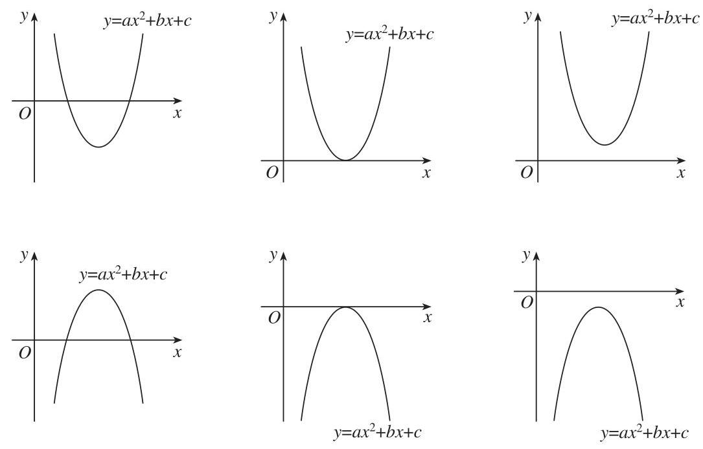

图 1 六类一元二次函数图象

上述两种方法的共性是都与一元二次方程的根有关, 差异是函数方法考虑了函数的变化规律。因此, 函数方法是具有一般性的, 特别是, 类比上述函数方法的思维过程, 还可以讨论其他类型函数的相关求解问题。

案例 2 函数的概念

【目的】理解基于对应关系的函数概念, 感悟函数概念进一步抽象的必要性。

【情境】在高中函数的教学中, 为什么要强调函数是实数集合之间的对应关系?

【分析】初中学习的函数概念表述为: 如果在一个变化过程中有两个变量 $x$ 和 $y$ ,对于变量 $x$ 的每一个值,变量 $y$ 都有唯一的值与它对应,那么称 $y$ 是 $x$ 的函数。它强调的是用函数描述一个变化过程。例如,在匀速直线运动中 (速度为 $v$ ),路程 $s$ 随着时间 $t$ 的变化而变化, 因此路程是时间的函数,记为 $s = {vt}$ 。再如,在单价 $p$ 、数量 $n$ 、总价

$S$ 的关系中,总价 $S$ 随着数量 $n$ 的变化而变化,因此总价是数量的函数,记为 $S = {pn}$ 。通常把这样的表述称为函数的 “变量说”。

但是, 上述两个函数自变量的单位不同, 不能进行加、减、乘、除等运算。若舍去其具体背景进一步抽象, 可以得到一般的正比例函数 $y = {kx}$ ( $k$ 为非零常数)。于是，两个正比例函数就可以进行运算了，所得结果还是一般的函数。

到了高中,函数的概念表述为: 给定两个非空实数集合 $A$ 和 $B$ , 以及对应关系 $f$ ,若对于集合 $A$ 中的每一个实数 $x$ ,集合 $B$ 中有唯一实数 $y = f\left( x\right)$ 与 $x$ 对应,则称 $y = f\left( x\right)$ 为集合 $A$ 上的函数。这个概念更强调实数集与实数集间的对应关系, 通常把这样的表述称为函数的 “对应关系说”。这样, 不同的函数可以进行加、减、乘、除等运算, 函数研究的内涵和应用的范围得以扩展。

对应关系强调的是对应的结果, 而不是对应的过程。例如, 借助高中函数的表述,可以认定函数 $y = {\cos }^{2}x + {\sin }^{2}x\left( {x \in  \left( {-\infty , + \infty }\right) }\right)$ 与函数 $y = 1\left( {x \in  \left( {-\infty , + \infty }\right) \text{表示同一个函数。更一般地,可以判断两个函}}\right)$ 数是否相同:如果两个函数的定义域相同，且相同的自变量值对应的函数值也相同, 那么, 这两个函数就是同一个函数。直观地说, 如果两个函数的图象重合,这两个函数是同一个函数。此外,函数 $u = {t}^{2}\left( {t \in  ( - \infty }\right.$ , $+ \infty )), x = {y}^{2}\left( {y \in  \left( {-\infty , + \infty }\right) }\right) , y = {x}^{2}\left( {x \in  \left( {-\infty , + \infty }\right) }\right)$ 使用的字母不同，但它们表示的是同一个函数，因为它们的定义域和对应关系分别对应相同; 反之,函数 $y = {x}^{2}\left( {x \in  \left( {-\infty , + \infty }\right) }\right) , y = {x}^{2}(x \in  (0$ , + >>>)的对应关系相同, 但它们是不同的函数, 因为它们的定义域不同。因此, 函数的表达与字母的使用无关。

使用对应关系刻画函数还有更为深刻的含义, 这是因为有些函数很难用解析式表示。例如, 狄利克雷函数

$$
y = \left\{  \begin{array}{l} 1, x\text{ 是有理数,} \\  0, x\text{ 是无理数 } \end{array}\right.
$$

因此, 对函数概念的进一步抽象是必要的。

注:19世纪以来，很多数学家都对函数概念进行了研究。例如， 1837 年，德国数学家狄利克雷最先给出函数“对应说”的定义。在这里介绍一些其他数学家对函数概念的描述。1851 年, 德国数学家黎曼给出函数的定义:

假定 $z$ 是一个变量，它可以逐次取所有可能的实数值。如果对它的每一个值,都有未知量 $w$ 的唯一的一个值与之对应,则 $w$ 称为 $z$ 的函数。

人们通常称这样的定义为函数的 “对应说”，因为定义中采用了 “唯一的一个值与之对应”的说法。法国布尔巴基学派的宗旨是在集合论的基础上, 用形式化的方法重新构建数学最基本的概念和法则。1939 年, 布尔巴基学派给出函数的定义:

设 $E$ 和 $F$ 是两个集合，它们可以不同，也可以相同。 $E$ 中的变元 $x$ 和 $F$ 中的变元 $y$ 之间的一个关系称为一个函数关系,如果对于每一个 $x \in  E$ ,都存在唯一的 $y \in  F$ ,它满足与 $x$ 给定的关系。称这样的运算为函数,它以上述方式将与 $x$ 有给定关系的元素 $y \in  F$ 与每一个元素 $x \in  E$ 相联系。称 $y$ 是函数在元素 $x$ 处的值,函数值由给定的关系所确定。两个等价的函数关系确定同一个函数。

人们通常称这样的定义为 “关系说”。由此可以看到, 高中函数定义的表述是黎曼对应说与布尔巴基学派关系说的融合, 采纳了 “对应” 和 “关系” 的表述方式。后来，有些学者把布尔巴基学派的定义进一步符号化:

设 $F$ 是定义在集合 $X$ 和 $Y$ 上的一个二元关系,称这个关系为函数, 如果对于每一个 $x \in  X$ ,都存在唯一的 $y \in  Y$ ,使得 $\left( {x, y}\right)  \in  F$ 。

这样, 函数的定义就完全用数学的符号形式化了, 在这个定义中, 已经很难找到变量甚至对应的 “影子”, 进而完全摆脱了函数的物理背景。虽然这种完全形式化的定义更为一般化, 却是以丧失数学直观为代价的, 因此不适于基础教育阶段的数学教育。

案例 3 引入弧度制的必要性

【目的】理解弧度制的本质是用线段长度度量角的大小, 这样的度量统一了三角函数自变量和函数值的单位; 进一步理解高中函数概念中为什么强调函数必须是实数集合与实数集合之间的对应, 因为只有这样才能进行基本初等函数的运算 (如四则运算、复合等), 使函数具有更广泛的应用性。

【情境】对于三角函数的教学, 为什么初中数学通过直角三角形讲述, 而高中数学要通过单位圆讲述? 这是必要的吗?

【分析】基于对应关系的函数定义, 要求函数是实数与实数的对应关系, 称前者的取值范围为定义域, 后者的取值范围为值域。初中三角函数是对直角三角形中的边角关系的刻画, 其中自变量的取值是 60 进位制的角度、不是 10 进位制的实数, 不符合对应关系的函数定义。事实上, 初中学习三角函数是为了解直角三角形, 并不讨论三角函数的基本性质。在高中阶段, 借助单位圆建立角度与对应弧长的关系, 用对应弧长刻画角的大小；因为长度单位与实数单位一致，这就使三角函数的自变量与函数值的取值都是实数，符合对应关系的函数定义。

用角度作为自变量表示三角函数，还存在着一个突出的问题，就是自变量的值与函数值不能进行运算 (例如, ${60}^{ \circ  }$ 与 $\sin {60}^{ \circ  }$ 不能相加), 阻碍了三角函数通过运算法则形成其他初等函数。此外, 微积分中重要极限 $\mathop{\lim }\limits_{{x \rightarrow  0}}\frac{\sin x}{x} = 1$ 成立,也依赖自变量 $x$ 为实数。特别是,利用三角函数能够较好地描述钟摆、潮汐等周期现象, 这时的自变量不一定是角度, 可以是时间或其他的量。通过这样的教学, 可以让学生感悟数学抽象的层次性。

案例 4 用三角函数刻画事物周期变化的实例

【目的】通过三角函数刻画周期变化现象的实例, 体会三角函数在表达和解决实际问题中的作用。

【情境】用正弦函数刻画三种周期变化的现象: 简谐振动 (单摆、 弹簧振子等)、声波(音叉发出的纯音)、交变电流。

【分析】单摆、弹簧振子等简谐振动可以用三角函数表达为 $y = \; A\sin \left( {{\omega x} + \varphi }\right)$ ,其中 $x$ 表示时间, $y$ 表示位移, $A$ 表示振幅, $\frac{\left| \omega \right| }{2\pi }$ 表示频率, $\varphi$ 表示初相位。

图 2 是单摆的示意图。点 $O$ 为摆球的平衡位置,如果规定摆球向右偏移的位移为正,则当摆球到达点 $C$ 时,摆球的位移 $y$ 达到最大值 $A$ ; 当摆球到达点 $O$ 时,摆球的位移 $y$ 为 0 ; 当摆球到达点 $D$ 时,摆球的位移 $y$ 达到反向最大值 $- A$ ; 当摆球再次到达点 $O$ 时,摆球的位移 $y$ 又一次为 0 ; 当摆球再次到达点 $C$ 时,摆球的位移 $y$ 又一次达到最大值 $A$ 。这样周而复始,形成周期变化。

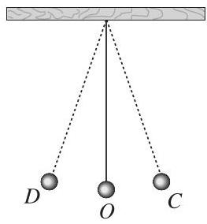

图 2 单摆示意图

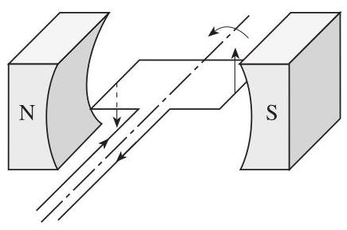

图 3 交变电流示意图

音叉发出的纯音振动可以用三角函数表达为 $y = A\sin \left( {\omega x}\right)$ ,其中 $x$ 表示时间, $y$ 表示纯音振动时音叉的位移, $\frac{\left| \omega \right| }{2\pi }$ 表示纯音振动的频率 (对应音高), $A$ 表示纯音振动的振幅 (对应音强)。

交变电流可以用三角函数表达为 $y = A\sin \left( {{\omega x} + \varphi }\right)$ ,其中 $x$ 表示时间, $y$ 表示电流, $A$ 表示最大电流, $\frac{\left| \omega \right| }{2\pi }$ 表示频率, $\varphi$ 表示初相位。

图 3 是交变电流产生的示意图。线圈在匀强磁场中按逆时针方向匀速旋转产生交变电流 (电刷及回路等部分省略), 当线圈处于图 3 所示的位置时,线圈中的感应电流 $y$ 达到最大值 $A$ ; 当线圈由此位置按逆时针方向旋转 ${90}^{ \circ  }$ 后到达与此平面垂直的位置时,线圈中的感应电流 $y$ 为 0 ; 当线圈继续按逆时针方向旋转 ${90}^{ \circ  }$ 后再次到达水平位置时,线圈中

的感应电流 $y$ 达到反向最大值 $- A$ ; 当线圈继续按逆时针方向旋转 ${90}^{ \circ  }$ 后再次到达垂直位置时,线圈中的感应电流 $y$ 又一次为 0 ; 当线圈继续按逆时针方向旋转 ${90}^{ \circ  }$ 后再次到达图示位置时,线圈中的感应电流 $y$ 又一次达到最大值 $A$ 。这样周而复始,形成周期变化。

对于这样的案例, 可以借助计算机软件做出动画, 形象化地说明周期变化。

案例 5 函数单调性概念的抽象过程

【目的】结合实例, 经历从具体的直观描述到形式的符号表达的抽象过程, 加深对函数单调性概念的理解, 体会用符号形式化表达数学定义的必要性, 知道这样的定义在讨论函数单调性问题中的作用。

【情境】在初中阶段, 学生已经初步了解一元一次函数、反比例函数、一元二次函数的图象具有单调性的特征。在高中阶段引入函数单调性概念时, 可以从直观认识出发, 提出合适的课堂讨论问题, 使学生经历函数单调性概念的抽象过程。例如, 可以提出如下问题。

问题 1 在初中阶段已经学过一元一次函数、反比例函数、一元二次函数,请根据函数图象 (如图 4),分别述说 $x$ 在哪个范围变化时, $y$ 随着 $x$ 的增大而增大 (或减小)?

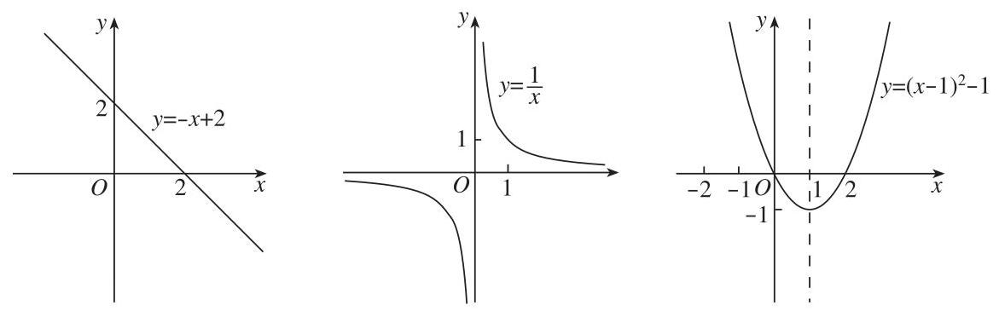

图 4 一元一次函数、反比例函数、一元二次函数示意图

问题 2 在日常生活中, 哪些函数关系具有上述特征?

问题 3 如图 5, $f\left( {-2}\right)  < f\left( 2\right)  < f\left( 8\right)$ ,能否据此得出 “ $f\left( x\right)$ 在 $\left\lbrack  {-2,8}\right\rbrack$ 上递增” 的结论? 为什么?

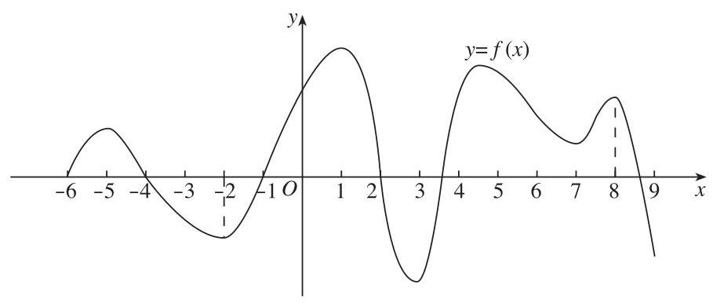

图 5

问题 4 依据函数单调性的定义,证明函数 $y = x + \frac{1}{x}, x \in  (2$ , $+ \infty )$ 是递增的。

【分析】初中阶段, 学生是经过从直观图形语言到数学自然语言的过程来认识函数的单调性的。到了高中阶段, 需要在此基础上进一步用符号语言来表述函数的单调性。在使用符号语言的过程中, “任意”两字是学生遇到的一个难点, 需要注意。另外, 函数单调性证明过程中的运算也是一个难点。

在函数单调性概念的形成中, 经历由具体到抽象、由图形语言和自然语言到符号语言表达的过程, 发展学生的数学抽象素养。在把握函数单调性定义时, 体会全称量词、存在量词等逻辑用语的作用, 发展学生的逻辑推理素养。在函数单调性证明的过程中, 发展学生的数学运算素养。

案例 6 利用单位圆的对称性探索三角函数的诱导公式

【目的】借助单位圆对称性的几何直观, 探索三角函数的诱导公式, 提升直观想象和逻辑推理素养。

【情境】通过单位圆定义正弦函数、余弦函数, 结合正弦函数、余弦函数的概念绘制正弦函数、余弦函数的图象。探索正弦函数、余弦函数的对称性, 得到三角函数的诱导公式。

教学片段 探索正弦函数、余弦函数的对称性。

教学过程 如图 6,在单位圆中,角 $\alpha$ 的终边与单位圆的交点记为

$P$ ,角 $- \alpha$ 的终边与单位圆的交点记为 ${P}^{\prime }$ ,通过点 $P$ 与 ${P}^{\prime }$ 关于 $x$ 轴成轴对称,探索与角 $- \alpha$ 有关的诱导公式。

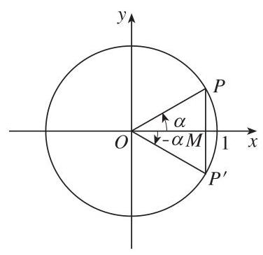

图 6

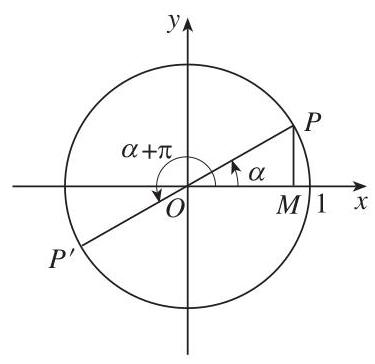

图 7

如图 7,在单位圆中,角 $\alpha$ 的终边与单位圆的交点记为 $P$ ,角 $\alpha  + \pi$ 的终边与单位圆的交点记为 ${P}^{\prime }$ ,通过点 $P$ 与 ${P}^{\prime }$ 关于点 $O$ 成中心对称, 即角 $\alpha$ 的终边绕点 $O$ 按逆时针方向旋转 $\pi$ 以后得到角 $\alpha  + \pi$ 的终边,探索与角 $\alpha  + \pi$ 有关的诱导公式。

引导学生通过类比, 发现其他形式的对称性以及与旋转变换相关的坐标关系, 尝试建立数学公式, 并验证公式的正确性。

引导学生自己给出记忆公式的方法, 理解其中的道理。例如, 理解 “奇变偶不变、符号看象限” 的含义。

【分析】重要的数学结论往往都是 “看” 出来的, 会 “看” 需要直观想象素养，诱导公式的教学内容提供了发展学生直观想象素养的平台。以上教学设计的情境，能够通过数学结论的直观背景和数学语言的清晰表达，揭示数学结论的本质，提升学生的直观想象和逻辑推理素养。

案例 7 停车距离问题

【目的】在数学建模活动中, 经历从现实问题中确定变量、探寻关系、建立模型、确定参数、分析结论的全过程, 形成和发展数学建模素养。

【情境】根据现实背景, 建立急刹车的停车距离数学模型, 理解数学模型中参数的意义, 并根据模型得到的结果, 就行车安全提出建议。

数学建模活动是一个科学研究的过程, 可以个人单独进行, 也可以组织研究小组共同开展。科学研究通常需要经历选题、开题、做题、结题四个基本步骤。

选题。本案例活动的选题步骤略去。

开题。结合问题, 查阅相关资料, 检索已有成果, 用 “头脑风暴” 的形式集思广益，初步形成解决问题的大致思路和方案，并分析操作的可行性。尝试撰写开题报告。教师可以组织小组之间交流，请学生代表本小组介绍开题报告，交流反思后，改进并确定实施方案。

做题。实施建立模型、求解模型、检验结果的过程, 写出结题报告或写成小论文。

结题。在班里介绍建模过程、结果和收获, 由老师和其他同学给出评价。

【分析】本案例中, 数学建模活动大体需要经历以下几个关键环节。

第一, 确定影响停车距离的主要因素。例如, 停车距离与刹车前汽车行驶的速度有关; 与驾驶人员的反应时间有关, 因人而异; 与车辆的刹车性能有关，因车而异；还与道路状况、天气状况等一些随机因素有关。构建数学模型时需要确定最为关键的因素, 例如, 在高速公路上, 如果汽车刹车性能良好, 则主要考虑前两个因素。

第二，建立急刹车的停车距离模型。由上面的分析，可以得到一个用自然语言表述的模型:

停车距离 $=$ 反应距离+制动距离。①

设 $d$ 表示停车距离, ${d}_{1}$ 表示反应距离, ${d}_{2}$ 表示制动距离,用数学符号把上述模型表示为 $d = {d}_{1} + {d}_{2}$ 。为了得到 ${d}_{1}$ 和 ${d}_{2}$ 的具体表达式, 可以作下面的假设。

关于反应距离, 假设反应距离是反应时间和汽车速度的函数。反应时间是指司机意识到应当急刹车到实施刹车所需要的时间, 汽车速度是指司机在实施急刹车之前汽车的速度。在一般情况下,反应距离 ${d}_{1}$ 与反应时间 $t$ 和汽车速度 $v$ 都成正比,把这个关系表示为 ${d}_{1} = {\alpha tv}$ ,其中

$\alpha$ 为正的待定参数。在现实生活中,可以知道反应时间 $t > 0$ ,但很难确定具体数值。因此, 最终只能确认反应距离与汽车速度成正比, 即把这个关系写成 ${d}_{1} = {\alpha v}$ ,可以认为用 $\alpha$ 替代了 ${\alpha t}$ 。

关于制动距离，假设刹车受力大小近似等于汽车轮胎与路面的摩擦力，制动距离是刹车受力与汽车速度的函数。

若 $F$ 表示刹车受力,则汽车急刹车时所作的功为 $F{d}_{2}$ 。根据能量守恒定律得 $F{d}_{2} = \frac{m{v}^{2}}{2}$ ,其中 $m$ 是汽车质量。另一方面,如果急刹车时的加速度是 $a$ ,再根据牛顿第二定律得 $F = {ma}$ 。综合上面两个式子, 可以得到 ${ma}{d}_{2} = \frac{m{v}^{2}}{2}$ ，即制动距离 ${d}_{2} = \frac{{v}^{2}}{2a}$ 。也就是说，制动距离与汽车速度的平方成正比: ${d}_{2} = \beta {v}^{2}$ ,其中 $\beta$ 是待定参数。依据①式,得

$$
d = {d}_{1} + {d}_{2} = {\alpha v} + \beta {v}^{2}。
$$

②

第三，确定参数，计算求解。模型中的参数是至关重要的，一般来说不可能通过理论计算得到, 因为在构建模型的过程中有许多因素没有考虑也不可能考虑清楚。在现实模型中, 参数值通常是通过统计方法得到的, 是通过现实数据估计出来的。大体上有三种方法可以得到现实数据:调查、实验和试验。

为了估计急刹车的停车距离模型中的参数, 需要通过试验的方法得到现实数据。表 7 是对美国公路局公布的试验数据进行单位换算后的数据表 (注:原始数据中距离的单位是英里、英尺, 这里以千米、米为距离单位,对相关的数据进行了换算)。通过正比例关系 ${d}_{1} = {\alpha v}$ 和 ${d}_{2} = \; \beta {v}^{2}$ ,可以计算出表 7 每一行中相应的 $\alpha$ 和 $\beta$ 的值。它们的平均数分别约为 0.210,0.006,这组数据可以作为对参数 $\alpha ,\beta$ 的一种估计。于是, 通过试验数据得到了停车距离模型

$$
d = {0.210v} + {0.006}{v}^{2}\text{。}
$$

③

表 7 通过试验观察到的反应距离、制动距离与停车距离

<table><tr><td>$v/\left( {\mathrm{{km}} \cdot  {\mathrm{h}}^{-1}}\right)$</td><td>${d}_{1}/\mathrm{m}$</td><td>${d}_{2}/\mathrm{m}$</td><td>$d$ / m</td><td>$\alpha$</td><td>$\beta$</td></tr><tr><td>32</td><td>6.7</td><td>6.1</td><td>12.8</td><td>0.209</td><td>0.006 0</td></tr><tr><td>40</td><td>8.5</td><td>8.5</td><td>17.0</td><td>0.213</td><td>0.0053</td></tr><tr><td>48</td><td>10.1</td><td>12.3</td><td>22.4</td><td>0.210</td><td>0.0053</td></tr><tr><td>56</td><td>11.9</td><td>16.0</td><td>27.9</td><td>0.213</td><td>0.0051</td></tr><tr><td>64</td><td>13.4</td><td>21.9</td><td>35.3</td><td>0.209</td><td>0.0053</td></tr><tr><td>72</td><td>15.2</td><td>28.2</td><td>43.4</td><td>0.211</td><td>0.0054</td></tr><tr><td>80</td><td>16.8</td><td>36.0</td><td>52.8</td><td>0.210</td><td>0.0056</td></tr><tr><td>89</td><td>18.6</td><td>45.3</td><td>63.9</td><td>0.209</td><td>0.0057</td></tr><tr><td>97</td><td>20.1</td><td>55.5</td><td>75.6</td><td>0.207</td><td>0.0059</td></tr><tr><td>105</td><td>21.9</td><td>67.2</td><td>89.1</td><td>0.209</td><td>0.0061</td></tr><tr><td>113</td><td>23.5</td><td>81.1</td><td>104.6</td><td>0.208</td><td>0.0064</td></tr><tr><td>121</td><td>25.3</td><td>96.9</td><td>122.2</td><td>0.209</td><td>0.006 6</td></tr><tr><td>129</td><td>26.8</td><td>114.6</td><td>141.4</td><td>0.208</td><td>0.0069</td></tr></table>

从③式可以看到，汽车停车距离模型是汽车速度的二次函数，因此从数学应用的角度可以认为，函数是构建数学模型的有力工具。

由于模型中的参数来源于实际, 在一般情况下, 这个模型能够经受实践的检验。因此, 急刹车的停车距离模型③普遍应用于汽车刹车设计和路面交通管理。

为了便于查阅，除了构建模型、制作表格，人们也给出直观图形。 图 8 直观地给出了急刹车的停车距离模型。

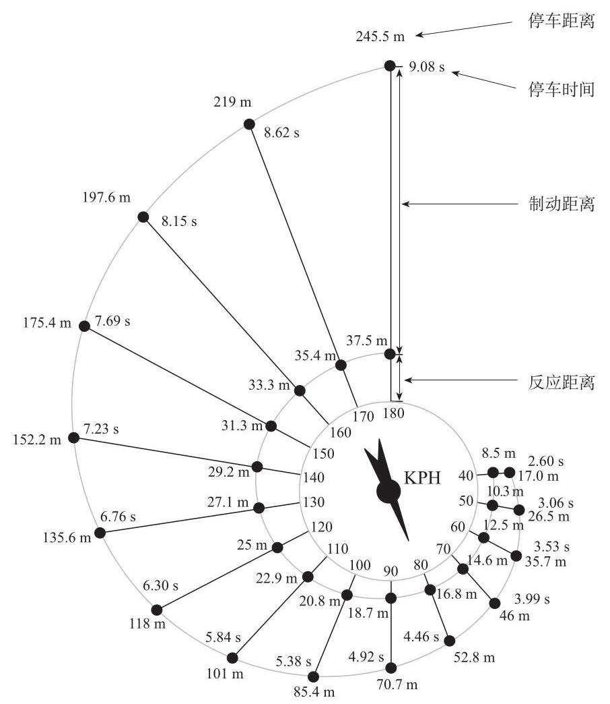

图 8 停车距离示意图

案例 8 “指数爆炸” 的感知和理解

【目的】通过观察、计算 (可利用作图、计算工具), 体会幂函数、 指数函数、对数函数增长速度的差异, 感知和理解 “指数爆炸” 的含义。

【情境 1】使用工具进行计算, 感知 “指数爆炸” 的含义。

【分析】课程标准中提到了“指数爆炸” 这个名词。如果局限于纸笔运算，在课堂上可以让学生计算整数底数的某些幂。如果借助计算工具, 可以先让学生计算 1.01 的平方和立方, 进而提出问题: 猜测 1.01 ${}^{365}$ 大概是多少? 同样地,可以让学生猜测 ${0.99}^{365}$ 的值。实际上, 它们的数值分别近似为:

$$
\text{1.}{01}^{365} \approx  {37.8},{0.99}^{365} \approx  {0.03}\text{。}
$$

这样的学习方式, 不仅使学生能够直观感知 “指数爆炸” 的含义, 还能帮助学生理解底数对幂的影响。能够帮助学生建立对指数函数变化的直观认识:底数大于 1 时，随着指数的增大幂变大；底数大于 0 且小于 1 时, 随着指数的增大幂变小。

【情境 2】借助计算机进行作图, 对指数函数、对数函数、幂函数的增长速度进行比较, 进一步理解 “指数爆炸” 的含义。

【分析】可以让学生利用计算机作图工具,画出 $y = {2}^{x}, y = {x}^{100}$ , $y = {x}^{0.25}, y = {\log }_{2}x$ 的函数图象,通过比较图象,分析这四个函数增长的快慢。特别是当 $x$ 值比较大的时候,直观感知这四个函数值的差异。

进一步,让学生通过 $y = {1.01}^{x}$ 与 $y = {x}^{10}$ 图象之间的比较、 $y = \; {x}^{0.1}$ 与 $y = \lg x$ 图象之间的比较,形成更一般的猜想。例如,交点的个数、变化的差异等。

借助这样的素材进行教学, 可以让学生体会指数函数、幂函数、对数函数增长速度的差异, 比较这三种函数的变化趋势; 经历通过图形建立直观猜想、通过计算验证结论的思维与操作过程, 提升学生的直观想象和逻辑推理素养。

## 案例 9 向量投影

【目的】理解投影的作用, 体会投影是构建高维空间与低维空间之间联系的桥梁, 形成直观想象; 了解投影与数量积运算规则的关系, 体会 “特殊情况”与“一般情况”的相互作用，提升逻辑推理素养。

【情境】空间向量向平面投影、向直线投影, 一个向量向另一个向量投影，向量投影有什么意义和作用?

【分析】向量的投影是高维空间到低维子空间的一种线性变换, 得到的是低维空间向量, 这里是指正交投影。在高中数学中, 如图 9(1), 在空间中,向量 $\mathbf{\alpha }$ 向平面 $\pi$ 投影得到的是平面 $\pi$ 内的向量 $\gamma$ ; 如图 9(2),在空间中,向量 $\mathbf{\alpha }$ 向直线 $l$ 投影得到的是直线 $l$ 上的向量 $\gamma$ ; 如图 9(3),在空间中,向量 $\mathbf{\alpha }$ 向向量 $\mathbf{\beta }$ 的投影,是指向量 $\mathbf{\alpha }$ 向与向量 $\mathbf{\beta }$

共线的向量构成的子空间的投影,得到的是与向量 $\mathbf{\beta }$ 共线的向量 $\mathbf{\gamma }$ 。向量 $\gamma$ 称为投影向量。

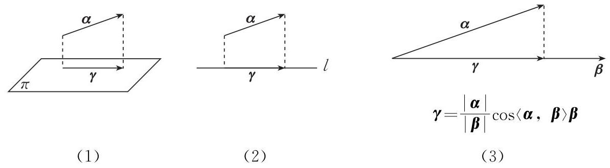

图 9 向量投影

如图 9(1),不难看出,向量 $\mathbf{\alpha } - \gamma$ 与向量 $\mathbf{\gamma }$ 垂直。这就意味着,当向量 $\mathbf{\gamma }$ 与向量 $\mathbf{\alpha }$ 起点相同时,终点间的距离最小。此时,三个向量 $\mathbf{\alpha }$ , $\mathbf{\alpha } - \mathbf{\gamma }$ 和 $\mathbf{\gamma }$ 构成一个直角三角形。借助勾股定理,可以通过几何直观更好地理解向量投影的本质。以上分析适用于高维空间到低维空间的正交投影。

向量标准正交分解定理是投影作用的另一个重要体现。如图 10, 给定标准正交基 $\{ i, j, k\}$ ,设向量 $\mathbf{\alpha }$ 在 $i, j, k$ 上的投影向量分别为 ${\mathbf{\alpha }}_{i},{\mathbf{\alpha }}_{j},{\mathbf{\alpha }}_{k}$ ,则 $\mathbf{\alpha } = {\mathbf{\alpha }}_{i} + \; {\mathbf{\alpha }}_{j} + {\mathbf{\alpha }}_{k} = \left( {\mathbf{\alpha } \cdot  \mathbf{i}}\right) \mathbf{i} + \left( {\mathbf{\alpha } \cdot  \mathbf{j}}\right) \mathbf{j} + \left( {\mathbf{\alpha } \cdot  \mathbf{k}}\right) \mathbf{k}$ 。显然, $\mathbf{\alpha } \cdot  \mathbf{i},\mathbf{\alpha } \cdot  \mathbf{j},\mathbf{\alpha } \cdot  \mathbf{k}$ 是向量 $\mathbf{\alpha }$ 在标准正交基 $\{ i, j, k\}$ 下的坐标。

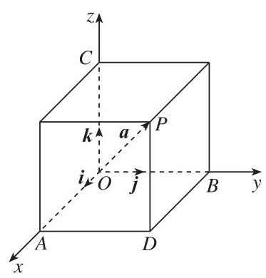

图 10 向量标准正交分解

## 案例 10 复数的引入

【目的】了解复数概念形成的重要发展阶段, 体会其中的理性思维、 创新精神和数学文化。

【情境】复数的产生大致经历了以下过程。

在希腊学者丢番图时代, 人们已经知道一元二次方程有两个根, 但其中有一个根为虚数时, 宁可认为方程不可解。直到 16 世纪, 人们普遍认同丢番图的办法。

虽然复数问题是由求一元二次方程的解所引发的, 但迫使人们认真对待复数却是因为求一元三次方程的解。意大利数学家卡尔丹在 1545 年出版的著作《重要的艺术》中，全面介绍了求解一元三次方程的代数方法, 卡尔丹通过区分十三种情况对一元三次方程进行讨论, 给出十三种求解的公式。在公式中出现了十分尴尬的情况:即便一元三次方程的三个根都是实根, 但在用公式求解的时候会出现虚数。例如, 对方程 ${16} + {x}^{2} + {x}^{3} = {24x}$ (这是当时人们表示方程的方法),容易验证 $x = 4$ 是方程的一个根,于是这个方程就等价于 $\left( {x - 4}\right) \left( {{x}^{2} + {5x} - 4}\right)  = 0$ ,检验其中的一元二次方程可知, 其余两个根也都是实数, 因此方程的三个根都是实根。但是, 直接用卡尔丹求解一元三次方程的公式计算方程解的过程中会出现虚数, 那么, 这样的方程是有解还是无解呢?

虚数 (imaginary number) 这个名称是法国哲学家、数学家笛卡儿给出的, 写在 1637 年出版的《几何》中。欧拉第一个使用符号 i 表示虚数, 并将其写在 1777 年提交给圣彼得堡科学院的论文中, 这篇论文直到 1794 年才发表。

只有给出复数的几何表示, 人们才真正感觉到了复数的存在, 才心安理得地接受了复数。1797 年, 丹麦测量学家韦塞尔在丹麦皇家科学院宣读了一篇关于复数的论文，文中引入了虚轴，并把复数表示为平面向量。但直到 100 年后的 1897 年, 韦塞尔的丹麦文的论文被翻译为法文后，复数几何表示的工作才引起数学界的广泛重视。瑞士数学家阿尔冈把复数对应的向量的长度称为模, 写在 1806 年出版的著作《试论几何作图中虚量的表示法》中，他还进一步利用三角函数表示复数。

现在，复数已经被广泛应用于流体力学、信号分析等学科，因此复数有着深厚的物理背景。在复数的基础上, 英国数学家哈密顿构造了四元数, 并导致了物理学中著名的麦克斯韦方程的产生。

【分析】在数学史上, 虚数以及复数概念的引入经历了一个曲折的过程, 其中充满着数学家的想象力、创造力和不屈不挠、精益求精的精神。因此, 在复数概念的教学中, 可以适当介绍其历史发生发展过程, 一方面可以让学生感受数学的文化和精神，另一方面也有助于学生理解复数的概念和意义。

如何将数学史融入中小学的数学教学是数学教育领域的一个重要课题。通过数学概念和思想方法的历史发生发展过程, 一方面可以使学生感受丰富多彩的数学文化, 激发数学学习的兴趣; 另一方面也有助于学生对数学概念和思想方法的理解。数学史在数学课堂中的融入方式可以是多种多样的, 相关的网络资源也十分丰富, 教师应该根据教学的需要选择合适的资料和教学方式。

案例 11 正方体截面的探究

【目的】结合正方体截面设计的问题串, 引导学生完成探究、发现、 证明新问题的过程, 积累数学探究的经验。

【情境】用一个平面截正方体, 截面的形状将会是什么样的? 启发学生提出逐渐深入的系列问题, 引导学生进行逐渐深刻的思考。学生可以自主或在教师引导下提出一些问题, 例如:

(1)给出截面图形的分类原则，找到截得这些形状截面的方法，画出这些截面的示意图。例如, 可以按照截面图形的边数进行分类 (如图 11)。

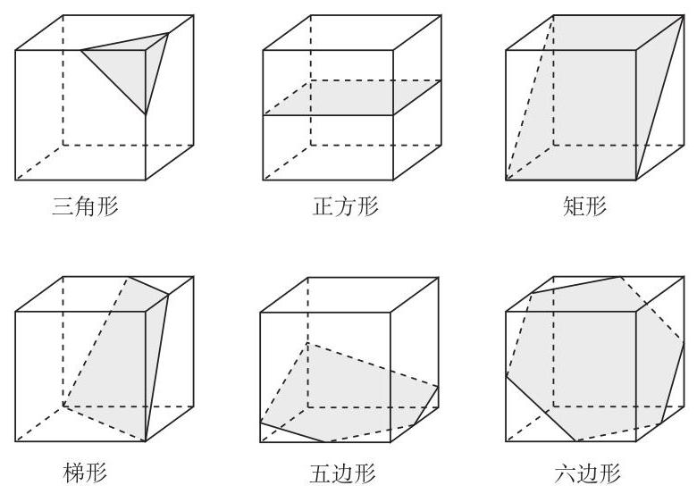

图 11 正方体截面图形示意图

(2)如果截面是三角形，可以截出几类不同的三角形？为什么？

(3)如果截面是四边形, 可以截出几类不同的四边形? 为什么?

(4)还能截出哪些多边形？为什么？

然后进一步探讨:

(5)能否截出正五边形？为什么？

(6)能否截出直角三角形？为什么？

(7)有没有可能截出边数超过 6 的多边形? 为什么?

(8) 是否存在正六边形的截面? 为什么?

最后思考:

(9)截面面积最大的三角形是什么形状的三角形？为什么？

【分析】这是一个跨度很大的数学问题串, 可以针对不同学生, 设计不同的教学方式, 通过多种方法实施探究。例如, 可以通过切萝卜块观察, 启发思路; 也可以在透明的正方体盒子中注入带有颜色的水, 观察不同摆放位置、不同水量时的液体表面的形状; 还可以借助信息技术直观快捷地展示各种可能的截面。但是, 观察不能代替证明。探究的难点是分类找出所有可能的截面, 并证明哪些形状的截面一定存在或者一定不存在。可以鼓励学生通过操作观察, 形成猜想, 证明结论。经历这样逐渐深入的探究过程, 有利于培养学生发现问题、分类讨论、作图表达、推理论证等能力，在具体情境中提升直观想象、数学抽象、逻辑推理等素养，积累数学探究活动经验。

案例 12 投掷骰子问题

【目的】理解样本点、样本量、有限样本空间的概念, 以及有限样本空间中随机事件的相关运算, 理解随机事件的表达, 体会随机思想。

【情境】将一枚均匀骰子相继投掷两次, 请回答以下问题:

(1)写出样本点和样本空间；

(2)用 $A$ 表示随机事件 “至少有一次掷出 1 点”，试用样本点表示事件 $A$ ;

(3) 用 ${A}_{j}\left( {j = 1,2,3,4,5,6}\right)$ 表示随机事件 “第一次掷出 1 点,第二次掷出 $j$ 点”,用 $B$ 表示随机事件 “第一次掷出 1 点”,试用随机事件 ${A}_{j}$ 表示随机事件 $B$ ;

(4)用 $C$ 表示随机事件 “点数之和为 7”，并求 $C$ 发生的概率。

【分析】上述四个问题, 依次分析如下。

(1)首先确定样本点，用1,2,3,4,5,6表示掷出的点数，用 $(i$ ， $j$ ) 表示 “第一次掷出 $i$ 点,第二次掷出 $j$ 点”,则相继投掷两次的所有可能结果如下:

(1,1) (1,2) (1,5) (1,6)

(2,1) (2,3) (2,3) (2,5) (2, 6) (3, 1)

(3, 1) (3,2) (3,3) (3, 4) (3, 5) (3,6)

(4, 6)

(5, 6)

$\begin{array}{llllll} \left( {6,1}\right) & \left( {6,2}\right) & \left( {6,3}\right) & \left( {6,4}\right) & \left( {6,5}\right) & \left( {6,6}\right)  \end{array}$

注意到 $\left( {1,2}\right)$ 和 $\left( {2,1}\right)$ 是不同的样本点,分别表示 “第一次掷出 1 点, 第二次掷出 2 点” 和 “第一次掷出 2 点, 第二次掷出 1 点” 这两个随机事件, 因此样本空间共有 36 个样本点。把每个样本点称为基本事件。样本空间为

$$
\begin{aligned}  & \Omega  = \left\{  \begin{array}{llllll} \left( {1,1}\right) , & \left( {1,2}\right) , & \left( {1,3}\right) , & \left( {1,4}\right) , & \left( {1,5}\right) , & \left( {1,6}\right) , \\  \left( {2,1}\right) , & \left( {2,2}\right) , & \left( {2,3}\right) , & \left( {2,4}\right) , & \left( {2,5}\right) , & \left( {2,6}\right) , \\  \left( {3,1}\right) , & \left( {3,2}\right) , & \left( {3,3}\right) , & \left( {3,4}\right) , & \left( {3,5}\right) , & \left( {3,6}\right) , \\  \left( {4,1}\right) , & \left( {4,2}\right) , & \left( {4,3}\right) , & \left( {4,4}\right) , & \left( {4,5}\right) , & \left( {4,6}\right) , \\  \left( {5,1}\right) , & \left( {5,2}\right) , & \left( {5,3}\right) , & \left( {5,4}\right) , & \left( {5,5}\right) , & \left( {5,6}\right) , \\  \left( {6,1}\right) , & \left( {6,2}\right) , & \left( {6,3}\right) , & \left( {6,4}\right) , & \left( {6,5}\right) , & \left( {6,6}\right)  \end{array}\right\} \\  & = \{ \left( {i, j}\right)  \mid  i, j = 1,2,3,4,5,6\} \text{。} \end{aligned}
$$

(2)因为随机事件 $A =$ “至少有一次掷出 1 点”，则 $A$ 包括上述样本空间中所有出现 1 的样本点, 因此

$$
A = \left\{  \begin{array}{llllll} \left( {1,1}\right) , & \left( {1,2}\right) , & \left( {1,3}\right) , & \left( {1,4}\right) , & \left( {1,5}\right) , & \left( {1,6}\right) , \\  \left( {2,1}\right) , & \left( {3,1}\right) , & \left( {4,1}\right) , & \left( {5,1}\right) , & \left( {6,1}\right) &  \end{array}\right\}  。
$$

(3) ${A}_{j} = \{ \left( {1, j}\right) \} , j = 1,2,3,4,5,6$ 。因为这些事件任何一个发生事件 $B$ 就发生,所以 $B = {A}_{1} \cup  {A}_{2} \cup  {A}_{3} \cup  {A}_{4} \cup  {A}_{5} \cup  {A}_{6}$ 。

(4) 因为 $C = \{ \left( {1,6}\right) ,\left( {2,5}\right) ,\left( {3,4}\right) ,\left( {4,3}\right) ,\left( {5,2}\right) ,\left( {6,1}\right) \}$ ,包括 6 个样本点,样本空间共有 36 个样本点,所以 $P\left( C\right)  = \frac{6}{36} = \frac{1}{6}$ 。

通过上面的讨论可以看到, 样本空间只与问题的背景有关。

案例 13 分层抽样

【目的】理解分层随机抽样的特点, 了解分层随机抽样的应用, 探索快速、有效计算分层抽样数据均值和方差的方法。

【情境】在大数据时代, 常常需要汇总分析来自不同层次的数据。 例如, 基于来自不同部门或者不同时期数据的均值和方差, 计算全部数据的均值和方差。请看下面的例子。

某学校有高中学生 500 人，其中男生 320 人，女生 180 人，希望获得全体高中学生身高的信息。按照分层抽样原则抽取了样本, 通过计算得到男生身高样本均值为 ${173.5}\mathrm{\;{cm}}$ ,方差为 17; 女生身高样本均值为 163.83cm，方差为 30.03。请回答以下问题:

(1)根据以上信息，能够计算出所有数据的样本均值吗？为什么？

(2)应当如何计算所有数据的样本均值和方差？

【分析】按照传统的统计方法, 需要把所有的数据收集到一起进行计算。但是, 在大数据时代, 不仅数据量非常庞大, 而且要求非常迅速地提供数据结论, 因此不可能把所有的数据都收集好以后再进行计算, 需要创造更为简捷的方法。以上述问题为例进行分析。

(1)假设所有身高样本的均值为 $\bar{x}$ ，根据男女生的分层方法和样本均值的定义, 可以得到下面的关系式:

$$
= \frac{\text{男生样本量}}{\text{总样本量}} \times  {173.5} + \frac{\text{女生样本量}}{\text{总样本量}} \times  {163.83}。
$$

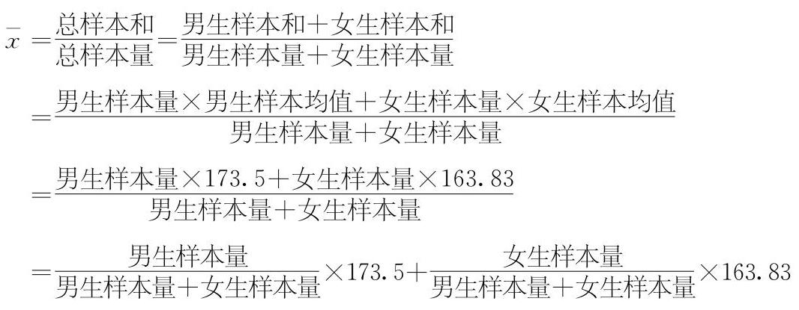

从上面的分析可以知道, 仅仅依赖问题中提供的信息不能得到所有数据的样本均值, 因为缺少男生样本量和女生样本量。因此, 在提供分层样本均值的基础上, 还需要知道分层的样本量, 或知道男生样本量权重、女生样本量权重。

(2)假设男生样本量为 32，女生样本量为 18。记男生样本为 ${y}_{1},\cdots$ ， ${y}_{32}$ ,均值为 ${y}_{33}$ ,方差为 ${s}_{33}^{2}$ ; 记女生样本为 ${z}_{1},\cdots ,{z}_{18}$ ,均值为 ${z}_{4}$ , 方差为 ${s}_{\text{女 }}^{2}$ ; 所有数据样本均值为 ${\bar{x}}_{\text{总 }}$ ,方差为 ${s}_{\text{总 }}^{2}$ ,样本总量为 50 。

先求所有数据的样本均值。根据样本均值的定义，

$$
{\bar{x}}_{\text{总 }} = \frac{{y}_{1} + {y}_{2} + \cdots  + {y}_{32} + {z}_{1} + {z}_{2} + \cdots  + {z}_{18}}{{32} + {18}}。
$$

虽然数据 ${y}_{1},\cdots ,{y}_{32}$ 和 ${z}_{1},\cdots ,{z}_{18}$ 是未知的,但在上面的计算中, 只需要样本数据之和, 这可以通过样本均值和样本量的乘积得到, 即

$$
{y}_{1} + {y}_{2} + \cdots  + {y}_{32} = {32}{\bar{y}}_{33},{z}_{1} + {z}_{2} + \cdots  + {z}_{18} = {18}{\bar{z}}_{女}。
$$

所以

$$
{\bar{x}}_{\text{总 }} = \frac{{y}_{1} + {y}_{2} + \cdots  + {y}_{32} + {z}_{1} + {z}_{2} + \cdots  + {z}_{18}}{{32} + {18}} = \frac{{32}{\bar{y}}_{\text{男 }} + {18}{\bar{z}}_{\text{女 }}}{{32} + {18}}
$$

$$
= \frac{{32} \times  {173.5} + {18} \times  {163.83}}{50} \approx  {170.02}\left( \mathrm{\;{cm}}\right) \text{。}
$$

下面计算所有数据的样本方差。根据方差的定义,

$$
{s}_{\text{总 }}^{2} = \frac{1}{50}\left\lbrack  {\mathop{\sum }\limits_{{i = 1}}^{{32}}{\left( {y}_{i} - {\bar{x}}_{\text{总 }}\right) }^{2} + \mathop{\sum }\limits_{{j = 1}}^{{18}}{\left( {z}_{j} - {\bar{x}}_{\text{总 }}\right) }^{2}}\right\rbrack  。
$$

因为其中的数据是未知的, 根据同样的道理, 需要把上面的式子转化为各层样本方差、样本均值和样本量的函数。可以计算如下:

$$
\begin{aligned}  & {s}_{\text{总 }}^{2} = \frac{1}{50}\left\lbrack  {\mathop{\sum }\limits_{{i = 1}}^{{32}}{\left( {y}_{i} - {\bar{x}}_{\text{总 }}\right) }^{2} + \mathop{\sum }\limits_{{j = 1}}^{{18}}{\left( {z}_{j} - {\bar{x}}_{\text{总 }}\right) }^{2}}\right\rbrack \\  & = \frac{1}{50}\left\{  {\mathop{\sum }\limits_{{i = 1}}^{{32}}{\left\lbrack  \left( {y}_{i} - {\bar{y}}_{\text{男 }}\right)  + \left( {\bar{y}}_{\text{男 }} - {\bar{x}}_{\text{总 }}\right) \right\rbrack  }^{2} + \mathop{\sum }\limits_{{j = 1}}^{{18}}{\left\lbrack  \left( {z}_{j} - {\bar{z}}_{\text{女 }}\right)  + \left( {\bar{z}}_{\text{女 }} - {\bar{x}}_{\text{总 }}\right) \right\rbrack  }^{2}}\right\} \end{aligned}
$$

$$
\begin{aligned}  & = \frac{1}{50}\left\{  {\mathop{\sum }\limits_{{i = 1}}^{{32}}\left\lbrack  {{\left( {y}_{i} - {\bar{y}}_{\text{男 }}\right) }^{2} + 2\left( {{y}_{i} - {\bar{y}}_{\text{男 }}}\right) \left( {{\bar{y}}_{\text{男 }} - {\bar{x}}_{\text{总 }}}\right)  + {\left( {\bar{y}}_{\text{男 }} - {\bar{x}}_{\text{总 }}\right) }^{2}}\right\rbrack   + }\right. \\  & \left. {\mathop{\sum }\limits_{{j = 1}}^{{18}}\left\lbrack  {{\left( {z}_{j} - {\bar{z}}_{\text{女 }}\right) }^{2} + 2\left( {{z}_{j} - {\bar{z}}_{\text{女 }}}\right) \left( {{\bar{z}}_{\text{女 }} - {\bar{x}}_{\text{总 }}}\right)  + {\left( {\bar{z}}_{\text{女 }} - {\bar{x}}_{\text{总 }}\right) }^{2}}\right\rbrack  }\right\} \\  & = \frac{1}{50}\left\{  {\left\lbrack  {\mathop{\sum }\limits_{{i = 1}}^{{32}}\left\lbrack  {{\left( {y}_{i} - {\bar{y}}_{\text{男 }}\right) }^{2} + \mathop{\sum }\limits_{{i = 1}}^{{32}}2\left( {{y}_{i} - {\bar{y}}_{\text{男 }}}\right) \left( {{\bar{y}}_{\text{男 }} - {\bar{x}}_{\text{总 }}}\right)  + \mathop{\sum }\limits_{{i = 1}}^{{32}}{\left( {\bar{y}}_{\text{男 }} - {\bar{x}}_{\text{总 }}\right) }^{2}}\right\rbrack  }\right\rbrack   + }\right. \\  & \left. \left\lbrack  {\mathop{\sum }\limits_{{j = 1}}^{{18}}{\left( {z}_{j} - {\bar{z}}_{\text{女 }}\right) }^{2} + \mathop{\sum }\limits_{{j = 1}}^{{18}}2\left( {{z}_{j} - {\bar{z}}_{\text{女 }}}\right) \left( {{\bar{z}}_{\text{女 }} - {\bar{x}}_{\text{总 }}}\right)  + \mathop{\sum }\limits_{{j = 1}}^{{18}}{\left( {\bar{z}}_{\text{女 }} - {\bar{x}}_{\text{总 }}\right) }^{2}}\right\rbrack  \right\}  , \end{aligned}
$$

其中

$$
\mathop{\sum }\limits_{{i = 1}}^{{32}}\left( {{y}_{i} - {\bar{y}}_{\text{男 }}}\right) \left( {{\bar{y}}_{\text{男 }} - {\bar{x}}_{\text{总 }}}\right)  = \left( {{\bar{y}}_{\text{男 }} - {\bar{x}}_{\text{总 }}}\right) \left( {\mathop{\sum }\limits_{{i = 1}}^{{32}}{y}_{i} - \mathop{\sum }\limits_{{i = 1}}^{{32}}{\bar{y}}_{\text{男 }}}\right)
$$

$$
= \left( {{\bar{y}}_{\text{男 }} - {\bar{x}}_{\text{总 }}}\right) \left( {\mathop{\sum }\limits_{{i = 1}}^{{32}}{y}_{i} - {32}{\bar{y}}_{\text{男 }}}\right)  = 0;
$$

同理

$$
\mathop{\sum }\limits_{{j = 1}}^{{18}}\left( {{z}_{j} - {\bar{z}}_{\text{女 }}}\right) \left( {{\bar{z}}_{\text{女 }} - {\bar{x}}_{\text{总 }}}\right)  = 0。
$$

于是

$$
{s}_{\text{总 }}^{2} = \frac{1}{50}\left\{  {\left\lbrack  {\mathop{\sum }\limits_{{i = 1}}^{{32}}{\left( {y}_{i} - {\bar{y}}_{\text{男 }}\right) }^{2} + \mathop{\sum }\limits_{{i = 1}}^{{32}}{\left( {\bar{y}}_{\text{男 }} - {\bar{x}}_{\text{总 }}\right) }^{2}}\right\rbrack   + }\right.
$$

$$
\left. \left\lbrack  {\mathop{\sum }\limits_{{j = 1}}^{{18}}{\left( {z}_{j} - {\bar{z}}_{\text{女 }}\right) }^{2} + \mathop{\sum }\limits_{{j = 1}}^{{18}}{\left( {\bar{z}}_{\text{女 }} - {\bar{x}}_{\text{总 }}\right) }^{2}}\right\rbrack  \right\}
$$

$$
= \frac{1}{50}\left\{  {\left\lbrack  {{32}{s}_{\text{男 }}^{2} + {32}{\left( {\bar{y}}_{\text{男 }} - {\bar{x}}_{\text{总 }}\right) }^{2}}\right\rbrack   + \left\lbrack  {{18}{s}_{\text{女 }}^{2} + {18}{\left( {\bar{z}}_{\text{女 }} - {\bar{x}}_{\text{总 }}\right) }^{2}}\right\rbrack  }\right\}
$$

$$
\approx  {43.24}\text{。}
$$

【拓展】如果将总体分为 $k$ 层,第 $j$ 层抽取的样本为 ${x}_{j1},{x}_{j2},\cdots$ , ${x}_{j{n}_{j}}$ ,第 $j$ 层的样本量为 ${n}_{j}$ ,样本均值为 ${\bar{x}}_{j}$ ,样本方差为 ${s}_{j}^{2}, j = 1$ , $2,\cdots , k$ 。记 $\mathop{\sum }\limits_{{j = 1}}^{k}{n}_{j} = n$ ,所有数据的样本均值和方差分别为

$$
\begin{aligned}  & \bar{x} = \frac{1}{n}\mathop{\sum }\limits_{{j = 1}}^{k}\mathop{\sum }\limits_{{t = 1}}^{{n}_{j}}{x}_{jt} = \frac{1}{n}\mathop{\sum }\limits_{{j = 1}}^{k}\left( {{n}_{j}{\bar{x}}_{j}}\right) , \\  & {s}^{2} = \frac{1}{n}\mathop{\sum }\limits_{{j = 1}}^{k}\mathop{\sum }\limits_{{t = 1}}^{{n}_{j}}{\left( {x}_{jt} - \bar{x}\right) }^{2} = \frac{1}{n}\mathop{\sum }\limits_{{j = 1}}^{k}{n}_{j}\left\lbrack  {{s}_{j}^{2} + {\left( {\bar{x}}_{j} - \bar{x}\right) }^{2}}\right\rbrack  。 \end{aligned}
$$

注:无论总体是分为两层还是分为多层，计算方法没有实质性差异。但需要注意的是，当层次较多时数学符号的表达比较繁杂，要充分考虑学生的理解能力。

这样的问题是有普遍现实意义的。例如, 针对某个问题, 不同网站提供了各自调查的样本均值和方差, 应当如何得到所有数据的样本均值和方差? 再如, 针对某个问题, 连续几天收集数据, 得到了每天数据的样本均值和方差, 应当如何得到这几天所有数据的样本均值和方差?

案例 14 阶梯电价的设计

【目的】通过生活中的实例, 理解百分位数的统计含义及其应用, 让学生体会用统计方法解决实际问题的全过程。

【情境】为了实现绿色发展, 避免浪费能源, 某市政府计划对居民用电采用阶梯收费的方法。为此, 相关部门在该市随机调查了 200 户居民六月份的用电量 (单位: $\mathrm{{kW}} \cdot  \mathrm{h}$ ),以了解这个城市家庭用电量的情况。数据如下:

$\begin{array}{llllllllll} {107} & {101} & {78} & {99} & {208} & {127} & {74} & {223} & {31} & {131} \end{array}$

$\begin{array}{llllllllll} {214} & {135} & {89} & {66} & {60} & {115} & {189} & {135} & {146} & {127} \end{array}$

$\begin{array}{llllllllll} {203} & {97} & {96} & {62} & {65} & {111} & {56} & {151} & {106} & 8 \end{array}$

$\begin{array}{llllllllll} {162} & {91} & {67} & {93} & {212} & {159} & {61} & {63} & {178} & {194} \end{array}$

$\begin{array}{llllllllll} {194} & {216} & {101} & {98} & {139} & {78} & {110} & {192} & {105} & {96} \end{array}$

$\begin{array}{llllllllll} {22} & {50} & {138} & {251} & {120} & {112} & {100} & {201} & {98} & {84} \end{array}$

$\begin{array}{llllllllll} {137} & {203} & {260} & {134} & {156} & {61} & {70} & {100} & {72} & {164} \end{array}$

$\begin{array}{llllllllll} {174} & {131} & {93} & {100} & {163} & {80} & {76} & {95} & {152} & {182} \end{array}$

$\begin{array}{llllllllll} {88} & {247} & {191} & {70} & {130} & {49} & {114} & {110} & {163} & {202} \end{array}$

$\begin{array}{llllllll} {265} & {18} & {94} & {146} & {149} & {147} & {177} & {339} \end{array}$ 109

$\begin{array}{llllllll} {107} & {182} & {101} & {148} & {274} & {289} & {82} & {213} \end{array}$ 224

$\begin{array}{lllllllll} {142} & {61} & {108} & {137} & {90} & {254} & {201} & {83} & {253} \end{array}$ 113

84

130 127

<table><tr><td>107</td><td>71</td><td>96</td><td>140</td><td>77</td><td>106</td><td>132</td><td>106</td><td>135</td><td>132</td></tr><tr><td>167</td><td>82</td><td>258</td><td>542</td><td>51</td><td>107</td><td>69</td><td>98</td><td>72</td><td>48</td></tr><tr><td>109</td><td>134</td><td>250</td><td>42</td><td>320</td><td>113</td><td>180</td><td>144</td><td>116</td><td>530</td></tr><tr><td>200</td><td>174</td><td>135</td><td>160</td><td>462</td><td>139</td><td>133</td><td>304</td><td>191</td><td>283</td></tr><tr><td>121</td><td>132</td><td>118</td><td>134</td><td>124</td><td>178</td><td>206</td><td>626</td><td>120</td><td>274</td></tr><tr><td>141</td><td>80</td><td>187</td><td>88</td><td>324</td><td>136</td><td>498</td><td>169</td><td>77</td><td>57</td></tr></table>

根据以上数据, 应当如何确定阶梯电价中的电量临界值, 才能使得电价更为合理?

【分析】选取六月份调查, 是因为这个城市六月份的部分时间需要使用空调, 因此六月份的用电量在一年 12 个月中处于中等偏上水平。 如果阶梯电价临界值的确定依赖于居民月用电量的分布, 例如计划实施 3 阶的阶梯电价, 有人给出一个分布如下: 75% 用户在第一档(最低一档)，20%用户在第二档，5%用户在第三档(最高一档)。这样，需要通过样本数据估计第一档与第二档、第二档与第三档的两个电量临界值, 即 75% 和 95%这两个电量临界值。

通过样本估计总体百分位数的要领是对样本数据进行排序, 得到有序样本 (在统计学中称为顺序统计量)。利用电子表格软件, 对上面的样本数据进行排序, 可以得到下面的结果:

<table><tr><td>8</td><td>18</td><td>22</td><td>31</td><td>42</td><td>48</td><td>49</td><td>50</td><td>51</td><td>56</td></tr><tr><td>57</td><td>57</td><td>60</td><td>61</td><td>61</td><td>61</td><td>62</td><td>62</td><td>63</td><td>63</td></tr><tr><td>65</td><td>66</td><td>67</td><td>69</td><td>70</td><td>70</td><td>71</td><td>72</td><td>72</td><td>74</td></tr><tr><td>76</td><td>77</td><td>77</td><td>78</td><td>78</td><td>80</td><td>80</td><td>82</td><td>82</td><td>82</td></tr><tr><td>83</td><td>84</td><td>84</td><td>88</td><td>88</td><td>89</td><td>90</td><td>91</td><td>93</td><td>93</td></tr><tr><td>94</td><td>95</td><td>96</td><td>96</td><td>96</td><td>97</td><td>98</td><td>98</td><td>98</td><td>99</td></tr><tr><td>100</td><td>100</td><td>100</td><td>101</td><td>101</td><td>101</td><td>105</td><td>106</td><td>106</td><td>106</td></tr><tr><td>107</td><td>107</td><td>107</td><td>107</td><td>108</td><td>108</td><td>109</td><td>109</td><td>110</td><td>110</td></tr><tr><td>110</td><td>111</td><td>112</td><td>113</td><td>113</td><td>114</td><td>115</td><td>116</td><td>118</td><td>120</td></tr><tr><td>120</td><td>120</td><td>121</td><td>123</td><td>124</td><td>127</td><td>127</td><td>127</td><td>130</td><td>130</td></tr></table>

<table><tr><td>130</td><td>131</td><td>131</td><td>132</td><td>132</td><td>132</td><td>133</td><td>133</td><td>134</td><td>134</td></tr><tr><td>134</td><td>135</td><td>135</td><td>135</td><td>135</td><td>136</td><td>137</td><td>137</td><td>138</td><td>139</td></tr><tr><td>139</td><td>140</td><td>141</td><td>142</td><td>144</td><td>146</td><td>146</td><td>147</td><td>148</td><td>149</td></tr><tr><td>151</td><td>152</td><td>154</td><td>156</td><td>159</td><td>160</td><td>162</td><td>163</td><td>163</td><td>164</td></tr><tr><td>165</td><td>167</td><td>169</td><td>170</td><td>170</td><td>172</td><td>174</td><td>174</td><td>177</td><td>178</td></tr><tr><td>178</td><td>180</td><td>182</td><td>182</td><td>187</td><td>189</td><td>191</td><td>191</td><td>192</td><td>194</td></tr><tr><td>194</td><td>200</td><td>201</td><td>201</td><td>202</td><td>203</td><td>203</td><td>206</td><td>208</td><td>212</td></tr><tr><td>213</td><td>214</td><td>216</td><td>223</td><td>224</td><td>237</td><td>247</td><td>250</td><td>250</td><td>251</td></tr><tr><td>253</td><td>254</td><td>258</td><td>260</td><td>265</td><td>274</td><td>274</td><td>283</td><td>288</td><td>289</td></tr><tr><td>304</td><td>319</td><td>320</td><td>324</td><td>339</td><td>462</td><td>498</td><td>530</td><td>542</td><td>626</td></tr></table>

样本数据总共有 200 个, 最小值是 8 , 最大值是 626 , 说明 200 户居民六月份的最小用电量为 $8\mathrm{\;{kW}} \cdot  \mathrm{h}$ ,最大用电量为 ${626}\mathrm{\;{kW}} \cdot  \mathrm{h}$ ,极差为 618。初中统计内容中学过的中位数, 相当于 50% 分位数。因为数据量是 200, 那么这组数据的样本中位数就是有序样本中第 100 个数 130 和第 101 个数 130 的平均数, 即 130 , 说明这个城市六月份居民用电量的中间水平大约为 130 kW · h。

下面确定 75% 和 95% 这两个电量临界值。类似中位数的计算, 因为 200×75%=150，所以第一个临界值为有序样本中第 150 个数 178 和第 151 个数 178 的平均数,仍然是 178 。因为 ${200} \times  {95}\%  = {190}$ ,所以第二个临界值为有序样本中第 190 个数 289 和第 191 个数 304 的平均数, 这个平均数为 296.5 (因为是对百分位数的估计, 估计值可以是 289 和 304 之间任何一个数, 为了便于操作可以取值为 297 )。

依据确定了的电量临界值, 阶梯电价可以规定如下: 用户每月用电量不超过 178 kW·h(或每年用电量不超过 2136 kW·h)，按第一档电价标准缴费；每月用电量(单位:kW·h)在区间(178, 297)内(或每年用电量在区间(2 136, 3 564 )内，其中的 178 kW·h 按第一档电价标准缴费，超过 ${178}\mathrm{{kW}} \cdot  \mathrm{h}$ 的部分按第二档电价标准缴费；每月用电量超过 ${297}\mathrm{{kW}} \cdot  \mathrm{h}$ (或每年用电量超过 ${3564}\mathrm{{kW}} \cdot  \mathrm{h}$ ),其中的 ${178}\mathrm{{kW}} \cdot  \mathrm{h}$ 按

第一档电价标准缴费,119 kW · h按第二档电价标准缴费(注:297 - 178=119),超过 ${297}\mathrm{\;{kW}} \cdot  \mathrm{h}$ 的部分按第三档电价标准缴费。

社会上对这种制定阶梯电价的原则和方法存在不同意见, 教师可以引导学生讨论制定合理阶梯电价的原则和方法。

## 案例 15 测量学校内、外建筑物的高度

【目的】运用所学知识解决实际测量高度的问题, 体验数学建模活动的完整过程。组织学生通过分组、合作等形式, 完成选题、开题、做题、结题四个环节。(关于本案例的评价部分参见案例 16)

【情境】给出下面的测量任务:

(1)测量本校的一座教学楼的高度；

(2)测量本校的旗杆的高度；

(3)测量学校院墙外的一座不可及，但在学校操场上可以看得见的物体的高度。

可以每 2~3 个学生组成一个测量小组，以小组为单位完成；个人填写测量课题报告表 (参见表 8)，一周后上交。

表 8 测量课题报告表

项目名称:___ 完成时间:___

<table><tr><td colspan="2">1. 成员与分工</td></tr><tr><td>姓名</td><td>分工</td></tr><tr><td></td><td></td></tr><tr><td></td><td></td></tr><tr><td colspan="2">2. 测量对象   例如,某小组选择的测量对象是: 教学楼、旗杆、校外的 $\times   \times$ 大厦。</td></tr></table>

续表

<table><tr><td>3. 测量方法 (请说明测量的原理、测量工具、创新点等)</td></tr><tr><td>4. 测量数据、计算过程和结果(可以另外附图或附页)</td></tr><tr><td>5. 研究结果(包括误差分析)</td></tr><tr><td>6. 简述工作感受</td></tr></table>

【教学过程】教师可以对学生的工作流程提出如下要求和建议。

(1)成立项目小组，确定工作目标，准备测量工具。

(2)小组成员查阅有关资料，进行讨论交流，寻求测量效率高的方法, 设计测量方案 (最好设计两套测量方案)。

(3)分工合作，明确责任。例如，测量、记录数据、计算求解、撰写报告的分工等。

(4)撰写报告，讨论交流。可以用照片、模型、PPT 等形式展现获得的成果。

根据上述要求, 每个小组要完成以下工作。

(1) 选题

本案例活动的选题步骤略去。

(2)开题

可以在课堂上组织开题交流, 让每个项目小组陈述初步测量方案, 教师和其他同学可以质疑。例如:

如果有学生提出要通过测量仰角计算高度, 教师可以追问: 怎么测量? 用什么工具测量? 目的是提醒学生, 事先设计出有效的测量方法和实用的测量仪器。

如果有学生提出要通过测量太阳的影长计算高度, 教师可以追问: 几时测量比较好? 如果学生提出比较测量物和参照物的影长时, 教师可以追问:是同时测量好, 还是先后测量好? 目的是提醒学生注意测量的细节。

如果有学生提出用照相机拍一张测量对象和参照物(如一个已知身高的人)的合影，通过参照物的高度按比例计算出楼的高度。教师可以追问:参照物应该在哪里？与测量对象是什么位置关系？目的是提醒学生注意现实测量与未来计算的关联。

在讨论的基础上, 项目小组最终形成各自的测量方案。讨论的目的是让学生想清楚测量过程中将使用的数学模型, 这样可以减少实践过程中的盲目性, 培养学生良好的思维习惯; 同时可以让学生意识到, 看似简单的问题, 也有许多需要认真思考、认真对待的内容, 促进科学精神的形成。

(3) 做题

依据小组的测量方案实施测量。尽量安排各个小组在同一时间进行

测量, 这样有利于教师的现场观察和管理。教师需要提醒学生: 要有分工、合作，责任落实到人。

在测量过程中，教师要认真巡视，记录那些态度认真、合作默契、 方法恰当的测量小组和个人，供讲评时使用。特别要注意观察和发现测量中出现的问题, 避免因为测量方法不合理产生较大误差, 当学生出现类似的问题时, 教师要把问题看作极好的教育契机, 启发学生分析原因, 引导他们发现出现问题的原因、寻求解决问题的办法。

(4)结题

在每位学生都完成 “测量报告” 后, 可以安排一次交流讲评活动。 遴选的交流报告最好有鲜明的特点, 如测量结果准确, 过程完整清晰, 方法有创意，误差处理得当，报告书写规范等；或者测量的结果出现明显误差, 使用的方法不当。交流讲评往往是数学建模活动中最为重要的环节，可以使学生在这一过程中相互借鉴，共同提高。(有关测量评价的讨论参见案例 16)

【分析】测量高度是传统的数学应用问题, 这样的问题有助于培养学生分析和解决问题、动手实践、误差分析等方面的能力。构建测量模型可以用平面几何的方法，例如，比例线段、相似形等；也可以用三角的方法; 甚至可以用物理的方法, 例如, 考虑自由落体的时间; 等等。应鼓励学生在合作学习的基础上, 自主设计、自己选择测量方法解决问题。

这样的教学活动, 因为问题贴近学生的生活, 学生比较容易上手。 采用选题、开题、做题、结题四个环节实施数学建模活动, 能够使学生在做中学、在学中做, 从中体会数学的应用价值, 并且展现个性, 尝试创新。

【拓展】鼓励学生提出新的问题, 积累数学建模资源。例如:

1. 本市的电视塔的高度是多少米?

2. 一座高度为 $H\mathrm{\;m}$ 的电视塔,信号传播半径是多少? 信号覆盖面积有多大?

3. 找一张本市的地图, 看一看本市的地域面积有多少平方千米,

电视塔的位置在地图上的什么地方。按照计算得到的数据, 这座电视塔发出的电视信号是否能覆盖本市?

4. 本市 (限于外地) 到北京的距离是多少千米? 要用一座电视塔把信号从北京直接发送到本市，这座电视台的高度至少要多少米?

5. 如果采用多个中继站的方式,用 ${100}\mathrm{\;m}$ 高的塔接力传输电视信号，从北京到本地至少要建多少座 100 m 高的中继传送塔?

6. 考虑地球大气层和电离层对电磁波的反射作用, 重新考虑问题 2, 4, 5。

7. 如果一座电视塔(如 300 m 高)不能覆盖本市，请设计一个多塔覆盖方案。

8. 至少发射几颗地球定点的通信卫星, 可以使其信号覆盖地球?

9. 如果我国要发射一颗气象监测卫星，监测我国的气象情况，请你设计一个合理的卫星定点位置或卫星轨道。

10. 在网上收集资料，了解有关“北斗卫星导航系统”的内容，在班里做一个相关内容的综述, 并发表对这件事的看法。

## 案例 16 测量学校内、外建筑物的高度项目的过程性评价

【目的】本案例是案例 15 的深化。给出过程性评价, 体现如何让学生在交流过程中展现个性、学会交流、归纳总结，发现问题、积累经验、提升素养。

【评价过程】在每一个学生都完成“测量报告”后, 安排交流讲评活动。安排讲评的报告应当有所侧重。例如, 测量结果准确, 测量过程清晰，测量方法有创意，误差处理得当，报告书写认真等；或误差明显而学生自己没有察觉，测量过程中构建的模型有待商榷等。事实表明， 这种形式的交流讲评, 往往是数学建模过程中学生收获最大的环节。

附件:某个小组的研究报告的展示片段摘录。

测量不可及“理想大厦”的方法

## 1. 两次测角法

(1)测量并记录测量工具距离地面 $h\mathrm{m}$ ；

(2)用大量角器，将一边对准大厦的顶部，计算并记录仰角 $\alpha$ ；

(3) 后退 $a\mathrm{\;m}$ ，重复(2)中的操作，计算并记录仰角 $\beta$ ；

(4)楼高 $x$ 的计算公式为:

$$
x = \frac{a\tan \alpha \tan \beta }{\tan \alpha  - \tan \beta } + h,
$$

其中 $\alpha ,\beta , a, h$ 如图 12 所示。

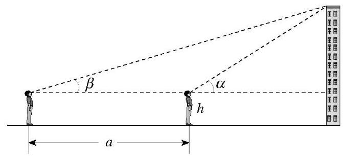

图 12 两次测角法示意图

2. 镜面反射法

(1)将镜子(平面镜)置于平地上(镜面保持水平)，人后退至从镜中能够看到楼顶的位置，测量人与镜子的距离；

(2)将镜子后移 $a\mathrm{\;m}$ ，重复(1)中的操作；

(3) 楼高 $x$ 的计算公式为:

$$
x = \frac{ah}{{a}_{2} - {a}_{1}},
$$

其中 ${a}_{1},{a}_{2}$ 是人与镜子的距离, $a$ 是两次观测时镜子之间的距离, $h$ 是人的 “眼高”，如图 13 所示。根据光的反射原理，利用相似三角形的性质联立方程组, 可以得到这个公式。 实际测量数据和计算结果, 测量误差简要分析。

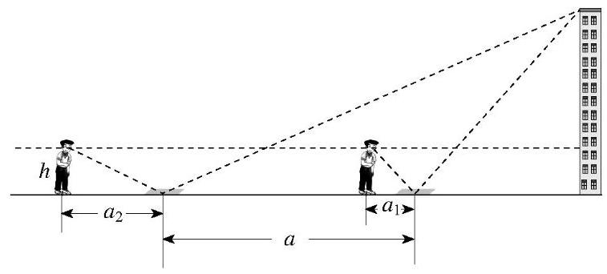

图 13 镜面反射法示意图

(1)两次测角法

实际测量数据:

<table><tr><td></td><td>第一次</td><td>第二次</td></tr><tr><td>仰角</td><td>${67}^{ \circ  }$</td><td>${52}^{ \circ  }$</td></tr></table>

后退距离为 ${25}\mathrm{\;m}$ ,人的 “眼高” 为 ${1.5}\mathrm{\;m}$ ,计算可得理想大厦的高度约为 71.5 m,结果与期望值 $\left( {{70}\mathrm{\;m} \sim  {80}\mathrm{\;m}}\right)$ 相差不大。误差的原因是铅笔在纸板上画出度数时不够精确。减小误差的方法是几个人分别测量高度及仰角, 再求平均值, 误差就能更小。

(2)镜面反射法

实际测量数据:

<table><tr><td></td><td>第一次</td><td>第二次</td></tr><tr><td>人与镜子的距离/m</td><td>3.84</td><td>3.91</td></tr></table>

镜子的相对距离为 ${10}\mathrm{\;m}$ ，人的 “眼高” 为 ${1.52}\mathrm{\;m}$ 。计算可得理想大厦的高度约为 ${217}\mathrm{\;m}$ ,结果与期望值相差较大。

产生误差有以下几点原因:

镜面放置不能保持水平；

两次放镜子的相对距离太近, 容易造成误差;

人眼看镜内物像时, 两次不一定都看准镜面上的同一个点;

人体不一定在两次测量时保证高度不变。

综上所述，要做到没有误差很难，但可以通过某些方式使误差更小, 我们准备用更多的测量方法找出理想的结果。

对上面的测量报告，教师和同学给出评价。例如，对测量方法，教师和同学评价均为 “优”，因为对不可及的测量对象选取了两种可行的测量方法; 对测量结果, 教师评价为 “良”, 同学评价为 “中”, 因为两种方法得到的结果相差较大。

对测量结果的评价, 教师和同学产生差异的原因是, 教师对测量过

程的部分项目实施加分, 包括对自制测量仰角的工具等因素作了误差分析; 同学则进一步分析产生误差的主要原因, 包括:

(1)测量工具问题。采用两次测角法的同学，自制量角工具比较粗糙, 角度的刻度误差较大; 采用镜面反射法的同学, 选用的镜子尺寸太大，造成镜间距测量有较大误差。

(2)间距差的问题。这是一个普遍的问题。间距差 $a$ 值是测量者自己选定的，因为没有较长的卷尺测量距离，有的同学甚至选间距差 $a$ 是 $1\mathrm{\;m}$ 。由于间距太小,两次测量的角度差或者人与镜子的距离差太小, 最终导致计算结果产生巨大误差。当学生意识到了这个问题后, 他们利用运动场 ${100}\mathrm{\;m}$ 跑道的自然长度作为间距差 $a$ ,使得测量精度得到较大提高。

(3)不少学生用自己的身高代替“眼高”，反映了学生没有很好地理解测量过程中的 “眼高” 应当是测量的高度, 如照片所示。

在结题交流过程中, 教师通过测量的现场照片, 引导学生发现问题, 让学生分析测量误差产生的原因。学生们在活动中意识到, 书本知识和实践能力的联系与转化是有效的学习方式。

测量现场的照片和观察说明:

<table><tr><td>照片</td><td>说明</td></tr><tr><td>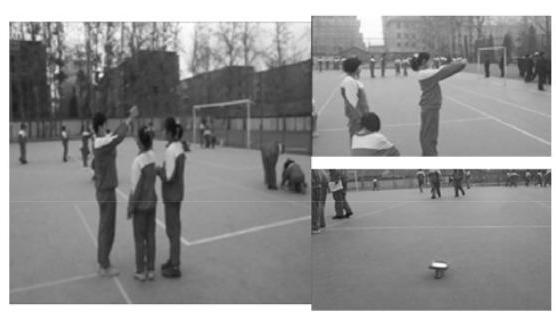</td><td>左图: 测量角的工具(量角器)太小, 造成仰角的测量误差很大。   右上图: 用腕尺法测量时, 腕尺应与地面垂直，手臂水平，否则就没有相似的直角三角形。   右下图:用镜子反射法时，要保持镜面水平，否则入射三角形和反射三角形就不相似。</td></tr></table>

续表

<table><tr><td>照片</td><td>说明</td></tr><tr><td>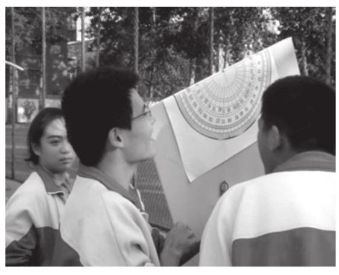</td><td>测量仰角的工具好: 把一个量角器放在复印机上放大 4 倍复印。在中心处绑上一个铅垂, 这样测量视线和铅垂线之间的夹角可以在图上直接读出，这个角是待测仰角的余角。</td></tr><tr><td>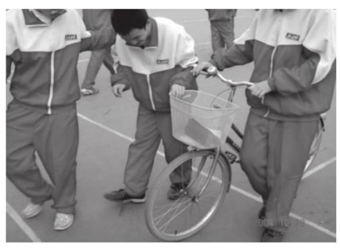</td><td>测量距离的工具好:用自行车来测距离，解决了皮尺长度不够的问题。</td></tr></table>

【分析】建模活动的评价要关注结果, 更要关注过程。

对测量方法和结果的数学评价可以占总评价的 60%, 主要由教师作评价。评价依据是现场观察和学生上交的测量报告, 关注的主要评价点有:

(1)测量模型是否有效；

(2)计算过程是否清晰准确，测量结果是否可以接受；

(3)测量工具是否合理、有效；

(4)有创意的测量方法(可获加分)；

(5)能减少测量误差的思考和做法(可获加分)；

(6)有数据处理的意识和做法(可获加分)；

...... 非数学的评价可以占总评价的 40% ，主要评价点有:

(1)每一名成员在小组测量和计算过程中的工作状态；

(2)测量过程中解决困难的机智和办法；

(3)讨论发言、成果汇报中的表现等。

非数学的评价主要是在同学之间进行, 可以要求学生给出本小组以外其他汇报小组的成绩, 并写出评价的简单理由。

## 案例 17 用向量方法研究距离问题

【目的】针对距离问题, 通过几种研究方法的比较, 提炼解决问题的通性通法。在教师指导下, 学生经历梳理知识、提炼方法、感悟思想的研究过程, 提升直观想象、逻辑推理和数学运算素养。这样的教学可以为空间向量与立体几何的复习课提供素材。

【情境】在 “几何与代数” 内容的阐述中强调: 通过几何图形建立直观, 通过代数公式表达规律。正如希尔伯特所说:

算术符号是文字化的图形，而几何图形则是图象化的公式。没有一个数学家能缺少这些图象化的公式, 正如在数学演算中他们不能不使用加、脱括号的操作或其他的分析符号一样。

距离问题是培养学生直观想象、逻辑推理和数学运算素养的很好的载体。在基础教育阶段涉及的距离问题主要有:两点间的距离，点到直线的距离, 平行线之间的距离, 点到平面的距离, 直线与平面的距离, 平行平面之间的距离, 异面直线之间的距离 (选修)。

计算距离可以用综合几何方法, 也可以用解析几何方法, 还可以用向量方法。

教学片段 1 梳理求平面内点到直线距离的几种方法。

综合几何方法。给定过点 $A, C$ 的直线 $l, B$ 为直线 $l$ 外一点,求点 $B$ 到直线 $l$ 的距离。因为过点 $A, B, C$ 可以得到一个平面内的三角形, 所以求距离就等价于求三角形的高。基本思路是: 用余弦定理确定 $\angle A$ ,再用正弦函数值求出 ${AC}$ 边上的高。

解析几何方法。建立平面直角坐标系,确定点 $B$ 的坐标和过点 $A$ ,

$C$ 的直线 $l$ 的方程,然后求点 $B$ 到直线 $l$ 的距离。基本思路是: 求与直线 $l$ 垂直的直线的斜率,再求过点 $B$ 的点斜式直线方程,最后求这两条相互垂直直线的交点。交点与点 $B$ 的距离就是点 $B$ 到直线 $l$ 的距离。

向量方法。建立平面直角坐标系,确定点 $B$ 的坐标和过点 $A, C$ 的直线 $l$ 的法向量,求点 $B$ 到直线 $l$ 的距离。基本思路是: 求向量 $\overrightarrow{AB}$ 到法向量的投影向量, 投影向量的长度就是所要求的距离。

教学片段 2 比较求点到平面的距离和求两条异面直线之间距离的向量方法。

点到平面的距离。用向量方法求点 $B$ 到平面的距离基本思路: 确定平面法向量,在平面内取一点 $A$ ,求向量 $\overrightarrow{AB}$ 到法向量的投影向量, 投影向量的长度即为所要求的距离。

异面直线之间的距离。用向量方法求异面直线之间距离的基本思路: 求出与两条直线的方向向量都垂直的法向量; 在两条直线上分别取点 $A$ 和 $B$ ,求向量 $\overrightarrow{AB}$ 到法向量的投影向量,投影向量的长度即为所要求的距离。

【分析】对于上述两个片段, 可以归纳出下面的结论。

片段 1 通过处理距离问题三种方法的对比, 可以知道垂直反映了距离的本质, 垂直意味着线段长度最短, 借助勾股定理可以直观、准确地揭示这个本质, 两点间的距离公式以及向量投影都可以看作勾股定理的应用。可以让学生在比较的过程中分析不同方法的共性与差异, 进而发现解决问题的关键。

片段2 无论是对于平面还是直线, 法向量都是反映垂直方向的最为直观的表达形式，法向量的方向和法向量上投影向量的长度既体现了几何图形直观, 又提供了代数定量刻画。在这个过程中, 向量与起点无关的自由性为求距离带来很大的便利。归纳用向量研究上述距离问题的方法, 可以得到通性通法, 即程序思想方法:

第一步，确定法向量；

第二步, 选择参考向量;

第三步，确定参考向量到法向量的投影向量；

第四步，求投影向量的长度。

通过以上分析，可以体会借助几何直观的必要性:可以启发运算思路, 甚至可以得到解决问题的程序。程序思想方法具有解决一类数学问题的功能, 是计算 (特别是利用计算机进行计算) 的基本思想方法。

【拓展】引导学生用向量方法给出空间所有距离问题的求解程序, 并引导学有余力的学生查阅高等数学中有关的距离问题。

## 案例 18 二项式定理

【目的】根据多项式相乘的运算法则, 探索二项式定理的构造性证明, 体会运算法则的作用。感知运算是一种严格的逻辑推理, 通过一般性运算可以发现和提出命题, 掌握推理的基本形式和规则, 探索和表述论证过程, 发展数学运算素养。

【情境】探索二项式定理的构造性证明。

【分析】首先,让学生分析得到公式 ${\left( a + b\right) }^{2} = {a}^{2} + {2ab} + {b}^{2}$ 的运算过程。

$$
{\left( a + b\right) }^{2} = \left( {a + b}\right) \left( {a + b}\right)
$$

$$
= \left( {a + b}\right) a + \left( {a + b}\right) b
$$

$$
= {a}^{2} + {ba} + {ab} + {b}^{2}
$$

$$
= {a}^{2} + {2ab} + {b}^{2}\text{。}
$$

中间的两个步骤利用 “乘法对加法的分配律”，得到的每一项都是关于 $a, b$ 的二次项; 最后一步利用 “乘法交换律” 合并同类项。在此基础上,还可以进一步分析得到 ${\left( a + b\right) }^{3}$ 公式的运算过程,中间步骤得到的每一项都是关于 $a, b$ 的三次项; 最后一步依然利用 “乘法交换律” 合并同类项。尝试让学生归纳出多项式相乘的规律，然后运用规律推出二项式定理。例如下面的过程。

1. 求出每一项。因为 ${\left( a + b\right) }^{n}$ 是 $n$ 个二项式 $\left( {a + b}\right)$ 相乘,根据多项式相乘的规律,展开式中的每一项都是一个 $n$ 次项,具有形式 ${a}^{n - k}{b}^{k}$ ,其中 $k = 0,1,2,\cdots , n$ 。

2. 合并同类项。需要计算形如 ${a}^{n - k}{b}^{k}$ 同类项的个数。由于 $k$ 个 $b$ 来自不同的 $k$ 个二项式 $\left( {a + b}\right) ,\left( {n - k}\right)$ 个 $a$ 来自剩余的 $\left( {n - k}\right)$ 个二项式 $\left( {a + b}\right)$ ,因此 ${a}^{n - k}{b}^{k}$ 同类项的个数是组合数 ${\mathrm{C}}_{n}^{k}$ 。

3. 得到展开式。根据加法原理, 可以得到二项式的展开式为

$$
{\left( a + b\right) }^{n} = {\mathrm{C}}_{n}^{0}{a}^{n} + {\mathrm{C}}_{n}^{1}{a}^{n - 1}b + \cdots  + {\mathrm{C}}_{n}^{k}{a}^{n - k}{b}^{k} + \cdots  + {\mathrm{C}}_{n}^{n}{b}^{n},
$$

即

$$
{\left( a + b\right) }^{n} = \mathop{\sum }\limits_{{k = 0}}^{n}{\mathrm{C}}_{n}^{k}{a}^{n - k}{b}^{k}\text{ 。 }
$$

【拓展】通过类比的方法, 探索概率中的二项分布。

案例 19 杨辉三角

【目的】通过杨辉三角, 了解中华优秀传统文化中的数学成就, 体会其中的数学文化。

【情境】图 14 中的表称为杨辉三角, 它出现在我国南宋数学家杨辉 1261 年所著的《详解九章算法》一书中。这是我国数学史上的一个伟大成就。

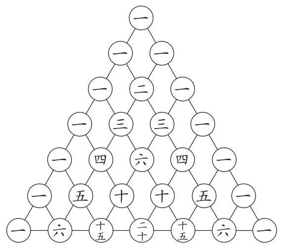

图 14 杨辉三角

【分析】杨辉三角有许多重要性质。

1. 每行两端的数都是 1 。

2. 第 $n$ 行的数字有 $n$ 个。

3. 第 $n$ 行的第 $m$ 个数可表示为 ${\mathrm{C}}_{n - 1}^{m - 1}$ ,且 ${\left( a + b\right) }^{n}$ 的展开式中的各项系数依次对应杨辉三角的第 $\left( {n + 1}\right)$ 行中的各项。

4. 每行数字左右对称,即第 $n$ 行的第 $m$ 个数与第 $n$ 行的第 $(n - m +$ 1)个数相等。

5. 相邻的两行中, 除 1 以外的每个数等于它 “肩上” 两数的和, 即第 $\left( {n + 1}\right)$ 行的第 $i$ 个数等于第 $n$ 行的第 $\left( {i - 1}\right)$ 个数与第 $i$ 个数的和, 可表示为 ${\mathrm{C}}_{n}^{i} = {\mathrm{C}}_{n - 1}^{i - 1} + {\mathrm{C}}_{n - 1}^{i}$ ,其中 $2 \leq  i \leq  n - 1$ 。可用此性质写出整个杨辉三角。

6. 第 $n$ 行数字和为 ${2}^{n - 1}$ 。

## 案例 20 函数图象

【目的】说明数学抽象素养的表现和水平, 体会评价 “能够在熟悉的情境中直接抽象出数学概念和规则”的满意原则和加分原则。

【情境】学校宿舍与办公室相距 $a\mathrm{\;m}$ 。某同学有重要材料要送交给老师, 他从宿舍出发, 先匀速跑步 3 min 来到办公室, 停留 2 min, 然后匀速步行 10 min 返回宿舍。在这个过程中，这位同学行进的速度和行走的路程都是时间的函数, 画出速度函数和路程函数的示意图。

【分析】回顾课程标准的要求:在实际情境中能够用图象揭示函数性质, 整体反映函数的基本特征。本题答案的示意图如图 15。解答本题时, 能给出速度函数或路程函数的大部分示意图, 根据满意原则, 可以认为达到数学抽象素养水平一的要求; 能够完整画出速度函数和路程函数示意图 (二者自变量一致), 可以认为达到数学抽象素养水平二的要求。这个问题也可以考查直观想象等素养。

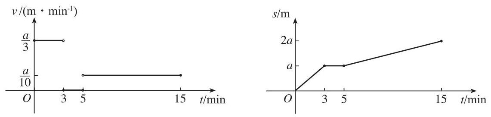

图 15 速度函数和路程函数示意图

案例 21 跑道问题

【目的】说明数学直观想象素养的表现和水平, 体会评价 “能够在熟悉的情境中, 抽象出实物的几何图形, 建立简单图形与实物之间的联系；体会图形与图形、图形与数量的关系”的满意原则和加分原则。

【情境】400 m标准跑道的内圈如图 16 所示, 其中左右两端均是半径为 ${36}\mathrm{\;m}$ 的半圆弧。(注: ${400}\mathrm{\;m}$ 标准跑道最内圈约为 ${400}\mathrm{\;m}$ )

(1)求每条直道的长度(圆周率取 3.14 ，结果精确到 1 m )；

(2)建立平面直角坐标系，写出跑道上半部分对应的函数解析式。

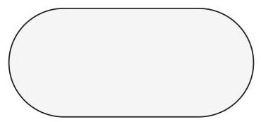

图 16 标准跑道内圈示意图

【分析】回顾课程标准的要求:“在平面直角坐标系中，探索并掌握圆的标准方程与一般方程。”“能根据给定直线、圆的方程，判断直线与圆、圆与圆的位置关系。”

如果能够完成 (1) 的计算，可以认为达到直观想象素养水平一的要求; 能够基本得到 (2) 所要求的表达式, 可以认为达到直观想象素养水平二的要求。这个问题也可以考查数学运算等素养。本题解答如下。

(1)因为跑道两端的弧形合起来是一个完整的圆，所以弧形部分跑道的长度为 $2 \times  {3.14} \times  {36} = {226.08}\left( \mathrm{\;m}\right)$ ,两条直道长度为 ${400} - {226.08} =$ 173.92 (m)。所以每条直道长为 173.92÷2≈87 (m)。

(2)建立如图 17 所示的平面直角坐标系。

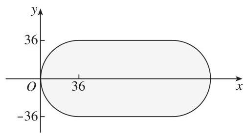

图 17 建立平面直角坐标系示意图

当 $0 \leq  x < {36}$ 时,圆的方程为 ${\left( x - {36}\right) }^{2} + {y}^{2} = {36}^{2}$ ,函数解析式为 $y = \sqrt{{72x} - {x}^{2}};$

当 ${36} \leq  x < {123}$ 时,函数解析式为 $y = {36}$ ;

当 ${123} \leq  x \leq  {159}$ 时,函数解析式为 $y = \sqrt{{246x} - {x}^{2} - {13833}}$ 。

所以函数解析式为

$$
y = \left\{  \begin{array}{ll} \sqrt{{72x} - {x}^{2}}, & 0 \leq  x < {36}, \\  {36}, & {36} \leq  x < {123}, \\  \sqrt{{246x} - {x}^{2} - {13833}}, & {123} \leq  x \leq  {159}。 \end{array}\right.
$$

【拓展】可以考虑以图形的中心为原点建立平面直角坐标系。

案例 22 距离问题

【目的】说明如何考查学生数学抽象、直观想象和数学运算等素养达成的综合情况，体会:要关注数学学科核心素养各要素的不同特征及要求, 更要关注数学学科核心素养的综合性与整体性, 以及评价中的满意原则和加分原则。

【情境 1】在数轴上,对坐标分别为 ${x}_{1}$ 和 ${x}_{2}$ 的两点 $A$ 和 $B$ ,用绝对值定义两点间的距离,表示为 $d\left( {A, B}\right)  = \left| {{x}_{1} - {x}_{2}}\right|$ 。回答下面的问题:

(1)在数轴上任意取三点 $A, B, C$ ,证明

$$
d\left( {A, B}\right)  \leq  d\left( {A, C}\right)  + d\left( {B, C}\right) \text{。}
$$

(2)设 $A$ 和 $B$ 两点的坐标分别为 -3 和 2，找出满足 $d\left( {A, B}\right)  = \; d\left( {A, C}\right)  + d\left( {B, C}\right)$ 的点 $C$ 的范围,再找出满足 $d\left( {A, B}\right)  < \; d\left( {A, C}\right)  + d\left( {B, C}\right)$ 的点 $C$ 的范围。

【情境 2】城市的许多街道是相互垂直或平行的, 因此, 往往不能沿直线行走到达目的地, 只能按直角拐弯的方式行走。如果按照街道的垂直和平行方向建立平面直角坐标系,对两点 $A\left( {{x}_{1},{y}_{1}}\right)$ 和 $B\left( {{x}_{2},{y}_{2}}\right)$ ,类比 “情境 1” 中的方式定义两点间距离为

$$
d\left( {A, B}\right)  = \left| {{x}_{1} - {x}_{2}}\right|  + \left| {{y}_{1} - {y}_{2}}\right| ,
$$

回答类似的问题:

(1)在平面直角坐标系中任意取三点 $A, B, C$ ,证明

$$
d\left( {A, B}\right)  \leq  d\left( {A, C}\right)  + d\left( {B, C}\right) \text{。}
$$

(2)设 $A$ 和 $B$ 两点的坐标分别为 $\left( {{x}_{1},{y}_{1}}\right)$ 和 $\left( {{x}_{2},{y}_{2}}\right)$ ，找出满足 $d\left( {A, B}\right)  = d\left( {A, C}\right)  + d\left( {B, C}\right)$ 的点 $C$ 的范围,再找出满足 $d\left( {A, B}\right)  < \; d\left( {A, C}\right)  + d\left( {B, C}\right)$ 的点 $C$ 的范围。

【分析】考虑下面数学学科核心素养达成的等级划分标准。

对于 “情境 1” 中的问题, 基本上给出 (1) 的证明或 (2) 的计算, 可以认为达到数学抽象、逻辑推理、直观想象和数学运算素养水平一的要求。

对于 “情境 2” 中的问题, 关键点是通过理解特殊的 “两点间距离”定义, 考查学生的直观想象和数学抽象素养。对于问题 (1), 如果学生能够对平面上固定的三点 $A, B, C$ ,说明 $d\left( {A, B}\right)  \leq  d\left( {A, C}\right)  + \; d\left( {B, C}\right)$ ,可以认为达到数学抽象、逻辑推理、直观想象和数学运算等素养水平一的要求; 进一步地,如果学生对任意的三点 $A, B, C$ , 得到该结果, 可以认为达到相应素养水平二的要求。对于问题 (2), 只要学生画出基本符合要求的图形, 就可以认为达到相应素养水平二的要求; 进一步地, 如果学生还能给出清晰的证明, 可以适当加分。

【拓展】在 “情境 2” 中的距离意义下,画出到定点 $O\left( {0,0}\right)$ 的距离等于 1 的点 $P\left( {x, y}\right)$ 所形成的图形。从上述距离的定义出发,给出 “点到直线的距离” 的定义, 并计算已知点到已知直线的距离。

案例 23 四棱锥中的平行问题

【目的】以空间中的平行关系为知识载体, 以探索作图的可能性为数学任务, 依托判断、说理等数学思维活动, 说明逻辑推理素养水平一、水平二的表现，体会评价中的满意原则和加分原则。

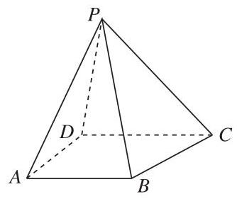

图 18 四棱锥示意图

【情境】如图 18,在四棱锥 $P - {ABCD}$ 的底面 ${ABCD}$ 中, ${AB}//{DC}$ 。回答下面的问题:

(1)在侧面 ${PAB}$ 内能否作一条直线使其与 ${DC}$ 平行? 如果能,请写出作图过程并给出证明; 如果不能, 请说明理由。

(2)在侧面 ${PBC}$ 中能否作出一条直线使其与 ${AD}$ 平行？如果能， 请写出作图过程并给出证明; 如果不能, 请说明理由。

【分析】直线与直线、直线与平面、平面与平面的平行和垂直等位置关系是高中立体几何内容的重点, 也是教学的难点。设计开放性问题, 让学生在运用与平行和垂直的相关定理进行判断、说理的活动过程中, 提升直观想象和逻辑推理素养; 通过这样的活动也可以对学生达到的相应素养水平进行评价。

(1)能作出平行线。具体作法是，在侧面 ${PAB}$ 内作 ${AB}$ 的平行线; 因为 ${AB}$ 与 ${DC}$ 平行,依据平行公理,这条平行线也必然平行于 ${DC}$ 。完成这个过程,说明学生知道在平面内作与平面外直线平行的直线, 需要寻求平面外直线与这个平面之间的关联, 依据满意原则, 可以认为达到逻辑推理素养水平一的要求。

(2)需要分别判断。如果 ${AD}$ 与 ${BC}$ 平行，可以参照(1)的方法作出平行线。如果 ${AD}$ 与 ${BC}$ 不平行,不能作出平行线。用反证法进行说理如下: 假设侧面 ${PBC}$ 内存在直线与 ${AD}$ 平行,可推证 ${AD}$ 与侧面 ${PBC}$ 平行,依据直线与平面平行的性质定理,可推证 ${AD}$ 与 ${BC}$ 平行, 这与条件矛盾。完成这个过程, 说明学生能够理解直线与平面平行的相关定理以及定理之间的逻辑关系, 依据满意原则, 可以认为达到逻辑推理素养水平二的要求。

案例 24 覆盖问题

【目的】以平面几何为知识载体, 以证明 “周长一定的四边形中正方形所围面积最大” 为数学任务, 说明逻辑推理素养水平一、水平二、 水平三和数学抽象素养水平一、水平二的表现, 体会满意原则和加分原则。

【情境】设桌面上有一个由铁丝围成的封闭曲线,周长是 ${2L}$ 。回答下面的问题:

(1)当封闭曲线为平行四边形时,用直径为 $L$ 的圆形纸片是否能完全覆盖这个平行四边形? 请说明理由。

(2)求证:当封闭曲线是四边形时，正方形的面积最大。

【分析】虽然问题涉及的知识不难, 但由于问题中的封闭曲线是动态的, 问题是开放的, 因此需要具备一定的数学抽象和逻辑推理素养才可能抓住问题的本质。如果学生能够构建过渡性命题、完成概念的抽象过程, 并且论证途径清晰、推理过程表述严谨, 可以认为达到逻辑推理素养水平三的要求。

(1)首先，需要从生活语言到数学语言，表达清楚什么是完全覆盖。最初的生活语言可以是,周长为 ${2L}$ 的平行四边形包含的点都在直径为 $L$ 的圆面内,显然这个层面的表达是无法进行论证的; 用数学语言可以表述为，周长为 ${2L}$ 的平行四边形内的任意一点到圆心的距离不大于 $\frac{L}{2}$ ,可是,这样的表述又脱离了完全覆盖的背景; 因此需要在表述中加上条件, 例如让平行四边形的对称中心与圆的圆心重合。鼓励学生回顾并表述上面的思维过程。如果学生能够完成前两个过程, 根据满意原则, 可以认为达到数学抽象素养水平一的要求; 如果学生能够完成三个过程, 根据加分原则, 可以认为达到数学抽象素养水平二的要求。

如果学生能够得到可以完全覆盖的结论, 但只是证明了平行四边形对角线的长度不大于 $L$ ,说明学生已经有了论证的思路,但还没有理解完全覆盖的几何本质, 依据满意原则, 可以认为达到逻辑推理素养水平一的要求。

如果学生进一步证明平行四边形四个顶点到对称中心距离不大于圆的半径, 但没有说明平行四边形内其他点的情况, 说明学生理解了完全覆盖的几何本质, 但证明过程还不够严谨, 依据满意原则, 可以认为达到逻辑推理素养水平二的要求。

如果学生能够完整证明平行四边形上的点到对称中心距离都不大于圆的半径, 说明学生基本掌握了数学证明, 依据加分原则, 可以认为达到逻辑推理素养水平三的要求。

(2)可以启发学生，采用列举、筛选的方法考察各种形式的四边

形, 逐一排除面积较小的四边形, 构建一个递进式的证明路径, 如图 19 所示。

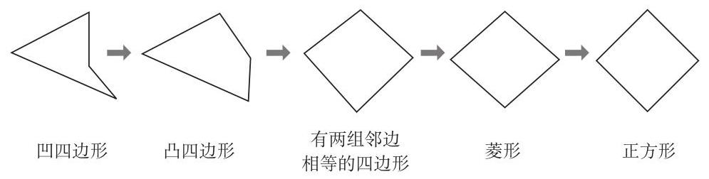

图 19 探索证明路径

如果学生能够独立完成上面的过程, 说明对较复杂的新问题, 能够通过直观想象创造性地构建证明路径, 依据满意原则, 可以认为达到逻辑推理素养水平二的要求; 如果学生能够进一步用数学语言严谨地论证所得到的结论, 根据加分原则, 可以认为达到逻辑推理素养水平三的要求。

## 案例 25 包装彩绳

【目的】在把实际问题转化为数学问题的过程中, 说明数学建模素养不同水平的表现, 体会评价的满意原则和加分原则。

【情境】春节期间, 佳怡准备去探望奶奶, 她到商店买了一盒点心。 为了美观起见, 售货员对点心盒做了一个捆扎 (如图 20 (1)), 并在角上配了一个花结。售货员说, 这样的捆扎不仅漂亮, 而且比一般的十字捆扎 (如图 20 (2)) 包装更节省彩绳。你同意这种说法吗? 请给出你的理由。(注:长方体点心盒的高小于长、宽)

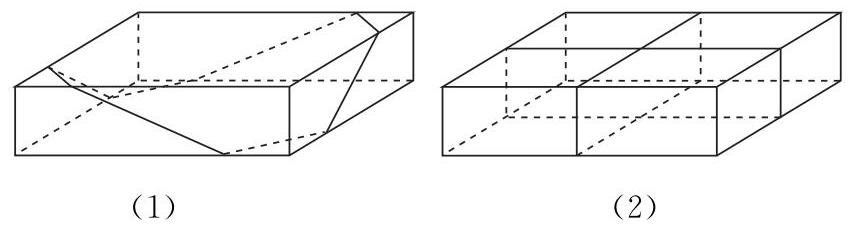

图 20 点心盒的两种包装

【分析】在数学建模过程中, 常常要把实际问题数学化。特别是, 需要借助几何直观才能论证的问题, 这通常是学生数学建模的难点。因此, 对于这样一类问题, 难点处理的差异能够反映数学建模素养的不同水平。

如果学生能够结合几个具体的长方体盒子, 通过捆扎操作、测量比

较的方法, 得到针对这几个盒子的结论, 并且能够通过归纳、提出一般长方体盒子情况下的猜想, 即使不能给出证明, 根据满意原则, 也可以认为达到数学建模素养水平一的要求。

如果学生能够用字母表示各段绳长, 将长方体盒子平面展开, 把问题转化为平面上折线长度的比较, 把 “扎紧” 的表述转化为两点间线段, 最后给出一般性的结论, 可以认为达到数学建模素养水平二的要求。

如果不考虑花结用绳, 或者认为两种捆扎方法中花结的用绳长度相同, 一个推理过程的范例可以表述如下。

设长方体点心盒子的长、宽、高分别为 $x, y, z$ ,依据图 20(2) 的捆扎方式,把彩绳的长度记作 $l$ 。因为长方体的每个面上的那一段绳都与相交的棱垂直,所以 $l = {2x} + {2y} + {4z}$ 。

依据图 20(1)的捆扎方式，可以想象将长方体盒子展开在一个平面上,则彩绳的平面展开图是一条由 $A$ 到 $A$ 的折线。在 “扎紧” 的情况下,彩绳的平面展开图是一条由 $A$ 到 $A$ 的线段,记为 ${A}^{\prime }{A}^{\prime \prime }$ (如图 21)，这时用绳最短，绳长记作 $m$ 。在 $\bigtriangleup  {A}^{\prime }B{A}^{\prime \prime }$ 中，由三角形中两边之和大于第三边, 得

$$
m = \left| {{A}^{\prime }{A}^{\prime \prime }}\right|  < \left| {{A}^{\prime }B}\right|  + \left| {{A}^{\prime \prime }B}\right|
$$

$$
= {2y} + {2z} + {2x} + {2z}
$$

$$
= {2x} + {2y} + {4z}\text{,}
$$

即 $l > m$ 。

因此, 图 20 (1) 所示的捆扎方式节省材料。

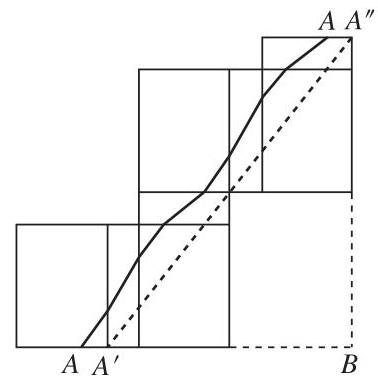

图 21 长方体盒子的平面展开示意图

如果学生能够完成以上工作, 可以认为达到数学建模素养水平二的要求。如果思路清晰、表达准确，还可以适当加分。

## 案例 26 体重与脉搏

【目的】在构建“比例模型”解决实际问题的过程中, 给出数学建模素养水平二、水平三的表现, 体会评价的满意原则和加分原则。

【情境】生物学家认为, 睡眠中的恒温动物依然会消耗体内能量, 主要是为了保持体温。研究表明,消耗的能量 $E$ 与通过心脏的血流量 $Q$ 成正比; 并且根据生物学常识知道,动物的体重与体积成正比。

表 9 给出了一些动物体重与脉搏率对应的数据。

表 9 一些动物的体重和脉搏率

<table><tr><td>动物名</td><td>体重/g</td><td>脉搏率/(次・min ${}^{-1}$ )</td></tr><tr><td>鼠</td><td>25</td><td>670</td></tr><tr><td>大鼠</td><td>200</td><td>420</td></tr><tr><td>豚鼠</td><td>300</td><td>300</td></tr><tr><td>兔</td><td>2000</td><td>205</td></tr><tr><td>小狗</td><td>5000</td><td>120</td></tr><tr><td>大狗</td><td>30000</td><td>85</td></tr><tr><td>羊</td><td>50000</td><td>70</td></tr><tr><td>马</td><td>450000</td><td>38</td></tr></table>

回答下面的问题:

(1)请根据生物学常识，给出血流量与体重之间关系的数学模型。

(2)从表 9 可以看到，体重越轻的动物脉搏率越高。请根据上面所提供的数据寻求数量之间的比例关系, 建立脉搏率与体重关系的数学模型。

(3)根据表 9，作出动物的体重和脉搏率的散点图，验证建立的数学模型。

【分析】为了建立数学模型, 需要进一步理解一些生物学概念, 例如,血流量 $Q$ 是单位时间内流过的血量,脉搏率 $f$ 是单位时间内心跳

的次数；还需要进一步知道一些生物学假设，例如，心脏每次收缩挤压出来的血量 $q$ 与心脏大小成正比,动物心脏的大小与这个动物体积的大小成正比。

因为数学建模只用到 “比例分析”，所以在知识层面上学生困难不大，但学生通常对比例模型的分析思路比较陌生；同时，这个数学活动体现了跨学科的应用, 因此如果能很好地解决问题, 可以认为达到数学建模素养水平二甚至水平三的要求。例如, 下面的建模过程。

(1)因为动物体温通过身体表面散发热量，表面积越大，散发的热量越多,保持体温需要的能量也就越大,所以动物体内消耗的能量 $E$ 与身体的表面积 $S$ 成正比,可以表示为 $E = {p}_{1}S$ 。又因为动物体内消耗的能量 $E$ 与通过心脏的血流量 $Q$ 成正比,可以表示为 $E = {p}_{2}Q$ 。因此得到 $Q = {pS}$ ,其中 ${p}_{1},{p}_{2}$ 和 $p$ 均为正的比例系数。

另一方面,因为体积 $V$ 与体重 $W$ 成正比,可以表示为 $V = {r}_{1}W$ ; 又因为表面积 $S$ 大约与体积 $V$ 的 $\frac{2}{3}$ 次方成正比,可以表示为 $S = {r}_{2}{V}^{\frac{2}{3}}$ , 因此得到 $S = r{W}^{\frac{2}{3}}$ ,其中 ${r}_{1},{r}_{2}, r$ 为正的比例系数。所以可以构建血流量与体重关系的数学模型 $Q = {k}_{1}{W}^{\frac{2}{3}}$ ,其中 ${k}_{1}$ 为正的比例系数。根据脉搏率的定义 $f = \frac{Q}{q}$ ,再根据生物学假设 $q = {cW}$ ( $c$ 为正的比例系数),最后得到 $f = \frac{Q}{q} = \frac{{k}_{1}{W}^{\frac{2}{3}}}{cW}$ ,也就是 $f = k{W}^{-\frac{1}{3}}$ ,其中 $k$ 为正的待定系数。

(2)脉搏率与体重关系的数学模型说明，恒温动物体重越大，脉搏率越低; 脉搏率与体重的 $\frac{1}{3}$ 次方成反比。表 9 中的数据基本上反映了这一反比例关系。

(3)图 22 是原始数据的散点图,图 23 是以 $\ln W$ 和 $\ln f$ 为坐标的散点图。可以看出,数据取对数之后基本满足线性关系,因此得到体重和脉搏率的对数线性模型,可以把这个模型表达为 $\ln f = \ln k - \frac{\ln W}{3}$ 。

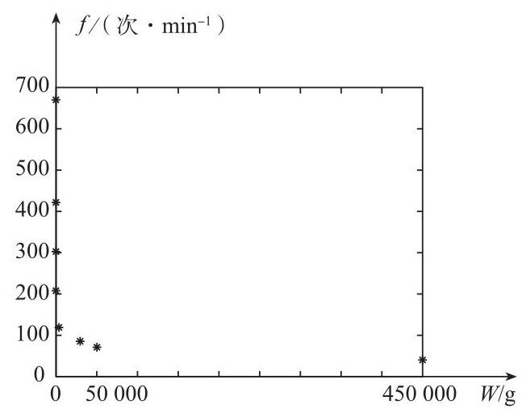

图 22 脉搏率 $f$ 与体重 $W$ 的散点图

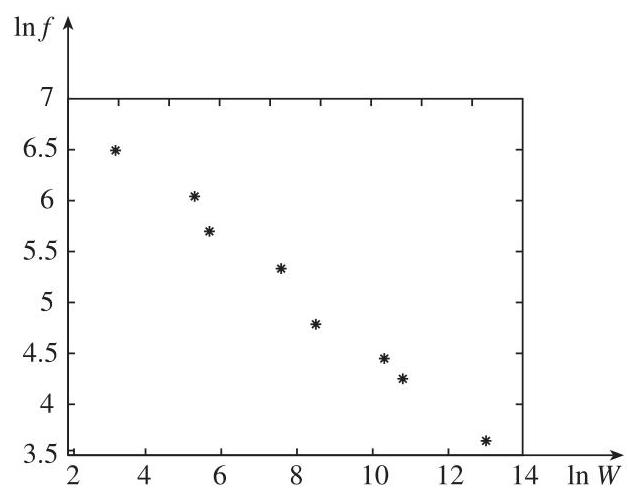

图 ${23}\ln f$ 与 $\ln W$ 的散点图

如果学生在上述分析过程中思路清晰、表达准确, 可以认为达到数学建模素养水平三的要求。如果在分析或者论证过程中还有一些创意, 例如, 对脉搏率与体重关系的模型两边取对数, 形成对数线性模型; 能够用相关系数进行线性相关性判断; 能够用方差分析方法检验模型的适合程度等, 则根据加分原则, 可以进行相应加分。

因为这个问题的分析线索比较长, 学生在建模求解的过程中, 可能会得到一些有价值的中间结论, 或者有些学生最终不能把整个过程进行到底, 甚至有些学生不经过任何分析就给出拟合函数 (如图 24)。这些情况都是数学建模和数据分析素养水平达成程度的表现, 可以适度加分或者扣分。

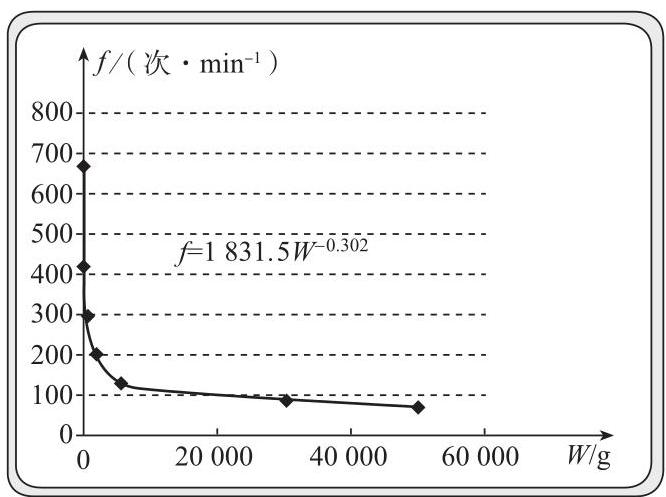

图 24

案例 27 估算地球周长

【目的】说明直观想象素养的表现和水平, 体会评价 “能够在熟悉的情境中, 抽象出实物的几何图形, 建立简单图形与实物之间的联系” 的满意原则和加分原则。

【情境】古希腊地理学家埃拉托色尼用下面的方法估算地球周长 (即赤道周长)。他从书中得知, 位于尼罗河第一瀑布的塞伊尼 (现在的阿斯旺，在北回归线上)，夏至那天正午立竿无影； 同样在夏至那天, 他所在的城市一古埃及北部的亚历山大城,立杆可测得日影角大约为 ${7}^{ \circ  }$ (如图 25)。埃拉托色尼猜想造成这个差异的原因是地球是圆的, 并且因为太阳距离地球很远 (现代科学观察得知, 太阳光到达地球表面需要 8.3 s,

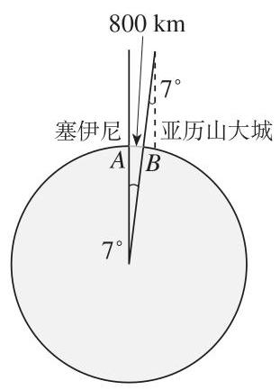

图 25 计算地球周长示意图

光速 ${300000}\mathrm{\;{km}}/\mathrm{s}$ ),太阳光平行照射在地球上。根据平面几何知识, 平行线内错角相等, 因此日影角与两地对应的地心角相等。他又派人测得两地距离大约为 5000 希腊里,约合 800 km; 因为 ${360}^{ \circ  }$ 大约为 ${7}^{ \circ  }$ 的 50 倍,于是他估算地球周长约为 ${800} \times  {50} = {40000}\left( \mathrm{\;{km}}\right)$ ,这与地球实际周长 40076 km 相差无几。

(1)试画出平面示意图；

(2)试由埃拉托色尼的估算结果，给出你的推理过程。

【分析】如果学生能够画出基本合理的草图, 可以认为达到直观想象素养水平一的要求; 能够画出清晰合理的示意图, 可以认为达到直观想象素养水平二的要求。本题也考查逻辑推理等素养。例如, 下面的分析过程。

(1)如图 25，记塞伊尼为点 $A$ ，亚历山大城为点 $B$ 。在两个点处太阳光平行,因为内错角相等得到 $\overset{⏜}{AB}$ 对应的地心角为 ${7}^{ \circ  },\overset{⏜}{AB}$ 的长度为 800 km。

(2)用 $\overset{⏜}{AB}$ 的长乘 $\frac{360}{7}$ 可以得到地球近似周长。

案例 28 圆柱体截面问题

【目的】说明直观想象素养的表现和水平, 体会满意原则和加分原则。

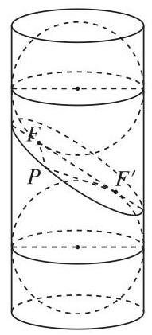

图 26

【情境】在一个密闭透明的圆柱桶内装一定体积的水。

(1)将圆柱桶分别竖直、水平、倾斜放置时, 指出圆柱桶内的水平面可能呈现出的所有几何形状, 画出直观示意图。

(2)参考图 26，对上述结论给出证明。

【分析】回顾课程标准中相关内容要求:“利用实物、 计算机软件等观察空间图形, 掌握柱、锥、台、球及简单组合体的结构特征, 能运用这些特征描述现实生活中简单物体的结构。”

如果学生能够比较完整地回答 (1) 的第一个问题, 可以认为达到直观想象素养水平一的要求; 能比较完整地回答 (1) 的第二个问题, 可以认为达到直观想象素养水平二的要求; 能比较完整地回答 (2) 的问题, 可以认为达到直观想象素养水平三的要求。此题也考查逻辑推理等素养。例如，下面的回答。

(1)圆柱桶竖直放置时，水平面为圆面；水平放置时，水平面为矩

形面；倾斜放置时，水平面为椭圆面或者部分椭圆面。可能呈现的所有类型的几何图形, 如图 27 所示。

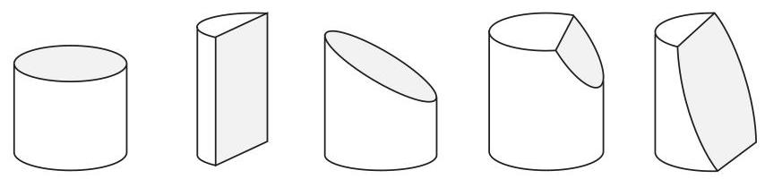

图 27 水平面可能出现的几何形状

(2)圆柱桶竖直放置时，水平面相当于平行于底面的截面，因此水平面是圆面。

圆柱桶水平放置时, 水平面与圆柱侧面的两条交线是圆柱的母线, 它们平行且相等, 且垂直于水平面与圆柱底面的两条交线, 所以水平面是矩形面。

圆柱桶倾斜放置时, 水平面相当于用平面斜截圆柱时所得到的截面。如图 28 所示, 上下两球与截面和圆柱侧面均相切, 两球面与圆柱侧面分别相切于以 ${BC},{DE}$ 为直径且平行于圆柱底面的大圆 ${O}_{1}$ 和 ${O}_{2}$ ,两球面与斜截面分别相切于点 $F$ 和 ${F}^{\prime }$ ,斜截面与 ${BD},{CE}$ 分别交于点 $A$ 和 ${A}^{\prime }, P$ 为所得截面边缘上一点 (即斜截面与圆柱侧面交线上一点)。设过点 $P$ 的圆柱的母线与圆 ${O}_{1}$ 和 ${O}_{2}$ 分别交于点 $M$ 和 $N$ ,则 ${PM}$ 和 ${PN}$ 分别是两球面的一条切线。

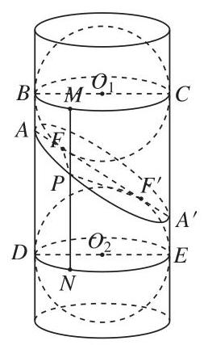

图 28

由于 ${PM}$ 和 ${PF}$ 是同一个球面的切线,故 ${PM} = {PF}$ ; 同理 ${PN} = P{F}^{\prime }$ ，于是有 ${PF} + P{F}^{\prime } = {PM} + {PN} = {MN}$ 为定值，即点 $P$ 到点 $F$ 和 ${F}^{\prime }$ 距离之和为定值,所以这时的截面是椭圆面。

案例 29 过河问题

【目的】以平面向量的运算为知识载体, 以确定游船的航向、航程为数学任务, 借助理解运算对象、运用运算法则、探索运算思路、设计运算程序、实施运算等一系列数学思维活动, 说明数学运算素养水平一、水平二和水平三的表现, 体会满意原则和加分原则。

【情境】长江某地南北两岸平行。如图 29 所示,江面宽度 $d = \; 1\mathrm{\;{km}}$ ,一艘游船从南岸码头 $A$ 出发航行到北岸。假设游船在静水中的航行速度 ${\mathbf{v}}_{1}$ 的大小为 $\left| {\mathbf{v}}_{1}\right|  = {10}\mathrm{\;{km}}/\mathrm{h}$ ,水流的速度 ${\mathbf{v}}_{2}$ 的大小为 $\left| {\mathbf{v}}_{2}\right|  = \; 4\mathrm{\;{km}}/\mathrm{h}$ 。设 ${\mathbf{v}}_{1}$ 和 ${\mathbf{v}}_{2}$ 的夹角为 $\theta \left( {{0}^{ \circ  } < \theta  < {180}^{ \circ  }}\right)$ ,北岸的点 ${A}^{\prime }$ 在 $A$ 的正北方向。回答下面的问题:

(1)当 $\theta  = {120}^{ \circ  }$ 时,判断游船航行到达北岸的位置在 ${A}^{\prime }$ 的左侧还是右侧, 并说明理由。

(2)当 $\cos \theta$ 多大时,游船能到达 ${A}^{\prime }$ 处? 需要航行多长时间?

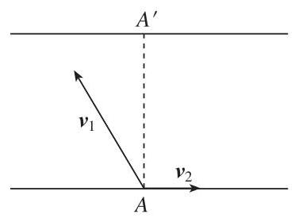

图 29 河流两岸示意图

【分析】回答这个问题需要几何直观下的代数运算。

(1)首先要知道游船航行速度是静水速度与水流速度之和，然后会按比例画示意图判断航行方向。如果学生能够用向量加法的平行四边形法则画出示意图, 并给出合理解释, 根据满意原则, 可以认为达到数学运算素养水平一的要求。

如果学生把航行速度即速度之和表示为 $v$ ,可以通过计算航行速度向量 $v$ 与水流速度向量 ${v}_{2}$ 之间的夹角进行判断,由

$$
\cos \left\langle  {\mathbf{v},{\mathbf{v}}_{2}}\right\rangle   = \frac{\mathbf{v} \cdot  {\mathbf{v}}_{2}}{\left| \mathbf{v}\right| \left| {\mathbf{v}}_{2}\right| } = \frac{{\mathbf{v}}_{1} \cdot  {\mathbf{v}}_{2} + {\mathbf{v}}_{2} \cdot  {\mathbf{v}}_{2}}{\left| \mathbf{v}\right| \left| {\mathbf{v}}_{2}\right| } = \frac{-4}{\left| \mathbf{v}\right| \left| {\mathbf{v}}_{2}\right| } < 0,
$$

判断游船到达的位置在 ${A}^{\prime }$ 的左侧。说明学生不仅能够理解向量的加法, 还能够根据题意, 运用向量数量积运算求解向量之间的夹角, 根据加分原则, 可以认为达到数学运算素养水平二的要求。

(2)首先要将 “游船能到达 ${A}^{\prime }$ 处” 抽象为游船的实际航向与河岸

垂直,即游船的静水速度和水流速度的合速度方向与 $\overrightarrow{A{A}^{\prime }}$ 相同,再将合速度运算与平面向量的加法运算联系起来, 画出速度合成示意图 (如图 30)。根据满意原则, 学生能够画出向量加法示意图, 可以认为达到数学运算素养水平一的要求。

通过解三角形,求得 $\cos \theta$ 值为 $- \frac{2}{5}$ ; 通过 $\left| \mathbf{v}\right|  = \left| {\mathbf{v}}_{1}\right| \sin \theta  = 2\sqrt{21}$ ,得到航行时间 $\frac{\sqrt{21}}{42}\mathrm{\;h}$ 。说明学生能够将题目中提供的数据信息与几何图形有机联系, 并且能够明晰运算途径、得到运算结果, 根据加分原则, 可以认为达到数学运算素养水平二的要求。

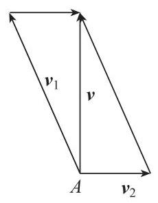

图 30

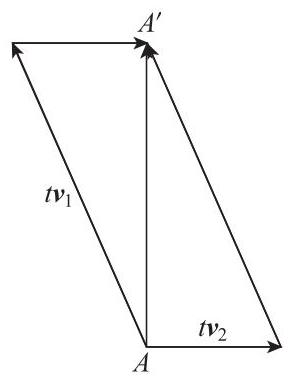

图 31

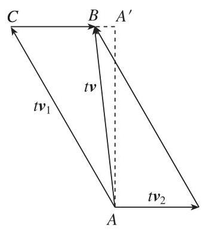

图 32

如果学生直接画出位移合成示意图 (如图 31,图中 $t$ 为到达对岸的时间), 说明学生不仅能用向量加法而且能够用向量的数乘运算来表达问题, 可以在数学运算素养水平二的基础上加分。

进一步地,如果学生能够通过直角三角形计算出 $\cos \theta  =  - \frac{2}{5}$ ,由勾股定理,通过 ${\left( {10}t\right) }^{2} - {\left( 4t\right) }^{2} = 1$ 解得 $t = \frac{\sqrt{21}}{42}\mathrm{\;h}$ 。说明学生能够运用勾股定理建立方程求解, 根据加分原则, 可以认为达到数学运算素养水平三的要求。

【拓展】在本题背景下, 可以设计数学运算素养拓展问题, 例如当 $\theta  = {120}^{ \circ  }$ 时,游船航行到北岸的实际航程是多少?

为了回答这个问题, 可以先依据题意画出向量加法的示意图, 如图 32 所示, 然后利用向量数量积运算求得

$$
{\left| t\mathbf{v}\right| }^{2} = {t}^{2}{\left( {\mathbf{v}}_{1} + {\mathbf{v}}_{2}\right) }^{2} = {t}^{2}\left( {{10}^{2} + 2 \times  {10} \times  4 \times  \cos {120}^{ \circ  } + {4}^{2}}\right)  = {76}{t}^{2}。
$$

在 Rt $\bigtriangleup A{A}^{\prime }C$ 中,因为 $t\left| {\mathbf{v}}_{1}\right| \cos {30}^{ \circ  } = 1$ ,从而 $t = \frac{\sqrt{3}}{15}$ ,所以 ${AB} = \; \frac{2\sqrt{57}}{15}\mathrm{\;{km}}$ 。如果学生能够完成这个过程,说明学生能够综合运用向量的加法、数乘、数量积运算和勾股定理, 恰到好处地设计运算程序、完成问题求解, 根据加分原则, 可以在数学运算素养水平三的基础上加分。

## 案例 30 隧道长度

【目的】以解三角形为知识载体, 以隧道测量为数学任务, 借助明确运算对象、探索运算思路、设计运算程序、实施运算等一系列数学思维活动, 说明数学运算素养的水平一和水平二的表现, 体会满意原则。

【情境】如图 33 所示, $A, B, C$ 为山脚两侧共线的三点,在山顶 $P$ 处测得三点的俯角分别为 $\alpha ,\beta ,\gamma$ 。计划沿直线 ${AC}$ 开通穿山隧道, 为求出隧道 ${DE}$ 的长度,你认为还需要直接测量出 ${AD},{EB},{BC}$ 中的哪些线段的长度? 根据条件, 并把你认为需要测量的线段长度作为已知量,写出计算隧道 ${DE}$ 长度的运算步骤。

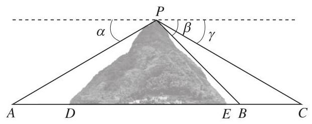

图 33 计算隧道长度示意图

【分析】由已经测得的三个角 $\alpha ,\beta ,\gamma$ ,依据平面几何知识可以知道, $\bigtriangleup {PAB},\bigtriangleup {PBC}$ 的三个内角已经确定,进而形状已经确定,因此还需要通过确定三角形的边长来确定三角形的大小。进一步, 为了能够计算隧道 ${DE}$ 的长度,由解三角形的知识,可以推断出还需要确定线段 ${AD},{EB},{BC}$ 的长度。

首先在 $\bigtriangleup {PBC}$ 中进行运算,依据正弦定理写出 ${BC}$ 与 ${PB}$ (或 ${PC}$ ) 之间的等量关系式,表达出 ${PB}$ (或 ${PC}$ )。如果学生能够完成这个步骤, 说明学生已经熟悉常规的解三角形问题及其解法, 根据满意原则, 可以认为达到数学运算素养水平一的要求。

如果学生能够继续在 $\bigtriangleup  {PAB}$ (或 $\bigtriangleup  {PAC}$ )中，由正弦定理写出 ${PB}$ 与 ${AB}$ (或 ${PC}$ 与 ${AC}$ ) 之间的等量关系式,用已知角度 $\alpha ,\beta ,\gamma$ 和测量得的线段 ${AD},{EB},{BC}$ 长度正确写出线段 ${DE}$ 长度的表达式,说明学生能够清晰表达图 33 中多个三角形之间的关系, 并且能够探索出运算程序、正确实施, 根据满意原则, 可以认为达到数学运算素养水平二的要求。

案例 31 估计考生总数

【目的】分别说明数学建模素养和数据分析素养水平一、水平二的表现，体会评价的满意原则和加分原则。

【情境】某大学美术系平面设计专业的报考人数连创新高。今年报名刚结束，某考生想知道报考人数。考生的考号按 0001，0002，...的顺序从小到大依次排列。这位考生随机地了解了 50 个考生的考号, 具体如下:

$\begin{array}{llllllllll} {0400} & {0904} & {0747} & {0090} & {0636} & {0714} & {0017} & {0432} & {0403} & {0276} \end{array}$

$\begin{array}{llllllllll} {0986} & {0804} & {0697} & {0419} & {0735} & {0278} & {0358} & {0434} & {0946} & {0123} \end{array}$

$\begin{array}{llllllllll} {0647} & {0349} & {0105} & {0186} & {0079} & {0434} & {0960} & {0543} & {0495} & {0974} \end{array}$

$\begin{array}{llllllllll} {0219} & {0380} & {0397} & {0283} & {0504} & {0140} & {0518} & {0966} & {0559} & {0910} \end{array}$

$\begin{array}{llllllllll} \text{ 0658 } & {0442} & {0694} & {0065} & {0757} & {0702} & {0498} & {0156} & {0225} & {0327} \end{array}$

请给出一种方法, 根据这 50 个随机抽取的考号, 帮助这位考生估计考生总数。

【分析】用样本的数字特征估计总体的数字特征或性质, 是统计建模的基本思想和基本方法, 既可以表现数学建模素养水平, 也可以表现数据分析素养水平。

如果学生给出的方法体现了用样本估计总体的思想, 并且述说的理由合理, 即使表述得不完整、不清楚、不到位, 根据满意原则, 都可以认为达到数据分析素养水平一的要求。例如, 用给出数据的最大值 986 (与 0986 对应) 估计考生总数; 用数据的最大值与最小值的和 1003 (即 986+17) 估计考生总数; 借助数据中的部分数据的信息 (如平均值、中位数等) 估计考生的总数; 等等。

如果学生能够理解数据分析的思想, 过程述说比较清楚, 数学表达比较到位, 可以认为达到数据分析素养水平二的要求。例如:

设考生总数为 $N$ ,即 $N$ 是最大考号。

方法一 随机抽取的 50 个数的平均值应该和所有考号的平均值接近, 即用样本的平均值估计总体的平均值。

这 50 个数的算术平均值是 ${24571} \div  {50} = {491.42}$ ,它应该与 $\frac{N}{2}$ 接近。 因此，估计今年报考这所大学美术系平面设计专业的考生总数为

$$
N \approx  {491.42} \times  2 \approx  {983}\text{(人)。}
$$

类似地,可以通过样本中位数得到 $N$ 的估计。

方法二 把这 50 个数据按从小到大的顺序排列, 这 50 个数把区间 $\left\lbrack  {0, N}\right\rbrack$ 分成 51 个小区间。由于 $N$ 未知,除了最右边的区间,其他区间都是已知的。可以利用这些区间长度来估计 $N$ 。

由于这 50 个数是随机抽取的, 一般情况下可以认为最右边区间的长度近似等于 $\left\lbrack  {0, N}\right\rbrack$ 长的 $\frac{1}{51}$ ,并且可以用前 50 个区间的平均长度近似代替这个区间的长度。因为这 50 个区间长度的和, 恰好是这 50 个数中的最大值 986 , 所以得到

$$
N \approx  \frac{986}{50} \times  {51} \approx  {1006}。
$$

因为这是一道开放题, 允许有不同的答案。只要学生能够对自己提出的方法给出合理的解释, 可以认为达到相应水平的要求。

案例 32 函数单调性主题教学设计

【目的】说明如何进行跨章节的主题教学设计。

【情境】函数单调性是函数的重要性质之一, 不仅与函数概念、 函数的其他性质有关, 也与基本初等函数、不等式、数列、导数等内容有关, 在表述过程中还与常用逻辑用语中的量词有关。所以, 函数单调性可以作为跨章节的主题进行整体教学设计。

【分析】一般来说, 主题教学的整体设计可分为前期准备、开发设计、评价修改三个阶段，具体可以包括以下几个步骤:确定主题内容， 分析教学要素，编制主题教学目标，设计主题教学流程，评价、反思、 修改。如图 34 所示。

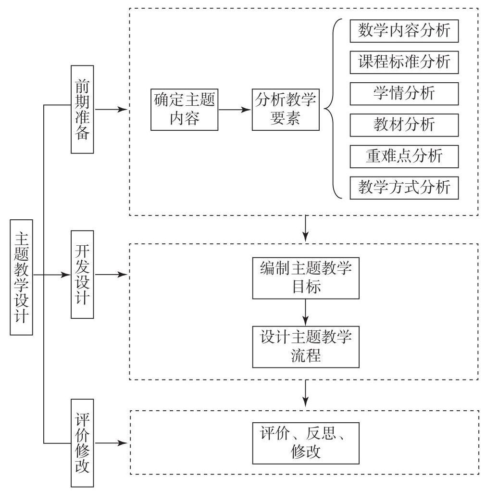

图 34 主题教学设计示意图

作为案例，下面给出教学设计的具体方法。

为了确定主题内容, 下面的两种策略可供选择。

一是以函数单调性知识的展开逻辑为线索。例如, 借助初等函数的图象直观理解函数单调性的含义、感悟函数的整体单调和部分区间单调；通过代数运算(特别关注最大(小)值)，验证函数的单调性以及单调性与自变量变化区间的关系; 用导数进一步刻画函数的单调性, 把握函数单调性的本质是变化趋势。以知识的逻辑联系为线索组织内容, 学生可以对函数单调性的认识逐渐深刻、表达逐渐清晰。

二是以函数单调性与其他性质的关系为线索。例如, 考察初等函数的单调性与对称性、周期性、最大 (小) 值之间的关系, 分析这几个性质的共性与差异。以函数的其他性质为线索组织内容, 学生可以通过比较函数的性质, 进一步加深对函数概念的理解, 体会正是因为不同函数具有不同性质, 才使得函数成为表达现实世界规律的丰富的数学语言。

无论采取哪种策略组织内容，在教学设计中，都要关注数学抽象、 逻辑推理、直观想象、数学运算等素养水平的提升。

分析教学要素是确定主题教学目标的前提, 是主题教学设计的重点环节。教学要素分析主要包括以下方面:数学内容分析、课程标准分析、学情分析、教材分析、重难点分析以及教学方式分析, 具体参见表 10 。

表 10 教学要素分析的内容

<table><tr><td>要素</td><td>内容</td></tr><tr><td>数学内容分析</td><td>1. 本主题内容的数学本质、所蕴含的数学文化以及所渗透的数学思想等;   2. 本主题内容在本学段数学课程中的地位;   3. 本主题内容在整个中小学数学课程中的地位和作用;   4. 本主题内容在数学整体中的地位;   5. 本主题内容与本学段、前后学段以及大学其他知识之间的联系。</td></tr></table>

续表

<table><tr><td>要素</td><td>内容</td></tr><tr><td>课程标准分析</td><td>1. 课程标准中对本主题内容的要求;   2. 课程标准中对本主题内不同内容要求的关联。</td></tr><tr><td>学情分析</td><td>1. 学生学习新知识的预备状态;   2. 学生对即将要学习的内容是否有所涉猎;   3. 学生学习新知识的情感态度;   4. 学生的学习方法、习惯以及风格。</td></tr><tr><td>教材分析</td><td>1. 比较不同版本教材对本主题内容在概念引入、情境创设、例题习题的编排方式等方面的异同，分析各自的特点；   2. 根据学情选择适当的内容及其处理方式。</td></tr><tr><td>重难点分析</td><td>1. 主题整体教学重难点;   2. 具体课时重难点。</td></tr><tr><td>教学方式分析</td><td>从主题整体角度出发，选择合适的教学方式 (体现学生的主体性)。</td></tr></table>

编制主题教学目标和设计教学流程。

例如, 本主题教学目标的一种表述: 经历用几何方法、代数方法和导数方法研究函数单调性的过程, 理解函数单调性的概念、掌握研究函数单调性的方法, 体会用代数方法与导数方法研究函数单调性的特征, 感受引入导数方法的必要性和重要性, 加深对函数概念的理解, 提升数学抽象、数学运算等素养; 通过梳理与研究函数单调性有关的概念与方法, 例如, 函数定义域、值域, 函数图象, 逻辑量词, 单调性概念, 用代数方法研究单调性、函数最值、不等式、函数零点与方程的根, 导数概念, 导数与单调性的关系等, 体会函数单调性对研究函数的重要性以及与其他数学内容的内在联系, 提升整体把握数学内容的能力, 增强学习数学的信心，提升逻辑推理、直观想象等素养；经历用函数单调性解决问题的过程, 体会函数单调性在解决问题中的作用, 提升数学建模素养。

因为是主题教学设计, 教学内容将涉及若干节甚至若干章, 所以在教学实施的过程中, 可以划分为几个不同的阶段, 这些阶段体现了教学流程。

例如, 如果内容选取采用以函数单调性知识的展开逻辑为线索, 其教学实施过程可分为以下几个阶段:

第一阶段, 从图形语言到符号语言的过渡, 让学生感悟从直观想象到数学表达的抽象的过程, 感悟常用逻辑用语中的量词与数学严谨性的关系;

第二阶段, 结合对几种初等函数单调性的研究, 理解用代数方法证明函数单调性的基本思路与论证方式, 增强逻辑推理和数学运算能力;

第三阶段，利用导数一般性地研究函数的单调性，感悟导数是研究函数性质强有力的工具, 理解函数单调性的本质;

第四阶段, 通过利用函数单调性刻画现实问题的若干实例分析, 理解为什么函数可以成为构建数学模型的有效数学语言, 从而理解研究函数的单调性不仅是数学本身的需要，也是更好地表达现实世界的需要。

案例 33 “互联网十” 促进高中生数学学科核心素养发展的路径

【目的】阐述“互联网＋数学教育”背景下，教学、学习、评价一体化的实践，体会 “互联网＋数学教育” 对教学带来的变革，感受在 “互联网＋”、大数据的支持下，数学教学由知识教学向核心素养教学转化的路径, 实现课堂教学的精准化、高效化、个性化, 提高学生数学学习的实际获得感。

【分析】在有条件的地区或学校, 可以借助 “互联网+”、大数据等现代数字技术优化学科教育生态。采用“互联网+数学教育”的思路破解数学课堂模式化培养与个性化学习之间的矛盾, 在教学中落实数学学科核心素养。“互联网+教育” 的关键因素之一是用好在线教育平台, 改善教师教学方式, 促进学生线上线下融合学习, 使得学习更加丰富多彩、生动有趣，实现教学的精准化和个性化。学生、教师角色的在线平台界面如图 35,36 所示。

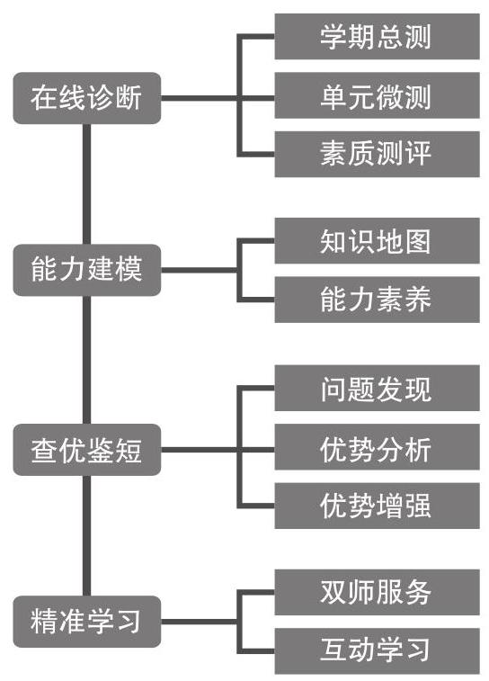

图 35 学生界面

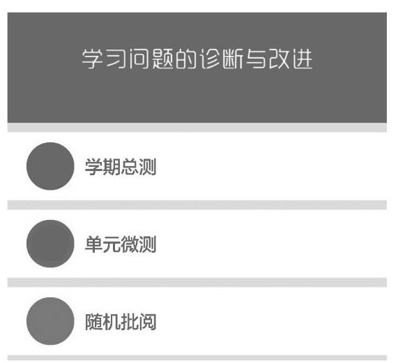

图 36 教师界面

依据课程标准中数学学科核心素养内涵与水平划分, 实现数学教学、 学习、评价一体化 (如图 37), 这是支撑测评和教学改进的关键。

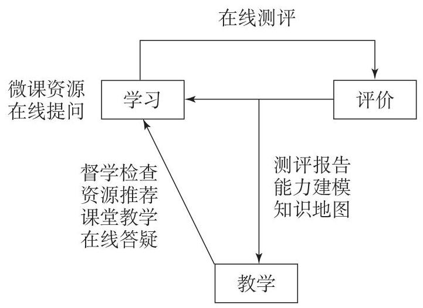

图 37 教学、学习、评价一体化的示意图

【情境 1】数学学习的个性化评价反馈系统

【分析】根据课程标准 “要注意分析全班学生评价结果的变化” “也需要根据学生个体的发展水平和特征进行个性化的反馈” 的要求, 在线测评可以实现学生学习的精准化、个性化诊断 (如图 38, 39)。通过采集学生学习过程的大数据, 可视化呈现学生数学学科核心素养, 基于数据的学情分析, 让学生更加精准地了解自己的学习问题和学科优势。

学生数学卷面作答情况

<table><tr><td>题型</td><td>题号</td><td>考查点</td><td>满分</td><td>你的得分</td><td>年级平均分</td><td>年级得分率</td><td>正确答案</td><td>作答情况</td></tr><tr><td rowspan="6">选择题</td><td>1</td><td>集合的基本运算</td><td>3</td><td>3</td><td>1.7</td><td>57.9%</td><td>B</td><td></td></tr><tr><td>2</td><td>三角函数的概念</td><td>3</td><td>3</td><td>1.9</td><td>64%</td><td>B</td><td></td></tr><tr><td>3</td><td>三角恒等变换</td><td>3</td><td>3</td><td>1.3</td><td>43.9%</td><td>C</td><td></td></tr><tr><td>4</td><td>函数的概念与性质</td><td>3</td><td>3</td><td>1.3</td><td>44.7%</td><td>A</td><td></td></tr><tr><td>5</td><td>三角恒等变换</td><td>3</td><td>0</td><td>0.7</td><td>24.6%</td><td>D</td><td></td></tr><tr><td>6</td><td>函数的应用 (零点定理，二分法)</td><td>3</td><td>0</td><td>1.7</td><td>55.3%</td><td>C</td><td>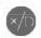</td></tr></table>

图 38 学生个性化诊断报告示例

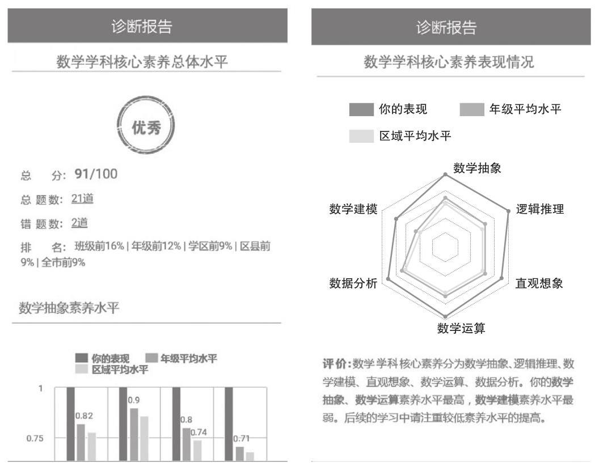

图 39 学生个性化诊断报告示例

课程标准要求 “重视评价的整体性与阶段性”。在线测评不仅实现了学生的个性化诊断反馈，而且兼顾了评价的整体性与阶段性。整体性评价以学段、学年、学期为时间单位, 测量学生的数学学科核心素养发展水平。阶段性评价以知识单元为单位, 测量每个知识单元的个体学习状况。测评数据的积累反映了学生数学学科核心素养发展的成长过程 (如图 40)。

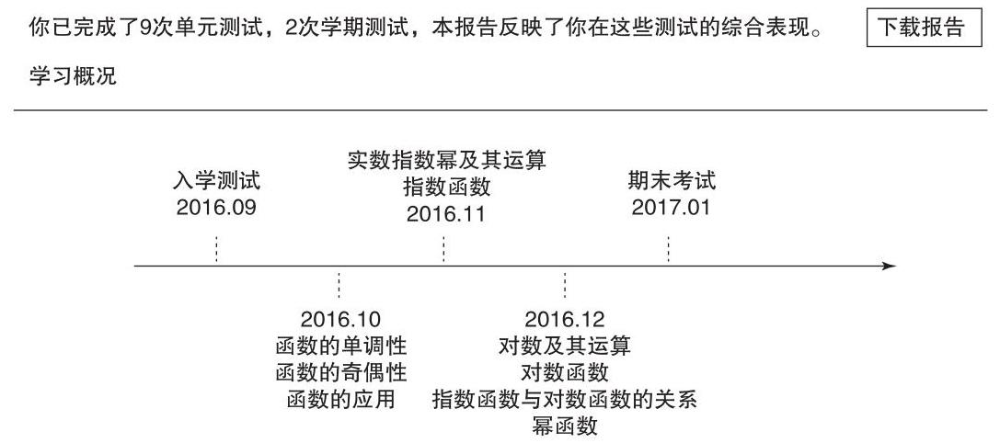

图 40 历次在线测评结果示例

客观题的自动批阅为教师教学带来了便利，提高了效率。未来，人工智能技术的发展将会实现主观题的自动识别和批阅 (如图 41)。

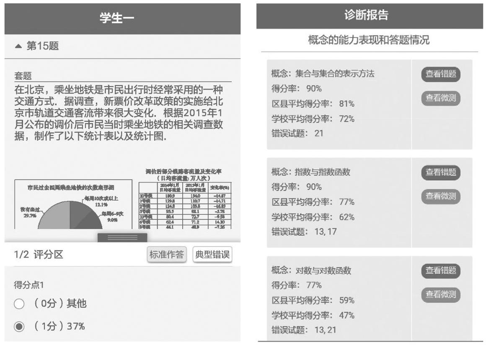

图 41 教师阅卷界面

图 42 宏、微结合的在线测评结构

宏、微结合的整体性和阶段性测量诊断实现了学生数学学科核心素养水平诊断的精准化 (如图 42)。通过期中、期末考试诊断出学生某个知识单元学习存在问题之后, 进一步进行知识单元诊断, 精准发现学习问题。

【情境 2】基于精准诊断的个性化学习支持系统

【分析】由于学生数学学习问题的诊断落实到了核心素养水平, 所以, 可以按照核心素养水平智能推荐对应的微课程, 也可以智能推荐在线教师 (如图 43); 学生在学习过程中连线, 教师在线答疑 (如图 44)。 推荐的微课程可以分 “问题改进型” “优势增强型” 等不同类型, 以服务不同核心素养水平学生学习的需要。

<table><tr><td colspan="3">查优鉴短> 问题改进</td></tr><tr><td>单元</td><td>推荐微课</td><td>推荐教师</td></tr><tr><td>集合与集合的表示方法</td><td>查看</td><td>查看</td></tr><tr><td>集合之间的关系与运算</td><td>查看</td><td>查看</td></tr><tr><td>函数</td><td>查看</td><td>查看</td></tr><tr><td>函数的单调性</td><td>查看</td><td>查看</td></tr><tr><td>函数的奇偶性</td><td>查看</td><td>查看</td></tr><tr><td>函数与方程</td><td>查看</td><td>查看</td></tr></table>

图 43 数学学习问题的改进资源推荐

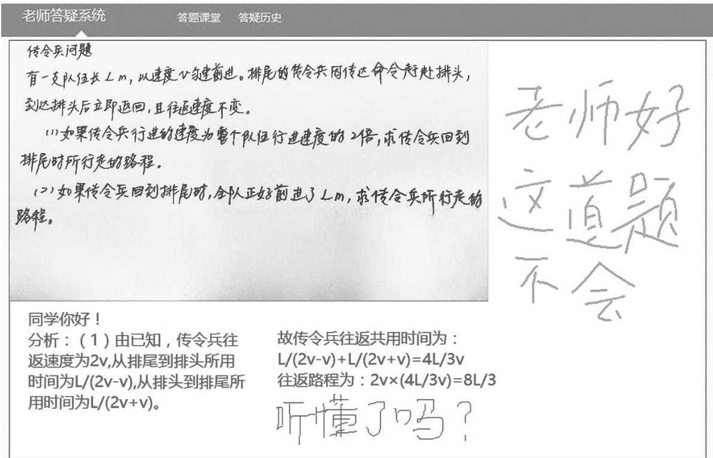

图 44 在线答疑

【情境 3】基于精准诊断的教学支持系统

【分析】在 “互联网+数学教育” 中, 在线教育平台上丰富的教学资源, 为教学提供了大量不同核心素养水平的教学素材, 教师可参考创设教学问题情境。数字技术全程融合应用于教学，有多种教学模式可供选择。可以采用翻转课堂教学模式, 也可以采用其他教学模式。教师在课前利用网络平台，发布学习任务。学生通过微课程学习、网络社区互动、自我测验等环节，解决部分学习任务。通过在线教育平台中学生学

习的数据报告，汇聚共性问题，线下课堂中采用合作探究等方式解决问题, 课后利用在线平台以作业形式检测学习效果, 确保学习的针对性和高效率, 优化教学。在具备信息技术条件的学校, 教师还可以充分利用在线平台开展其他类型的、丰富多彩的教学活动, 不断探索创新, 改进教学方式。